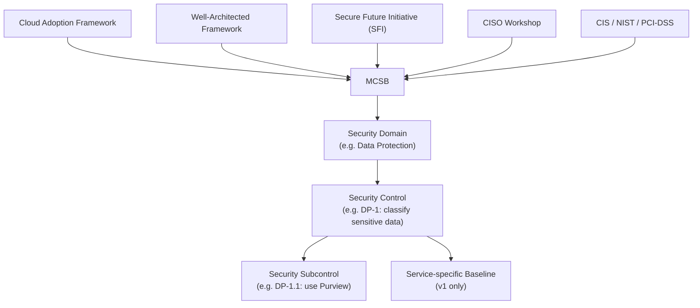
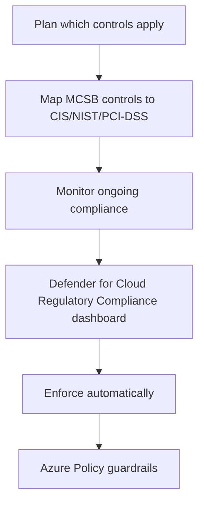

---
tags:
  - sc100
type: concept
domain:
  - best-practices
  - infrastructure
aliases:
  - MCSB
---
# Microsoft Cloud Security Benchmark (MCSB)

## Purpose

MCSB is Microsoft's prescriptive, cross-cloud security control framework — synthesizing [[Cloud Adoption Framework (CAF)]], the Well-Architected Framework, and industry standards — that underpins the default scoring in [[Security Posture Assessments]].

---

## Why Architects Choose It

- Pre-maps controls to CIS, NIST, and PCI-DSS, so meeting MCSB gives a head start on multiple regulatory frameworks instead of mapping each one separately.
- Synthesizes guidance from CAF, the Well-Architected Framework, Microsoft's [[Secure Future Initiative (SFI)|Secure Future Initiative]], and the CISO Workshop into one control set — a single reference instead of five.
- Cloud-agnostic in scope (Azure + multicloud), so the same control set monitors Azure, AWS, and other providers through one pane of glass.
- A structured hierarchy (Domain → Control → Subcontrol) gives both an executive-level summary and implementation-level detail from the same framework.

---

## When to Use

- New to Azure/multicloud and needing a starting security baseline instead of building one from scratch.
- Needing pre-mapped alignment to CIS, NIST, or PCI-DSS for a regulated industry.
- Establishing automated guardrails via [[Azure Policy]] tied to a named control set.
- Evaluating a new service before onboarding it into an approved service catalog.

---

## When NOT to Use

- As the capability/target-state architecture — that's [[Microsoft Cybersecurity Reference Architectures (MCRA)|MCRA]], not MCSB.
- As a replacement for reading the actual regulatory standard text when strict legal compliance is required — MCSB accelerates alignment, it isn't the regulation itself.
- Assuming a fixed, immutable structure — v2 (preview) reorganizes domains and controls from v1; the two versions aren't interchangeable in an answer.

---

## Architecture

---

## Architecture Decisions

---

## Identity Management (IM) Domain: Control-by-Control

Exam questions quote a control's **"security principle"** bullets and ask which control they belong to. Learn the IM IDs:

| ID | Control (MCSB v2 title) | Principle in one line | Classic distractor phrase |
| --- | --- | --- | --- |
| **IM-1** | Centralize identity and authentication (while ensuring isolation) | One identity system ([[Entra ID]]) for all cloud and non-cloud resources | "standardize on Entra ID" |
| **IM-2** | **Protect identity and authentication systems** | **Restrict privileged roles and accounts. Require strong authentication for all privileged access. Monitor and audit high-risk activities.** | — |
| **IM-3** | Manage application identities securely and automatically | **Managed identities** (or service principals where MI isn't possible) instead of human accounts or stored secrets | "use managed application identities" |
| **IM-4** | Authenticate server and services | Authenticate the remote server/service you connect to (TLS, certificates) | "verify server identity" |
| **IM-5** | Use single sign-on (SSO) for application access | SSO for apps via Entra ID | "SSO" |
| **IM-6** | Use strong authentication controls | MFA and **passwordless** for all users | "enforce passwordless / MFA for everyone" |
| **IM-7** | Restrict resource access based on conditions | [[Conditional Access]]: explicit verification of user, device, location, risk | "conditions", "Conditional Access" |
| **IM-8** | Restrict the exposure of credentials and secrets | Detect live secrets in code, store in [[Key Vault]] | "secret scanning", "no secrets in code" |

> MCSB **v1** also had **IM-9: Secure user access to existing applications** (legacy/on-prem apps via App Proxy / SHA). It isn't in the v2 IM list.

### Exam Scenario (got wrong): "Protect identity and authentication systems"

> Migrating all workloads (PaaS + IaaS) to Azure. Meet Microsoft and security best practices using **MCSB** controls. The first control to implement is **protection of identity and authentication systems**. Which **three** common security controls?

| Option | Verdict | Belongs to |
| --- | --- | --- |
| **Monitor and audit strong authentication for all privileged access** | ✅ | **IM-2** ("require strong authentication for all privileged access") |
| **Restrict privileged roles and accounts** | ✅ | **IM-2** |
| **Monitor and audit high risk activities** | ✅ | **IM-2** |
| Enforce strong passwordless authentication | ❌ (my pick) | **IM-6** Use strong authentication controls. Applies to *all users*, not specifically to protecting the identity system. |
| Use managed application identities | ❌ (my pick) | **IM-3** Manage application identities securely and automatically |

**Trap:** every option is good identity hygiene, so the question is **"which control number?"**, not **"is it secure?"** IM-2 is about protecting the **identity system itself**, so its bullets all point at **privileged** access (who can change the identity system) and **monitoring** (detecting attacks on it). Passwordless-for-everyone is IM-6 and app identities are IM-3.

**Recall rule for IM-2: "Restrict, Require, Review"**: **restrict** privileged roles, **require** strong auth for privileged access, **review** (monitor/audit) high-risk activity. All three are about **privilege**.

---

## Comparison

| Compare | Difference |
| --- | --- |
| MCSB vs. [[Microsoft Cybersecurity Reference Architectures (MCRA)|MCRA]] | MCSB is a scored control baseline; MCRA is a capability reference architecture — full comparison in the MCRA note. |
| MCSB v1 vs. v2 (preview) | v2 is Azure-focused with expanded domains (including a new AI Security domain, 7 recommendations), 420+ built-in Azure Policy definitions, and risk/threat-based guidance; v1's per-service baselines aren't yet available in v2. |
| Security Domain vs. Control vs. Subcontrol | Domain = high-level grouping (e.g., Data Protection); Control = specific requirement within it (e.g., DP-1); Subcontrol = granular implementation step (e.g., DP-1.1). |

---

## AZ-500 Review

AZ-500 already covers implementing the individual technical controls MCSB references (Azure Policy, encryption, network security, identity hardening). MCSB's role as a named, synthesized benchmark — and its Plan/Monitor/Establish lifecycle — is new for SC-100.

---

## What's New for SC-100

- Know MCSB by name as the framework [[Security Posture Assessments|Secure Score]] scores against by default — this note covers what MCSB *is*; scoring mechanics live in [[Security Posture Assessments]].
- Recognize MCSB's synthesis role: it isn't original content, it's CAF + WAF + Secure Future Initiative + CISO Workshop + industry standards combined into one control set.
- MCSB v2 (preview) adds a dedicated AI Security domain — directly relevant to the exam's "AI solutions aligned to Microsoft Cloud Security Benchmark" objective; see [[AI and Copilot Security Architecture]] for the tooling that operationalizes this domain.
- Use the Plan → Monitor → Establish lifecycle (map to standards → Regulatory Compliance dashboard → [[Azure Policy]]) as the architecture answer for "how do you operationalize MCSB." Older material may say "Azure Policy/Blueprints" — [[Azure Blueprints|Blueprints is deprecated]]; Policy alone is the current enforcement mechanism.

---

## Exam Tips

- A scenario aligning AI workloads to MCSB is testing awareness of the new AI Security domain in v2.
- "Protect identity and authentication systems" = **IM-2** → restrict privileged roles, strong auth for privileged access, monitor/audit high-risk activity. Passwordless = IM-6. Managed identities = IM-3.
- **Azure Security Benchmark (ASB)** = the old name of MCSB. It's auto-assigned when Defender for Cloud is enabled, so "assign ASB" is rarely the missing step (see [[Assigning Regulatory Compliance Standards]]).
- "Pre-mapped to CIS/NIST/PCI-DSS" is MCSB's distinguishing exam fact — don't confuse this regulatory pre-mapping with MCRA, which has none.
- The enforcement mechanism for MCSB is **Azure Policy**, not manual configuration — expect this in "how do you enforce this at scale" questions. Azure Blueprints is deprecated; don't pick it if offered as an option (see [[Azure Blueprints]]).

---

## Common Exam Confusion

- **MCSB vs. MCRA** — scored benchmark vs. capability reference architecture; see the MCRA note for the full breakdown.
- **MCSB v1 vs. v2** — different domain counts and structure; don't assume exam content describes a fixed, unchanging control list.

---

## Keywords

- Microsoft cloud security benchmark
- Security Domain / Control / Subcontrol / Baseline
- Pre-mapped to CIS, NIST, PCI-DSS
- Regulatory Compliance dashboard
- Azure Policy enforcement (Azure Blueprints is deprecated — see [[Azure Blueprints]])
- MCSB v2 preview, AI Security domain
- Azure Security Benchmark (ASB), the former name
- IM-1 to IM-8; IM-2 protect identity and authentication systems
- Plan, Monitor, Establish lifecycle

---

## Related Services

- [[Security Posture Assessments]]
- [[Microsoft Cybersecurity Reference Architectures (MCRA)]]
- [[Cloud Adoption Framework (CAF)]]
- [[Azure Policy]]
- [[Microsoft Defender for Cloud]]
- [[AI and Copilot Security Architecture]]
- [[Secure Future Initiative (SFI)]]
- [[Azure Blueprints]]
- [[Assigning Regulatory Compliance Standards]] — MCSB is the default standard. Named standards (ISO, PCI) are added.
- [[Securing Privileged Access]] — IM-2 / PA domain in practice
- [[PIM]]
- [[Identity Protection]] — monitoring high-risk sign-ins (IM-2)
- [[Conditional Access]] — IM-7
- [[Workload Identity Federation]] — IM-3 for non-Azure workloads

---

## References

- [Microsoft cloud security benchmark introduction](https://learn.microsoft.com/en-us/security/benchmark/azure/introduction) — Microsoft Learn
- [MCSB v2: Identity Management](https://learn.microsoft.com/en-us/security/benchmark/azure/mcsb-v2-identity-management) — Microsoft Learn
- [[Exam Objectives]]
- aka.ms/MCSB
- 
