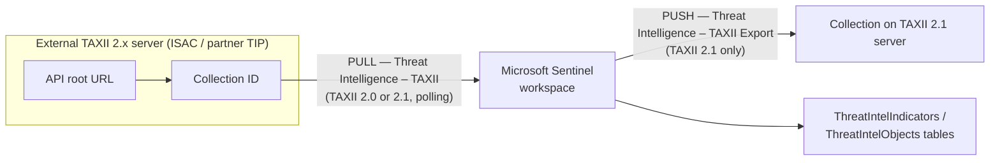

---
tags:
  - sc100
type: concept
domain:
  - ops-identity-compliance
aliases:
  - TAXII
  - STIX
  - Threat Intelligence - TAXII
  - TAXII Export
  - STIX/TAXII
---

# STIX and TAXII Connectors

## Purpose

[[Microsoft Sentinel]]'s built-in, standards-based way to **pull** CTI from TAXII 2.0/2.1 servers (**Threat Intelligence – TAXII**) and **push** CTI out to TAXII 2.1 servers (**Threat Intelligence – TAXII Export**).

---

## Why architects choose it

- **STIX** (data format) + **TAXII** (transport protocol) = the most widely adopted **industry standard** for exchanging threat intelligence. Any "industry-accepted formats and protocols" requirement → STIX/TAXII.
- Sentinel has a **built-in TAXII client**, so no custom code, playbook or app registration is needed to consume a feed.
- Import + export = **bi-directional sharing** with ISACs, consortiums and partner TIPs. Sentinel can send TI back to the platform it came from.
- Works with any vendor that runs a TAXII server, so you aren't tied to one TIP vendor's API.

---

## When to use

- The intelligence source (ISAC, consortium member TIP, commercial feed) exposes a **TAXII 2.0 or 2.1 server**.
- You need to **share CTI between organizations automatically** using open standards.
- You need to **export** Sentinel's curated TI to an external platform (TAXII **2.1** only).
- You need several feeds. Add one connector entry per collection, from one or more servers.

---

## When NOT to use

- Source is a TIP/custom app with **no TAXII server** → [[Threat Intelligence Platform (TIP) Connector|Upload API]] (STIX over REST).
- You want Microsoft's own curated IOCs → Defender Threat Intelligence connector (see [[Threat Intelligence]]).
- Export target only speaks **TAXII 2.0** → export isn't supported (import works with 2.0, export needs 2.1).
- You'd be exporting data you don't own or aren't authorized to share, or to another regulatory region. **Export can't be undone.**

---

## How it works

### Import: Threat Intelligence – TAXII connector

| Step | Detail |
| --- | --- |
| 1. Get server details | **API root URL** + **Collection ID**, usually in the provider's docs. If only a **discovery endpoint** is advertised, browse it (e.g. cURL) to find the API root. |
| 2. Install solution | Content hub → **Threat Intelligence** solution → Install/Update. Needs **Microsoft Sentinel Contributor** at **resource group** level. |
| 3. Configure connector | Data connectors → **Threat Intelligence – TAXII** → Open connector page |
| 4. Fill in | **Friendly name**, **API root URL**, **Collection ID**, **Username/Password (only if needed)**, indicator group, **polling frequency** → Add |
| 5. Repeat | One entry per collection. Multiple collections and servers are supported. |
| 6. Verify | Indicators appear in the **Threat intelligence** pane within minutes |

- **IP allowlisting**: some TAXII servers (e.g. **FS-ISAC**) require Sentinel's TAXII client IPs on their allowlist. Most don't.

### Export: Threat Intelligence – TAXII Export connector

| Setting | Detail |
| --- | --- |
| Protocol | **TAXII 2.1 only** |
| Required | Friendly name, **API root URL**, **Collection ID** |
| Authentication | **Basic authentication** or **API key** |
| Enable rules | Applies the connector page's rules to all exported data |
| Edit | **Not supported**. Reinstall the export connector to change server config or rules. |
| Firewall | Allowlist the export connector's IP ranges |
| Run export | Select STIX objects in Intel explorer → **Export** → choose server. See [[Threat Intelligence Management in Sentinel]]. |

---

## Exam Scenario — CTI consortium (solution evaluation series)

**Goal:** consortium members do threat hunting. Share CTI **between member TIPs automatically**, using **industry-accepted formats and protocols**, **supported by Microsoft Sentinel**.

| Proposed solution | Meets goal? | Why |
| --- | --- | --- |
| Retrieve the **API root** and **Collection ID** for the TIP (TAXII) server, configure a data connector in the target workspace | ✅ **Yes** | STIX/TAXII is the industry standard. API root + Collection ID is exactly what the TAXII connector needs. Sentinel pulls automatically on a polling schedule. |
| Define an **alert action** on the TIP, target product Sentinel, provide **application ID + client secret** | ❌ No | That's the legacy [[Threat Intelligence Platform (TIP) Connector]] (Graph tiIndicators). It's missing the **Directory (tenant) ID**, and Graph tiIndicators is a Microsoft API, not STIX/TAXII. |
| Register app in Entra ID, grant API permissions, add TIP source with the **client secret** only | ❌ No | Also missing app ID + directory ID. Same non-standard path. |

**Pattern to remember**
- "Industry-accepted formats and protocols" → **STIX/TAXII** → **API root + Collection ID**.
- "App ID / client secret / alert action / target product" → TIP connector → check that **all three** Entra values are present, and whether the goal demands open standards.
- "TIP server" in the TAXII answer is a distractor: a member TIP that exposes a TAXII endpoint is still a TAXII server.

---

## Common Exam Confusion

| Compare | TAXII connector | TIP connector (legacy) | Upload API |
| --- | --- | --- | --- |
| Direction | Sentinel **pulls** | TIP **pushes** | TIP/app **pushes** |
| Standard | **STIX/TAXII 2.0/2.1** (open) | Microsoft Graph **tiIndicators** API | STIX objects over REST |
| Needs | **API root + Collection ID** (+ optional user/pass) | **App ID + Tenant ID + Client secret**, `ThreatIndicators.ReadWrite.OwnedBy` + admin consent | Entra app with **Microsoft Sentinel Contributor** on the workspace |
| Data connector? | Yes | Yes (being deprecated) | **No** |
| Objects | STIX objects | **Indicators only** | Full STIX objects |
| Status | Current | **Deprecated, stopped collecting June 2026** | Current replacement for TIP |

| Compare | Difference |
| --- | --- |
| **STIX vs. TAXII** | STIX = the **format** (what the intel looks like: indicator, threat actor, attack pattern, relationship). TAXII = the **protocol** (how it travels over HTTPS: API roots, collections). |
| **TAXII import vs. TAXII Export** | Import: TAXII **2.0 or 2.1**, optional username/password. Export: TAXII **2.1 only**, Basic auth or API key, can't be edited. |
| **API root vs. discovery endpoint** | API root hosts collections and is what the connector needs. A discovery endpoint only lists API roots. |

---

## AZ-500 overlap

AZ-500 covers Sentinel data connectors in general (enable connector, check data in Log Analytics). STIX/TAXII, collections, polling and TI export aren't covered.

---

## What's new in SC-100

- Choosing the **TI ingestion path** is an architecture decision: TAXII (open standard, pull), Upload API (custom/TIP push), Defender TI (Microsoft feed).
- **Bi-directional sharing** design: import from a consortium and export curated intel back over TAXII 2.1.
- Governance of sharing: export is irreversible and can cross regulatory regions. Pair it with **TLP** marking (see [[Threat Intelligence Management in Sentinel]]).

---

## Exam Tips

- TAXII connector = **API root URL + Collection ID**. Username/password are only "if needed".
- Import supports **TAXII 2.0 and 2.1**. **Export is 2.1 only.**
- Installing the Threat Intelligence solution from Content hub needs **Microsoft Sentinel Contributor at resource group** scope.
- No app registration, client secret or Graph permission is involved in TAXII import. An answer that adds them is describing the TIP connector.
- Some ISAC servers (FS-ISAC) require allowlisting Sentinel's TAXII client IPs.

---

## Keywords

- STIX, TAXII 2.0, TAXII 2.1, open standard, industry-accepted formats and protocols
- API root URL, Collection ID, discovery endpoint, friendly name, polling frequency
- Threat Intelligence – TAXII, Threat Intelligence – TAXII Export
- Basic authentication, API key, IP allowlist, FS-ISAC
- Consortium, ISAC, TIP-to-TIP sharing, bi-directional threat intelligence sharing
- Content hub, Threat Intelligence solution

---

## Related Services

- [[Threat Intelligence]] — hub: all TI ingestion paths and the TI vs. Threat Analytics split
- [[Threat Intelligence Platform (TIP) Connector]] — legacy Graph-based push path and its Upload API replacement
- [[Threat Intelligence Management in Sentinel]] — what happens to the intel after ingestion (Intel explorer, ingestion rules, export)
- [[Microsoft Sentinel]]
- [[Security Operations]]
- [[Microsoft Defender XDR]]
- [[Attack Chain Models]] — STIX attack patterns map to MITRE ATT&CK

---

## References

- [Connect to STIX/TAXII threat intelligence feeds](https://learn.microsoft.com/en-us/azure/sentinel/connect-threat-intelligence-taxii?tabs=defender-portal) — Microsoft Learn (read 2026-10-20)
- [Threat intelligence in Microsoft Sentinel](https://learn.microsoft.com/en-us/azure/sentinel/understand-threat-intelligence) — Microsoft Learn
- [[Exam Objectives]]
