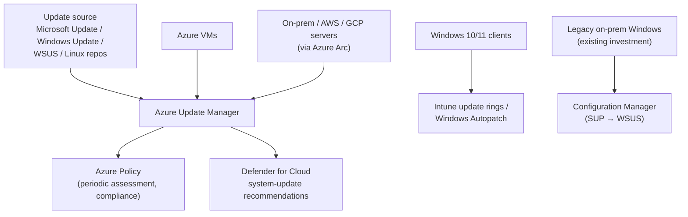

---
tags:
  - sc100
type: concept
domain:
  - security-strategy
  - infrastructure
aliases:
  - Patch Management
  - Security Updates
  - Evaluate solutions for security updates
status: needs-verification
---

# Security Updates and Patch Management

## Purpose

Choose the patching solution and strategy that keeps every server and client current against known vulnerabilities, across Azure, on-prem and other clouds. This is the SC-100 objective "evaluate solutions for security updates."

---

## Why Architects Choose It

- Unpatched known vulnerabilities are a leading ransomware entry point (see the MS17-010 walkthrough in [[Attack Chain Models]]). Patching is the **Prevent** phase of [[Ransomware Resiliency and BCDR]].
- The design decision is **which control plane owns patching for which machine type**. The wrong answer is usually two tools patching the same machine, or a tool used outside its scope (e.g. Intune for Windows Server).
- Microsoft's stated default: **cloud-native patch management** ([[Azure Update Manager]], extended with [[Azure Arc]]) balances coverage, governance and simplicity best. [[WSUS]] and [[Microsoft Configuration Manager]] remain valid for legacy Windows estates.
- Patch compliance should feed posture management: [[Microsoft Defender for Cloud]] surfaces missing system updates as [[Defender for Cloud Recommendations|recommendations]].

---

## Patch Management Strategy — 4 Areas

| Area | What good looks like |
| --- | --- |
| **Discovery & assessment** | Continuous inventory, automated **periodic assessment** of update status |
| **Prioritization** | By severity (critical/security/feature), exploitability, asset criticality — align with **CVSS** |
| **Deployment** | Maintenance windows, **staged rollouts**, rollback plans; balance urgency vs. stability |
| **Verification & reporting** | Confirm success, validate post-patch, audit trail for compliance |

## Key Capabilities to Evaluate

- **Flexible patching**: automatic guest patching (critical/security, no manual step), **hotpatching** (no reboot), scheduled patching with **dynamic scoping** (by tag/location/environment).
- **Unified assessment**: periodic checks and a single view across on-prem, cloud and multicloud.
- **Governance**: [[Azure Policy]] to audit/enforce update compliance, built-in reporting, query-based dashboards.
- **Hybrid/multicloud**: management-plane extensions ([[Azure Arc]]) bring non-Azure machines under the same governance.

---

## When to Use

- Designing a patch strategy for a hybrid/multicloud server estate.
- Deciding between Azure Update Manager, Configuration Manager/WSUS, Intune and third-party tools.
- Tying patch compliance into CSPM and ransomware-resiliency planning.
- Migrating off retired **Azure Automation Update Management**.

## When NOT to Use

- Windows **client** device patching → [[Intune]] update rings / Windows Autopatch, not Azure Update Manager (it doesn't support clients).
- PaaS/SaaS — Microsoft patches the platform ([[Shared Responsibility Model]]).
- Container images — rebuild/redeploy the image rather than patching running containers ([[Container and Kubernetes Security]]).

---

## Architecture



## Architecture Decisions

| Approach | Best for | Traits | Microsoft solution |
| --- | --- | --- | --- |
| **Cloud-native** | Azure VMs and Arc-enabled machines | Unified, Policy-integrated, no infrastructure | [[Azure Update Manager]] |
| **Cloud-native + management plane extensions** | Hybrid and multicloud | Extends cloud management on-prem/other clouds | Azure Update Manager + [[Azure Arc]] |
| **Traditional enterprise** | Legacy Windows environments | Familiar, granular, **limited cross-platform** | [[WSUS]], [[Microsoft Configuration Manager]] |
| **Third-party** | Existing investments | Specialized, added cost/complexity | — |

```
Patching Windows/Linux SERVERS (Azure, on-prem, AWS/GCP)?
  ↓
Azure Update Manager (+ Azure Arc for non-Azure)

Patching Windows CLIENTS?
  ↓
Intune update rings / Windows Autopatch

Big existing ConfigMgr estate, disconnected / low-bandwidth sites?
  ↓
Configuration Manager (SUP + WSUS + Distribution Points)

Need third-party app patches through Azure Update Manager?
  ↓
Publish them to WSUS (AUM installs from WSUS)
```

---

## AI Considerations (Learn unit)

- Patch **AI frameworks** (PyTorch, TensorFlow, ONNX Runtime) and AI service dependencies, not just the OS.
- Use CSPM's ML-based **vulnerability prioritization** to drive the patch schedule.
- Schedule AI infrastructure patching around model retraining/validation windows.
- Policy-based automated remediation for GPU VMs, ML compute clusters and inference endpoints.
- AI workloads are often containers → image scanning + base-image rebuilds.

---

## Comparison

| Compare | Difference |
| --- | --- |
| [[Azure Update Manager]] vs. Azure Automation Update Management | AUM is the successor. Native to Azure VMs and Arc servers, no Log Analytics or Automation account dependency, per-resource RBAC. Update Management (retired **31 Aug 2024**) needed an Automation account, a Log Analytics workspace and the MMA agent. |
| Azure Update Manager vs. [[Microsoft Configuration Manager]] | AUM: SaaS, Windows **and Linux**, no hierarchy/site servers, no phased deployment. ConfigMgr: on-prem infrastructure, Windows only for updates, phased deployments and orchestration groups. **Never both on the same servers.** |
| [[WSUS]] vs. Configuration Manager | WSUS is the update catalog/approval server. ConfigMgr sits on top of it (Software Update Point role) and adds targeting, ADRs, distribution points and reporting. |
| Azure Update Manager vs. [[Intune]] | Servers vs. clients. AUM does not support client devices; Intune update rings don't cover Windows Server. |
| Automatic VM guest patching vs. scheduled patching | Automatic: Azure orchestrates critical/security updates, no customer window. Scheduled: customer maintenance configuration and dynamic scope. |
| Hotpatch vs. regular patch | Hotpatch applies security updates **without reboot**. Regular patch needs a restart window. |

---

## AZ-500 Overlap

AZ-500 covered Update Management/Update Manager at configuration level: enabling it, creating a deployment schedule, and reading compliance. That is assumed here.

## What's New for SC-100

- Evaluate patching as a **solution choice** across hybrid/multicloud (the approaches table above), not a configuration task.
- Patch strategy is part of **ransomware resiliency** (Prevent phase).
- CSPM integration: missing updates appear as Defender for Cloud recommendations. Policy can require periodic assessment and automatic patching.
- AI-specific patching considerations are now explicitly in the Learn unit.

---

## Exam Tips

- "Standardize patching across Azure, on-prem and AWS/GCP servers" → **Azure Update Manager + Azure Arc**.
- "Legacy Windows environment, existing tooling" → WSUS / Configuration Manager.
- **Legacy exam question**: integrating *Azure Automation Update Management* with Configuration Manager when security updates are **not** coming from ConfigMgr and there is **no WSUS** → the prerequisite is **giving the Windows agent access to Microsoft Update**. Full breakdown in [[Azure Update Manager]].
- "Patch without reboot" → hotpatching. "Azure handles critical/security updates for me" → automatic VM guest patching.
- "Show missing OS updates as a security finding" → Defender for Cloud recommendation (CSPM integration).

## Common Exam Confusion

- **Update Management (retired) vs. Azure Update Manager** — same purpose, different architecture. Old exam questions still use the retired service's prerequisites (Log Analytics workspace, Automation account).
- **WSUS vs. Microsoft Update** — the Windows Update Agent needs *one* update source: an internal WSUS server *or* direct Microsoft Update access. If there's no WSUS, configuring one isn't a "prerequisite". It's a new deployment.
- **Hybrid-join** is an Intune/Conditional Access concept. It is **not** a patching prerequisite for Update Management/ConfigMgr integration.

---

## Keywords

- Evaluate solutions for security updates
- Periodic assessment, dynamic scoping, maintenance configuration
- Automatic VM guest patching, hotpatching
- CVSS-based prioritization
- Patch Tuesday
- Cloud-native vs. traditional enterprise patching
- Update source: Microsoft Update / Windows Update / WSUS
- Third-party patching via WSUS publishing

---

## Related Services

- [[Azure Update Manager]]
- [[WSUS]]
- [[Microsoft Configuration Manager]]
- [[Intune]]
- [[Azure Arc]]
- [[Azure Policy]]
- [[Microsoft Defender for Cloud]]
- [[Defender for Cloud Recommendations]]
- [[Ransomware Resiliency and BCDR]]
- [[Securing Server and Client Endpoints]]
- [[Shared Responsibility Model]]
- [[Attack Chain Models]]
- [[Exam Objectives]]

---

## References

- [Evaluate solutions for security updates](https://learn.microsoft.com/en-us/training/modules/design-resiliency-strategy-common-cyberthreats-like-ransomware/5-security-updates) — Microsoft Learn (SC-100 path)
- [Azure Update Manager overview](https://learn.microsoft.com/en-us/azure/update-manager/overview) — Microsoft Learn
- [Patching guidance: Configuration Manager to Azure](https://learn.microsoft.com/en-us/azure/update-manager/guidance-migration-azure) — Microsoft Learn

---

## Verification Flag

The Learn unit (updated May 2026) doesn't mention the retired Azure Automation Update Management, but practice exams still test it. Re-check which service the live exam references. Also re-check hotpatch availability per OS (Azure Edition vs. Arc-enabled Windows Server 2025), since it has changed frequently.
