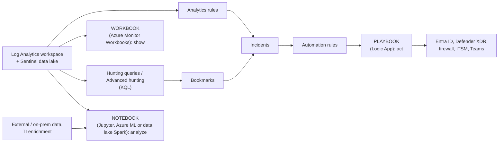

---
tags:
  - sc100
type: concept
domain:
  - ops-identity-compliance
aliases:
  - Sentinel workbooks
  - Sentinel notebooks
  - Workbooks vs playbooks vs notebooks
  - Jupyter notebooks
  - MSTICPy
status: needs-verification
---

# Sentinel Workbooks, Playbooks and Notebooks

## Purpose

The three similarly named [[Microsoft Sentinel]] tools: **workbooks** *show* data (dashboards), **playbooks** *act* on incidents (automation), and **notebooks** *analyze* data in code (advanced hunting).

> Memory hook: **Work**book = look, **Play**book = do, **Note**book = code.

---

## Why Architects Choose Them

- They answer three different SOC requirements: **visibility/reporting**, **automated response (SOAR)** and **deep investigation/hunting**. The exam tests matching requirement words to the right one.
- Each runs on a **different underlying service** with its own cost and permissions: Azure Monitor Workbooks, [[Logic Apps]], and Jupyter on Azure Machine Learning or Sentinel data lake Spark compute.
- All three ship as **templates in the Content hub** (inside solutions), so most designs start from Microsoft content and customize.

---

## Side-by-Side

| | **Workbook** | **Playbook** | **Notebook** |
| --- | --- | --- | --- |
| Verb | **Visualize / monitor / report** | **Automate / respond / orchestrate** | **Hunt / investigate / analyze** |
| Built on | **Azure Monitor Workbooks** | **[[Logic Apps]]** workflow + Microsoft Sentinel connector | **Jupyter** notebooks on an **Azure Machine Learning** workspace, or the **Sentinel data lake** (VS Code, PySpark) |
| You write | KQL queries + parameters + visuals | Low-code designer steps (connectors, conditions) | **Python** (+ KQL via Kqlmagic / MSTICPy) |
| Started by | A person opening it | **Automation rule** (incident/alert), or manually (incident, alert, entity) | A person running it. Data lake notebooks can run as **scheduled jobs**. |
| Output | Interactive charts, grids, maps, tiles | Actions in other systems + comments back on the incident | Analysis, ML results, custom visuals. Data lake jobs can write results to tables. |
| Changes anything? | No, read-only | **Yes**: disables users, blocks IPs, opens tickets | Not normally. It's analysis. |
| Cost | No extra charge beyond the data queried | **Logic Apps** per execution | **Azure ML compute** (VM) / data lake compute |
| Permissions | **Workbook Reader/Contributor** (Azure Monitor) or **Microsoft Sentinel Contributor** to create | **Microsoft Sentinel Automation Contributor** on the playbook RG (so Sentinel can run it) + Logic App Contributor to build | Sentinel **Reader/Responder/Contributor** for the Notebooks page + access to the **Azure ML workspace** |
| Example | Threat Intelligence workbook, Zero Trust / compliance workbooks, connector health, cost/usage | Enrich IP with TI, post to Teams, disable an Entra user, isolate a device | ML anomaly detection, process-tree timelines, joining on-prem or external data |

---

## Workbooks

- **What**: interactive dashboards over the Log Analytics workspace (and other Azure Monitor sources) built from **KQL** with parameters, tabs and drill-downs.
- **Templates → My workbooks**: install a workbook template from the **Content hub** (inside a solution or standalone), then **save** it to create your own editable copy. Customize the copy, not the template.
- **Typical SC-100 uses**: SOC operational metrics (MTTR, incident volume), **threat intelligence** reporting (the Threat Intelligence workbook over `ThreatIntelIndicators`, see [[Threat Intelligence Management in Sentinel]]), **compliance/Zero Trust posture** workbooks, data-connector health and ingestion **cost/usage** monitoring.
- **Defender portal**: workbook templates and saved workbooks are viewable in the Defender portal. Creating/editing and some visualizations may still need the Azure portal ("Open in Azure"), which retires for Sentinel on 31 Mar 2027.
- **Not**: an alerting tool (that's analytics rules) or an executive BI platform (Power BI suits cross-source business reporting and external sharing).

## Playbooks

- **What**: a [[Logic Apps]] workflow with a Microsoft Sentinel trigger: **incident**, **alert** or **entity** (manual from an entity page).
- **Attach via automation rules**, not per analytics rule. Automation rules decide *when*. Playbooks do the *work*. Full design detail: [[Playbooks and Automation Rules]].
- **Identity**: the Logic App's **managed identity** (least privilege) for downstream actions. Sentinel itself needs **Microsoft Sentinel Automation Contributor** on the playbook's resource group.
- **Network**: Logic Apps **Standard** for VNet integration when the playbook must reach private endpoints.
- **Same engine as [[Defender for Cloud Workflow Automation]]**: both are Logic Apps, with different triggers (Sentinel incident vs. Defender for Cloud alert/recommendation).
- **Not**: a written IR procedure (an *incident response playbook* document, see [[Microsoft Incident Response (DART)]]), and not a substitute for native [[Microsoft Defender XDR]] AIR / attack disruption.

## Notebooks

- **What**: **Jupyter** notebooks (Python) for hunting and investigation that go **beyond what KQL and the portal provide**: machine learning, custom visualizations (timelines, process trees), and joining **external or on-prem data** with Sentinel data.
- **Classic notebooks**: run on an **Azure Machine Learning workspace** (kernel on an Azure VM / compute). Users need access to **both** the Sentinel workspace and the Azure ML workspace.
- **MSTICPy**: Microsoft's open-source Python library for security data retrieval, enrichment (TI, geo-IP, WHOIS), analysis and visualization. Most Sentinel notebook templates use it.
- **Kqlmagic**: runs KQL from Sentinel directly inside a notebook.
- **Sentinel data lake notebooks**: Jupyter in **VS Code** with the **Microsoft Sentinel extension**, using **PySpark** on Spark compute over **data lake tier** tables. They can run as **scheduled jobs** (parameterized) and write results with `save_as_table()` to lake or analytics tier tables. Good for large-volume, long-lookback, low-and-slow analysis.
- **Cost/skill**: needs Python/data-science skills and compute. Use notebooks only when KQL hunting queries aren't enough.

---

## When to Use

- **Workbook**: "visualize", "dashboard", "monitor", "report on", "track trends/compliance", "SOC metrics".
- **Playbook**: "automatically respond", "remediate", "notify", "open a ticket", "enrich incidents", "orchestrate across systems".
- **Notebook**: "machine learning", "Python", "custom/advanced analytics", "external data sources", "guided investigation", "large-scale or long-term hunting on the data lake".

## When NOT to Use

- A workbook to **detect** threats → analytics rules ([[Sentinel Analytics Rule Types]]).
- A playbook for **triage-only changes** (severity, owner, close) → automation rule, free and native.
- A notebook for a **simple KQL hunt** → hunting queries / Advanced hunting. A notebook adds Azure ML cost and Python skill for nothing.
- Any of them for **cloud-resource findings inside Defender for Cloud** → [[Defender for Cloud Workflow Automation]] (automation) or Defender for Cloud dashboards/workbooks (visualization).

---

## Other Sentinel Building Blocks Often Confused

| Tool | What it is | Not to be confused with |
| --- | --- | --- |
| **Analytics rule** | KQL/ML detection that creates alerts/incidents | Workbook (shows, doesn't detect) |
| **Automation rule** | Free triage/orchestration: trigger → conditions → actions (incl. run playbook) | Playbook (does the cross-system work) |
| **Hunting query** | Saved KQL run on demand to look for threats | Notebook (Python, ML, external data) |
| **Livestream** | Hunting query run continuously, with a notification on new matches | Analytics rule (creates incidents) |
| **Bookmark** | Saved query result kept as evidence, can be promoted to an incident | Watchlist |
| **Watchlist** | Imported reference data (CSV, e.g. VIP users, known IPs) joined in KQL | Threat intelligence indicators |
| **Advanced hunting** (Defender portal) | Unified KQL hunting across XDR + Sentinel data | Notebooks (code-based) |

---

## Architecture

---

## AZ-500 Overlap

AZ-500 introduces Sentinel workbooks (use a template), playbooks (Logic App attached to an alert) and hunting. That's assumed. Notebooks get little coverage.

## What's New in SC-100

- Matching **requirement verbs** to the right tool (show / act / analyze) inside a SOC design.
- Knowing the **underlying service** of each: cost (Logic Apps, Azure ML compute), identity (managed identity, Automation Contributor) and network (Logic Apps Standard for private endpoints).
- The **data lake** extends notebooks to long-retention, large-scale analysis with scheduled jobs. It's part of the cost-tiered Sentinel data architecture ([[Security Operations]]).
- The **Defender portal** move: these tools are surfaced in the unified portal, but some authoring still points back to Azure.

---

## Exam Tips

- "Visualize / dashboard / report / monitor" → **workbook**.
- "Automate response / remediate / notify" → **playbook** (invoked by an automation rule).
- "Python / machine learning / external data / advanced investigation" → **notebook** (Azure ML + MSTICPy).
- "Hunt over long-term, low-cost data at scale on a schedule" → **Sentinel data lake notebooks / jobs**.
- Playbook won't run → **Microsoft Sentinel Automation Contributor** missing on the playbook's resource group.
- Notebook won't launch → no **Azure Machine Learning workspace** (or no access to it).
- Edit a workbook template → **save** it first, then edit your copy.

## Common Exam Confusion

- **Workbook vs. playbook**: dashboard vs. automation. Similar names, nothing else in common.
- **Notebook vs. hunting query**: Python + ML + external data vs. a saved KQL query.
- **Sentinel playbook vs. Defender for Cloud workflow automation**: both are Logic Apps, triggered by a Sentinel incident vs. a Defender for Cloud alert/recommendation.
- **Sentinel playbook vs. IR playbook**: Logic App vs. written human procedure.
- **Workbook vs. Power BI**: in-product KQL dashboards vs. a business BI tool for cross-source, shareable reports.

---

## Keywords

- Workbook, workbook template, My workbooks, Azure Monitor Workbooks, Content hub
- Workbook Reader, Workbook Contributor, Microsoft Sentinel Contributor
- Playbook, Logic App, incident/alert/entity trigger, automation rule, Microsoft Sentinel Automation Contributor
- Notebook, Jupyter, Azure Machine Learning workspace, MSTICPy, Kqlmagic
- Sentinel data lake, VS Code Microsoft Sentinel extension, PySpark, notebook jobs
- Hunting query, livestream, bookmark, watchlist

---

## Related Services

- [[Microsoft Sentinel]]
- [[Playbooks and Automation Rules]]
- [[Logic Apps]]
- [[Security Operations]]
- [[Sentinel Analytics Rule Types]]
- [[Threat Intelligence Management in Sentinel]]
- [[Microsoft Defender XDR]]
- [[Defender for Cloud Workflow Automation]]
- [[Microsoft Incident Response (DART)]]
- [[Azure Security Logging]]
- [[Azure Resource Graph]]: also a workbook data source
- [[Microsoft Security Copilot]]

---

## References

- [Visualize and monitor your data with workbooks](https://learn.microsoft.com/en-us/azure/sentinel/monitor-your-data) — Microsoft Learn
- [Roles and permissions in Microsoft Sentinel](https://learn.microsoft.com/en-us/azure/sentinel/roles) — Microsoft Learn
- [Automate threat response with playbooks](https://learn.microsoft.com/en-us/azure/sentinel/automate-responses-with-playbooks) — Microsoft Learn
- [Jupyter notebooks with Microsoft Sentinel hunting capabilities](https://learn.microsoft.com/en-us/azure/sentinel/notebooks) — Microsoft Learn (updated Apr 2026)
- [Get started with Jupyter notebooks and MSTICPy](https://learn.microsoft.com/en-us/azure/sentinel/notebook-get-started) — Microsoft Learn
- [Sentinel data lake notebooks overview](https://learn.microsoft.com/en-us/azure/sentinel/datalake/notebooks-overview) — Microsoft Learn (updated Jun 2026)

---

## Verification Flag

- **Defender portal workbook editing**: sources disagree. Some say editing still needs the Azure portal, others call Defender-portal editing a preview. Re-check close to exam date, since the Azure portal retires for Sentinel on 31 Mar 2027.
- **Classic (Azure ML) notebooks after the portal move**: the Learn notebooks page doesn't say how they're surfaced in the Defender portal, or whether they're being superseded by data lake notebooks. Re-verify.
- **Livestream** availability in the Defender portal, and the exact workbook template names (Zero Trust/compliance, usage), are from training knowledge. Check the Content hub catalog.
