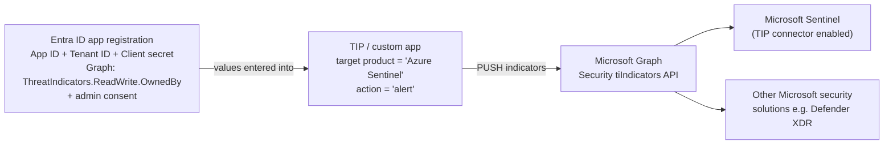

---
tags:
  - sc100
type: concept
domain:
  - ops-identity-compliance
aliases:
  - TIP Connector
  - Threat Intelligence Platforms connector
  - tiIndicators
  - Upload API
  - Threat Intelligence Upload API
status: needs-verification
---

# Threat Intelligence Platform (TIP) Connector

## Purpose

Legacy [[Microsoft Sentinel]] data connector that lets a TIP or custom app **push threat indicators** through the **Microsoft Graph Security tiIndicators API**. It's deprecated and replaced by the **Threat Intelligence Upload API**.

---

## Why architects choose it

- Many orgs aggregate feeds in a **TIP** (threat intelligence platform), curate them, then distribute to firewalls, EDR/XDR and SIEM. The TIP connector made Sentinel one of those destinations.
- Because it used the Graph tiIndicators API, the same push could also reach **other Microsoft security solutions such as Defender XDR**.
- **Today it isn't the right choice for new designs.** It's indicator-only and deprecated. Architects choose the **Upload API** instead and still need to recognize the TIP connector's setup values in exam questions.

---

## When to use

- Only to **recognize/troubleshoot** an existing legacy integration or to answer exam questions about it.
- For a **new** TIP/custom-app push integration → **Upload API** (STIX objects over REST, no data connector).

---

## When NOT to use

- **Any new integration.** It was deprecated and stopped collecting data in **June 2026**.
- When the requirement says **industry-accepted formats/protocols** → [[STIX and TAXII Connectors|STIX/TAXII]]. Graph tiIndicators is a Microsoft API.
- When you need STIX objects other than indicators (threat actors, attack patterns, relationships). tiIndicators **doesn't support other STIX objects**.

---

## How it works

### Three phases

| # | Where | What |
| --- | --- | --- |
| 1 | **[[Entra ID]]** | Register app (**single tenant**) → copy **Application (client) ID** + **Directory (tenant) ID** → API permissions: **Microsoft Graph** → **Application permissions** → `ThreatIndicators.ReadWrite.OwnedBy` → **grant admin consent** (green check under Status) → Certificates & secrets → **New client secret**. Copy it immediately because it can't be retrieved later. |
| 2 | **TIP / custom app** | Enter all **three values**. Target product = **`Azure Sentinel`** (entering "Microsoft Sentinel" **errors**). Action = **`alert`**. |
| 3 | **Sentinel** | Content hub → **Threat Intelligence** solution → Data connectors → **Threat Intelligence Platforms – BEING DEPRECATED** → **Connect**. Indicators show in the Threat intelligence pane within minutes. |

### Prerequisites / roles

| Task | Role |
| --- | --- |
| Install solution from Content hub | **Microsoft Sentinel Contributor** (resource group) |
| Grant Graph TI permissions to the TIP app | **Security Administrator** Entra role (or equivalent) |
| Store indicators | Read + write on the Sentinel workspace |

### Replacement: Threat Intelligence Upload API

| Upload API improvement | Detail |
| --- | --- |
| No data connector | The API is called directly |
| STIX-based | Fields follow the STIX standard. Supports **STIX objects**, not just indicators. |
| RBAC | Entra app needs the **Microsoft Sentinel Contributor** role, not a Graph permission |
| Scope | Endpoint is **workspace-scoped**, so permissions can be granted per workspace |

---

## Exam Scenario — CTI consortium (solution evaluation series)

**Goal:** share CTI between member TIPs automatically, **industry-accepted formats and protocols**, supported by Sentinel.

| Proposed solution | Meets goal? | Why |
| --- | --- | --- |
| Define an **alert action** on the TIP source, target product **Microsoft Sentinel**, provide **application ID + client secret** | ❌ **No** | **Directory (tenant) ID is missing.** Graph tiIndicators needs all three. Graph tiIndicators also isn't STIX/TAXII. |
| Register an Entra app, grant API permissions, add the TIP source with the client secret | ❌ No | Missing app ID + directory ID |
| Retrieve **API root + Collection ID**, configure the data connector in the target workspace | ✅ Yes | That's the [[STIX and TAXII Connectors\|TAXII connector]], which uses the open standard |

**Why the "alert action" answer is tempting:** it matches the real TIP procedure (action = `alert`, target product = Sentinel). It fails on the **incomplete credential set**. Count the values: app ID ✅, client secret ✅, **tenant ID ❌**.

---

## Common Exam Confusion

| Compare | TIP connector (legacy) | Upload API | TAXII connector |
| --- | --- | --- | --- |
| API / protocol | Microsoft **Graph tiIndicators** | Sentinel **STIX upload REST API** | **TAXII 2.x** |
| Direction | Push | Push | **Pull** |
| Credentials | App ID + **Tenant ID** + Client secret | Entra app + Sentinel Contributor | API root + Collection ID (+ optional user/pass) |
| Permission | Graph **`ThreatIndicators.ReadWrite.OwnedBy`** (application) + admin consent | **Microsoft Sentinel Contributor** RBAC | None in Entra |
| Objects | Indicators only | Full STIX objects | Full STIX objects |
| Data connector | Yes | **No** | Yes |
| Status | **Deprecated (June 2026)** | Current | Current |

| Compare | Difference |
| --- | --- |
| **Application permission vs. delegated permission** | TIP uses an **application** permission because the TIP authenticates as itself with app ID + secret. No signed-in user is involved. |
| **"Azure Sentinel" vs. "Microsoft Sentinel" target product** | The TIP config must say **Azure Sentinel**. "Microsoft Sentinel" returns an error, a legacy naming quirk. |
| **TIP vs. SIEM** | The TIP aggregates and curates feeds. The SIEM (Sentinel) consumes indicators to **detect** with analytics rules. |

---

## AZ-500 overlap

You already know app registrations, client secrets, application vs. delegated Graph permissions and admin consent. The TIP connector is that same pattern applied to TI. What's new is **which values the TIP needs** and that this path is legacy.

---

## What's new in SC-100

- Pick the TI ingestion path by **source capability + standard required**: TAXII (open standard) vs. Upload API (custom push) vs. Defender TI (Microsoft feed).
- Treat the TIP connector as a **migration item**: move to the Upload API for STIX object support and workspace-scoped RBAC.

---

## Exam Tips

- TIP connector = **App (client) ID + Directory (tenant) ID + Client secret**. If any one is missing, the answer is **No**.
- Graph permission: **`ThreatIndicators.ReadWrite.OwnedBy`**, **application** type, needs **admin consent**.
- TIP config: target product **Azure Sentinel**, action **alert**.
- Granting the permission needs **Security Administrator** (Entra role).
- "Industry-accepted formats and protocols" → not this. → **STIX/TAXII**.
- New push integration → **Upload API** (no data connector, Sentinel Contributor).

---

## Keywords

- Threat intelligence platform (TIP), custom TI solution, aggregated/curated feeds
- Microsoft Graph Security **tiIndicators** API
- Application (client) ID, Directory (tenant) ID, client secret
- `ThreatIndicators.ReadWrite.OwnedBy`, application permissions, admin consent
- Target product **Azure Sentinel**, action **alert**
- "Threat Intelligence Platforms – BEING DEPRECATED"
- Threat Intelligence **Upload API**, STIX objects, workspace-scoped

---

## Related Services

- [[Threat Intelligence]] — hub for all TI ingestion paths
- [[STIX and TAXII Connectors]] — the open-standard alternative (correct consortium answer)
- [[Threat Intelligence Management in Sentinel]] — managing indicators after they land
- [[Microsoft Sentinel]]
- [[Entra ID]] — app registration
- [[OAuth 2.0 and OpenID Connect]] — client credentials flow behind app ID + secret
- [[Microsoft Defender XDR]]

---

## References

- [Connect your threat intelligence platform to Microsoft Sentinel](https://learn.microsoft.com/en-us/azure/sentinel/connect-threat-intelligence-tip) — Microsoft Learn (read 2026-10-20)
- [Threat intelligence in Microsoft Sentinel — upload API](https://learn.microsoft.com/en-us/azure/sentinel/understand-threat-intelligence) — Microsoft Learn
- [[Exam Objectives]]

---

## Verification Flag

Learn (updated 2026-08-08) still says the TIP connector "will be deprecated and will stop collecting data in **June 2026**", but that date has passed. Re-check whether the connector page has been removed or the date changed, and whether exam questions still reference it.
