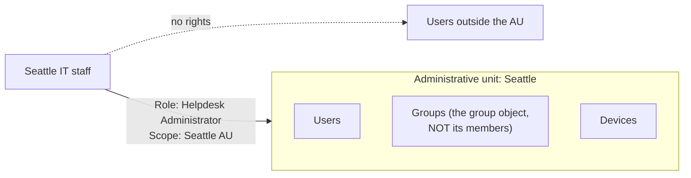

---
tags:
  - sc100
type: concept
domain:
  - ops-identity-compliance
aliases:
  - AU
  - AUs
  - Administrative Unit
  - Restricted management administrative units
  - RMAU
---

# Administrative Units

## Purpose

An [[Entra ID]] container of **users, groups or devices** that **scopes an Entra role assignment** to just that subset, e.g. "Helpdesk Admin for Seattle users only", instead of the whole tenant.

---

## Why architects choose it

- **Delegated administration with least privilege.** Regional or divisional IT teams get a real admin role, but only over their own objects.
- Fits orgs made of **semi-autonomous divisions**: university schools, subsidiaries, countries/regions.
- **Restricted management AUs** protect sensitive objects (CEO, executives, sensitive security groups) **even from tenant-level admins such as Global Administrator**, without removing anyone's tenant-wide roles.
- Common structure across **Microsoft 365** admin experiences. Plan AUs with M365-wide use in mind.

> Mental model: an AU is a **scope**, like an Azure RBAC scope (management group / subscription / resource group), but for **directory objects**. It answers "*over whom* can this admin act?", not "*what* can they do?" (that's the role) and not "*how must they sign in?*" (that's [[Conditional Access]]).

---

## When to use

- Delegate **Helpdesk/User/Groups/Authentication Administrator**-type roles to regional or divisional IT for their own users only.
- Protect **executive accounts, break-glass-adjacent accounts or sensitive security groups** from tenant-wide admins → **restricted management AU**.
- Compliance control: only **local in-country admins** may manage certain objects → restricted management AU.
- Auto-populate a scope by attribute (department, country) → **dynamic membership** AU (users/devices).

---

## When NOT to use

- **Targeting a Conditional Access policy.** CA can't select an AU, and CA doesn't support **AU-scoped role assignments**. Use **built-in directory roles** or groups.
- **Defining permissions.** An AU doesn't grant anything by itself. Permissions come from the role. Need different permissions → built-in or custom **role**.
- **Hiding objects.** AUs scope **management only**. Members and admins can still browse users outside the AU using default user permissions (except the filtered M365 admin center view).
- **Nesting.** AUs **can't be nested**.
- **Intune device management.** Not supported through AUs.
- Assigning **Global Administrator** or **Privileged Role Administrator** at AU scope isn't possible. These are tenant-scope only.

---

## How it works

### Key mechanics

| Fact | Detail |
| --- | --- |
| Members | **Users, groups, devices** only |
| Multiple AUs | An object can be in **many** AUs (e.g. "Seattle" and "Marketing") |
| Group in AU | Admin can manage the **group** (name, membership) but **not the users inside it**, unless those users are added to the AU directly |
| Role assigned without AU scope | Scope is the **entire tenant** |
| Who creates AUs | **Privileged Role Administrator** (or Global Admin) |
| Tools | Entra admin center, PowerShell, Microsoft Graph, M365 admin center (basic) |
| Dynamic membership | Rule-based for **users and devices**, **not groups** |
| AU-scoped admins can | Manage user properties/passwords, licenses, block/unblock sign-in, MFA credentials (not in M365 admin center), groups, enable/disable/delete devices, read **BitLocker recovery keys** |
| Constraints | **No nesting**. Not available in **Entra ID Governance** features. |

### Licensing

| Scenario | License |
| --- | --- |
| **Create** AUs | **Free** |
| Each **AU-scoped administrator** | **Entra ID P1** |
| Each AU **member** | Free |
| AU with **dynamic membership rules** | **P1 for each member** |
| Restricted management AU | P1 per AU admin, Free per member |

---

## Restricted management administrative units

| Fact | Detail |
| --- | --- |
| Effect | Only admins **explicitly assigned at that AU's scope** can modify members' Entra properties. **Global Administrator and Privileged Role Administrator at tenant scope are blocked.** |
| GA/PRA can still | Create/delete the AU, add/remove members, assign roles at AU scope, **assign themselves** to the AU (an **auditable** event) |
| Blocked for others | Modify properties, delete, reset password, change group owners/members |
| Still allowed | Read standard properties, add members to other groups, Exchange mailbox settings, **Intune policies on devices**, SharePoint site owner, licenses/usage location |
| Members | Users, devices, **security groups** only (no M365 groups, mail-enabled security groups or distribution groups) |
| Setting | Chosen **at creation** and **can't be changed** later |
| Not compatible with | **PIM for Groups**, entitlement management, lifecycle workflows, access reviews (ID Governance) |
| Apps | Graph application permissions **don't apply**. Assign the app an Entra role at RMAU scope. |
| Limit | **100** restricted management AUs per tenant |
| Gotcha | A **Global Admin** inside an RMAU can't have their password reset by anyone, because no AU-scopable role can reset a GA. Remove them from the RMAU first. |

---

## Exam Scenario — MFA for privileged accounts (Conditional Access)

**Scenario:** Entra ID **P1**. Design a solution that evaluates **sign-on signals** during authentication. Initial testing phase: users get access, but **accounts with elevated privileges require MFA**. Which **two** tasks?

| Option | Verdict | Why |
| --- | --- | --- |
| **Deploy a Conditional Access policy from a template** | ✅ | "Evaluates sign-on signals" = [[Conditional Access]] (P1). Template **Require multifactor authentication for admins** does exactly this. |
| **Specify an assignment that includes built-in roles** | ✅ | CA **Users → Directory roles** targets **built-in** Entra roles only. The admin template is already scoped to built-in privileged roles. |
| Add all privileged accounts to an **administrative unit** | ❌ | AUs scope **delegated administration**, not policy targeting. CA can't target an AU and doesn't support AU-scoped role assignments. |
| Define a **custom role** for administrator accounts | ❌ | CA **doesn't support custom roles** in the Directory roles assignment. A custom role also defines permissions, not MFA. |
| Create **App Control** policies | ❌ | Windows application allowlisting on devices — see [[App Control for Business and AppLocker]]. Not sign-in. |

**Rule:** CA *who* = users, groups, **built-in directory roles**, guests/external, workload/agent identities. **Not**: AUs, AU-scoped roles, custom roles.

---

## Common Exam Confusion

| Compare | Difference |
| --- | --- |
| **AU vs. custom role** | **AU = scope** (*over whom*). **Custom role = permission set** (*what*). Combine them: a custom or built-in role assigned at AU scope. |
| **AU vs. security group** | A group grants **access to resources/apps** and can be **targeted by CA**. An AU limits **who an admin can manage** and **can't** be targeted by CA. |
| **AU vs. Azure RBAC scope** | AU scopes **Entra directory roles** over users/groups/devices. Azure RBAC scopes (MG/subscription/RG/resource) govern **Azure resources**. |
| **AU vs. restricted management AU** | Regular AU **adds** scoped admins, but tenant-wide admins still have rights. RMAU **removes** tenant-wide admins' ability to modify members. |
| **AU vs. Conditional Access** | AU = delegation boundary for administration. CA = sign-in policy engine. They don't overlap. |
| **AU vs. [[PIM]]** | PIM controls **when** a role is active (JIT). AU controls **where** the role applies. You can use both: an eligible role at AU scope. RMAU groups can't use PIM for Groups. |
| **AU vs. tenant** | A tenant is a hard identity boundary. An AU is a logical sub-scope inside one tenant. |

---

## AZ-500 overlap

AZ-500 covered Entra built-in roles, custom roles and PIM role assignments. AUs appear there as one of the **scope** options when assigning an Entra role. What's new for SC-100 is choosing **AU vs. group vs. custom role vs. RMAU** as a design decision, and knowing what CA can and can't target.

---

## What's new in SC-100

- AUs as the **least-privilege delegation** pattern for decentralized IT (regions, subsidiaries, schools).
- **RMAUs** as a privileged-access control for **executives and sensitive groups**, protecting against compromised or rogue tenant admins. Fits the "assume breach" model in [[Securing Privileged Access]].
- Licensing awareness: **P1 per AU admin**, **P1 per member for dynamic AUs**.

---

## Exam Tips

- "Delegate admin rights for only a region/department/subsidiary" → **administrative unit** + scoped role.
- "Prevent even Global Admins from changing these accounts" → **restricted management AU**.
- "Require MFA for admins" → **Conditional Access** targeting **built-in directory roles** (template), **not** an AU and **not** a custom role.
- Adding a **group** to an AU doesn't bring its **members** into scope.
- AUs **can't be nested**. Restricted setting is **set at creation only**.

---

## Keywords

- Administrative unit, scoped role assignment, delegated administration, regional helpdesk
- Users, groups, devices, dynamic membership rules
- Restricted management administrative unit, executive accounts, protected from Global Administrator
- Privileged Role Administrator, Helpdesk Administrator, User Administrator, Groups Administrator
- No nesting, P1 per AU administrator
- Conditional Access directory roles: built-in only; AU-scoped and custom roles not supported

---

## Related Services

- [[Entra ID]]
- [[Microsoft Entra Built-in Roles]] — which role to scope
- [[Identity and Access Management (IAM)]] — scopes across Entra roles and Azure RBAC
- [[Conditional Access]] — what CA can and can't target
- [[PIM]] — JIT activation of AU-scoped roles
- [[Securing Privileged Access]] — RMAUs protect high-value accounts
- [[Privileged Access Tier Models]] — Control-plane accounts that need protecting
- [[Zero Trust]] — least privilege

---

## References

- [Administrative units in Microsoft Entra ID](https://learn.microsoft.com/en-us/entra/identity/role-based-access-control/administrative-units) — Microsoft Learn (read 2026-10-20)
- [Restricted management administrative units](https://learn.microsoft.com/en-us/entra/identity/role-based-access-control/admin-units-restricted-management) — Microsoft Learn (read 2026-10-20)
- [Conditional Access: users, groups, agents and workload identities](https://learn.microsoft.com/en-us/entra/identity/conditional-access/concept-conditional-access-users-groups) — Microsoft Learn (directory roles limitation)
- [[Exam Objectives]]
