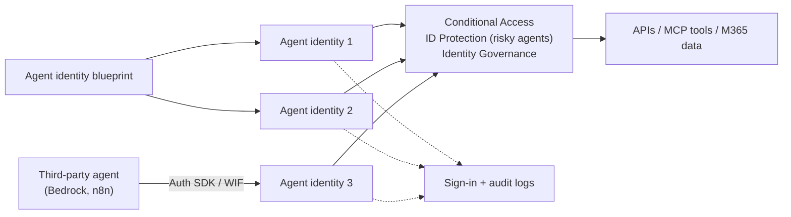

---
tags:
  - sc100
type: service
domain:
  - identity
aliases:
  - Entra Agent ID
  - Agent ID
  - Agent identity
  - Agent identity blueprint
status: needs-verification
---

# Microsoft Entra Agent ID

## Purpose

An identity and security framework that extends [[Entra ID]] to **AI agents**. It gives each agent a purpose-built, governed identity that can be authenticated, authorized, protected and audited like a user or workload.

---

## Why Architects Choose It

- Agents are a new class of **non-human identity** that act autonomously. Shared app registrations/service principals don't scale or govern well.
- **Agent identity blueprints** act as templates that create many agent identities with **parent–child relationships**, so one policy set covers a whole fleet.
- Existing Entra controls extend to agents: [[Conditional Access]], [[Identity Protection]] (risky agents), identity governance (lifecycle, access reviews), network controls (Global Secure Access) and sign-in/audit logs.
- Works with **Microsoft and non-Microsoft agents**: third-party platforms (e.g. AWS Bedrock, n8n) via the Entra ID Auth SDK sidecar or [[Workload Identity Federation]].
- Standard protocols: **OAuth 2.0**, **MCP** (Model Context Protocol), **A2A** (agent-to-agent). See [[OAuth 2.0 and OpenID Connect]].

---

## Key Objects

| Object | Role |
| --- | --- |
| **Agent identity** | The agent's own identity in Entra |
| **Agent identity blueprint** | Template that creates agent identities at scale (parent) |
| Parent–child relationship | Blueprint → many agents, with consistent policy |
| Sign-in/audit logs | All agent authentication and activity is logged |

## Licensing

- Agent ID (creating and managing agent identities and blueprints) is **available to all Entra customers**.
- **Extending Entra security features to agents** (CA, ID Protection, governance) requires **Microsoft Agent 365**. It's included in **Microsoft 365 E7** and is an add-on for E5/A5/Business Premium (or the Defender Suite + Purview Suite). See [[Microsoft 365 Licensing]].

---

## When to Use

- Any autonomous AI agent that authenticates, calls tools/APIs or acts on data.
- Governing agent fleets at scale (blueprints).
- Applying CA/risk policies and least privilege to agents (mitigates OWASP LLM **Excessive Agency**; see [[Threat Modeling]]).

## When NOT to Use

- A traditional app or Azure resource authenticating to Azure → managed identity / service principal ([[Identity and Access Management (IAM)]]).
- Human user access → normal Entra user + [[Conditional Access]].

---

## Architecture

---

## Comparison

| Compare | Difference |
| --- | --- |
| Agent ID vs. service principal / managed identity | Those authenticate an app or resource. Agent ID is built for autonomous agents (blueprints, parent–child, agent-specific CA/risk/governance). |
| Agent ID vs. [[Workload Identity Federation]] | WIF is a *mechanism* for secretless auth, which third-party agents can use to get an Agent ID identity. Agent ID is the identity construct. |
| Agent ID vs. Microsoft Agent 365 | Identity platform (all Entra customers) vs. the licensed layer that applies Entra security features and M365 operation to agents. |

---

## AZ-500 Overlap

None. This is new. AZ-500 covered service principals, managed identities and workload identity CA.

## What's New in SC-100

- Exam objective: **agent identities via Microsoft Entra Agent ID and Conditional Access policies** ([[Exam Objectives]]).
- Treat agents as a first-class identity type in the Zero Trust identity perimeter ([[Identity as the Security Perimeter]]).

---

## Exam Tips

- "Authenticate and govern autonomous AI agents at scale" → **Entra Agent ID + blueprints**, not a shared service principal.
- "Apply Conditional Access / risk detection to agents" → Agent ID with CA for agents / ID Protection (needs Agent 365).
- "Agent has too broad permissions" → least-privilege scoping of the agent identity.

## Common Exam Confusion

- **Agent identity vs. workload identity**: agents are autonomous and act on behalf of users/processes; workload identities are apps and services.
- **Agent ID availability vs. security feature licensing**: platform free, protections licensed.

---

## Keywords

- Microsoft Entra Agent ID, agent identity, agent identity blueprint
- Parent–child agent identities
- Conditional Access for agents, risky agents
- Microsoft Agent 365, Microsoft 365 E7
- MCP, A2A, OAuth 2.0
- Excessive Agency (OWASP LLM)

---

## Related Services

- [[AI and Copilot Security Architecture]]
- [[Entra ID]]
- [[Conditional Access]]
- [[Identity Protection]]
- [[Identity as the Security Perimeter]]
- [[Identity and Access Management (IAM)]]
- [[Workload Identity Federation]]
- [[OAuth 2.0 and OpenID Connect]]
- [[Microsoft Security Copilot]]
- [[Threat Modeling]]
- [[Microsoft 365 Licensing]]

---

## References

- [What is Microsoft Entra Agent ID?](https://learn.microsoft.com/en-us/entra/agent-id/what-is-microsoft-entra-agent-id) — Microsoft Learn
- [Conditional Access for agents](https://learn.microsoft.com/en-us/entra/identity/conditional-access/agent-id) — Microsoft Learn

---

## Verification Flag

This is a fast-moving surface. Licensing (Agent 365, Microsoft 365 E7) and GA/preview status of CA/ID Protection for agents were read from Learn in Sept 2026. Re-verify close to the exam.
