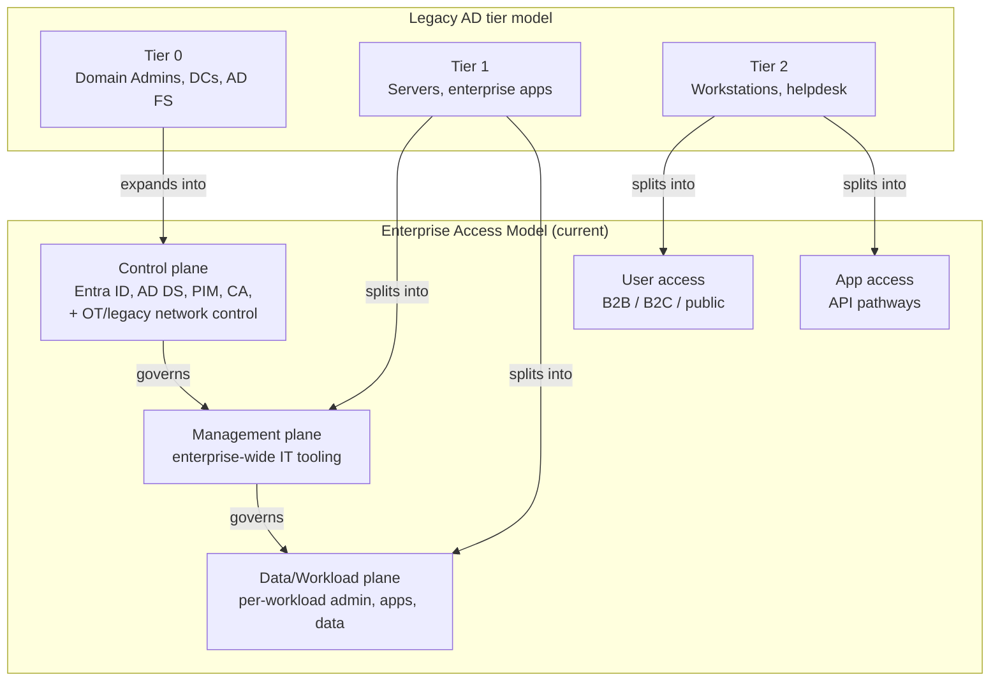
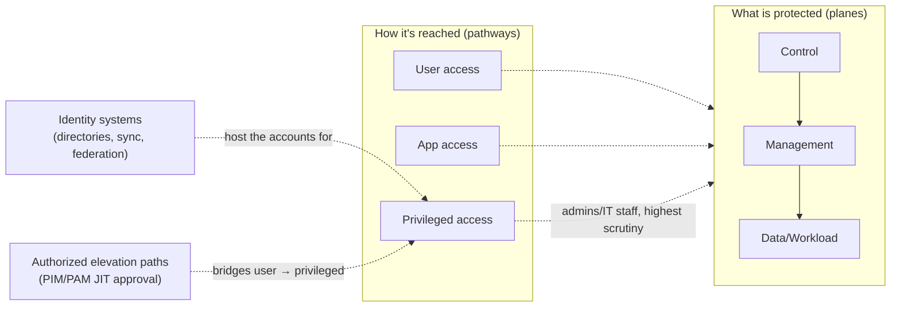
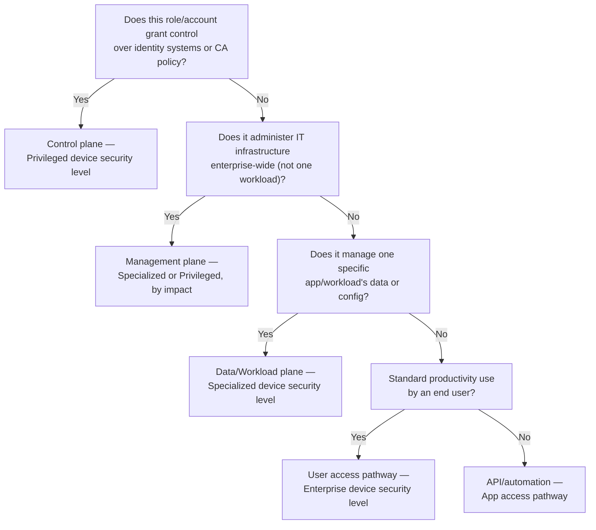

---
tags:
  - sc100
type: concept
domain:
  - ops-identity-compliance
aliases:
  - Tier 0
  - Tier 1
  - Tier 2
  - Enterprise Access Model
  - EAM
  - Privileged Access Levels
  - AD tier model
---
# Privileged Access Tier Models

## Purpose

Unpacks the containment models [[Securing Privileged Access]] and [[Securing Active Directory Domain Services (AD DS)]] reference in passing — the legacy AD **Tier 0/1/2** model, the **Enterprise Access Model** that replaced it, and the **Enterprise/Specialized/Privileged** device-and-account security levels used to implement both.

---

## Why Architects Choose It

- Every privileged-access control (PIM, PAWs, Conditional Access, JEA) is *placement* logic — it answers "which plane/tier is this account or device in," and that answer is meaningless without the model itself. Get the model wrong and every downstream control is scoped to the wrong boundary.
- The **Enterprise Access Model (EAM)** *builds on* the on-prem-only Tier 0/1/2 AD model. It keeps its containment elements and adds the full access-management needs of a modern enterprise: on-prem + multiple clouds, internal + external users, APIs, OT. Current Microsoft Learn guidance and the exam use EAM terminology. A design that speaks only in "Tier 0/1/2" is using legacy vocabulary.
- The model enforces a strict one-way hierarchy — **Control plane → Management plane → Data/Workload plane** — so that compromising a lower plane can never grant control of a higher one. This is the architectural reason PAW tiering, deny-logon GPOs, and PIM role scoping all exist.
- EAM separates *what's being protected* (the three planes) from *how someone reaches it* (User access / App access / Privileged access pathways) — two different axes that a design has to address independently, not one combined "tier."

---

## When to Use

- Classifying **any** identity, device, group, or admin role into a containment boundary before designing PIM, Conditional Access, or PAW policy around it.
- Explaining why on-prem AD hardening ([[Securing Active Directory Domain Services (AD DS)]]) and cloud privileged-access reduction ([[Securing Privileged Access]]) are the *same* containment problem applied to different planes, not two separate initiatives.
- Assigning a device security level (**Enterprise / Specialized / Privileged**) to a role based on the business impact of that role being compromised — not a uniform device policy for every admin.
- Migrating a design that still uses legacy Tier 0/1/2 language into current Enterprise Access Model terminology for an architecture review or exam scenario.
- Scoping OT/legacy network access control as part of the Control plane when identity-based control isn't achievable (the model explicitly folds this in).

---

## When NOT to Use

- Treating the three planes as a strict 1:1 replacement for Tier 0/1/2 — the mapping is a *split*, not a rename (see Architecture below); assuming otherwise misplaces Tier 2 assets.
- Applying "Privileged" device-security level uniformly to every admin — it's reserved for roles that could cause material organizational damage if compromised; over-applying it creates unnecessary friction and under-applying it leaves Control-plane admins on Enterprise-grade devices.
- Using the model as a static, one-time classification exercise — EAM requires continuous audit for configuration drift that could let a lower plane escalate into a higher one (e.g., a Management-plane tool granted standing rights over the Control plane).

---

## Enterprise Access Model — Learn Page Walkthrough

Section-by-section notes on Microsoft Learn's *Enterprise access model* page (source linked at the bottom).

### 0. Where the model fits

- **Privileged access strategy is one part of an overall enterprise access control strategy.** The EAM shows where privileged access sits among *all* the ways people and systems reach business assets.
- Companion docs: the **strategy** (why/what), the **[[Rapid Modernization Plan (RaMP)]]** (adoption roadmap), and **privileged access deployment** (implementation).
- Architect takeaway: don't design privileged access in isolation. It's one pathway in a model that also covers users, partners, customers and APIs.

### 1. Data/Workload plane — where business value lives

- The **primary stores of business value** an organization must protect.
- Applications and data hold most of the organization's:
  - **Business processes** (in applications and workloads)
  - **Intellectual property** (in data and applications)
- Every other plane and pathway exists to **run, manage or reach** this plane. That's why attackers target the layers above it: controlling them means controlling the data.
- Exam angle: an app owner or business unit managing **one workload's** config/data is a Data/Workload-plane role.

### 2. Management plane — enterprise IT that runs the workloads

- Enterprise IT **manages and supports the workloads and the infrastructure they're hosted on**, whether **on-premises, Azure or a third-party cloud**. That creates the management plane.
- Examples: enterprise-wide IT tooling, infrastructure admins, cross-workload management systems.
- Risk: management tools have **control of the data and workloads by virtue of their function**. Compromising a management tool = compromising everything it manages.

### 3. Control plane — consistent access control for the enterprise

- **Consistent access control across the enterprise** requires a control plane based on **centralized enterprise identity system(s)** (e.g. [[Entra ID]], AD DS, [[Conditional Access]], [[PIM]]).
- **Often supplemented by network access control** for **older systems such as OT devices**, where identity-based control isn't possible.
- Highest-impact plane. Whoever controls identity controls every access decision below it.

> **Why the planes matter to attackers:** "Each of these planes has control of the data and workloads by virtue of their functions, creating an attractive pathway for attackers to abuse if they can gain control of either plane." Attackers don't need to breach the data directly if they can own the plane that administers or authorizes it.

### 4. User access pathways

- Systems only create value if they're **accessible to internal users, partners and customers**, using their workstations or devices and **often remote access solutions**.
- That creates **user access pathways**. They cover employees, **B2B** partners, **B2C** customers and **public** access.
- Design implication: user access is a pathway to protect (CA, device compliance, session controls), not just a productivity concern.

### 5. Application access pathways

- Systems must often be **available programmatically via APIs** for **process automation**.
- That creates **application access pathways** and their own **API attack surface**: service principals, keys, tokens, integration accounts.
- Design implication: API/service access needs the same Zero Trust treatment (workload identity CA, [[Workload Identity Federation]], [[API Management and Security|API gateways]]).

### 6. Privileged access pathways

- The systems must be **managed and maintained by IT staff, developers or others**. That creates **privileged access pathways**.
- These give a **high level of control over business-critical assets**, so they "**must be stringently protected against compromise**."
- In the diagram the privileged pathway sits **over** the control, management and data/workload planes, because it's how humans reach the levers of every plane.
- Implementation lives in [[Securing Privileged Access]]: PAWs, PIM/JIT, separate admin accounts, phishing-resistant MFA.

### 7. What consistent access control requires

The page lists three requirement groups that apply to **all** pathways:

| Requirement | Components | What it means in a design |
| --- | --- | --- |
| **Enforce [[Zero Trust]] principles on all access** | **Assume breach** of other components · **Explicit validation** of trust · **Least privilege** access | No pathway or plane is trusted by default. Each access is validated. Rights are minimal. |
| **Pervasive security and policy enforcement** | Across **internal and external** access (consistent policy) · Across **all access methods**: users, admins, APIs, **service accounts**, etc. | One policy plane (e.g. CA) covering employees, guests, admins and workloads alike. No unmanaged side doors. |
| **Mitigate unauthorized privilege escalation** | **Enforce hierarchy** so lower planes can't control higher planes (via attacks **or abuse of legitimate processes**): Control → Management → Data/workload · **Continuously audit** for configuration vulnerabilities that enable **inadvertent escalation** · **Monitor and respond** to anomalies that could be attacks | Block "upward" control paths (e.g. a workload admin able to change identity config, a management agent running as a Control-plane account). Audit drift. Feed anomalies to [[Microsoft Sentinel]] / [[Microsoft Defender XDR]]. |

- "**Abuse of legitimate processes**" is important. Escalation doesn't need an exploit. A misconfigured delegation, an over-permissioned automation account or a helpdesk reset path into an admin account is enough.

### 8. Evolution from the AD tier model

- The **AD tier model** focused on **containing unauthorized escalation of privilege in an on-premises Windows Server Active Directory** environment.
- The EAM **incorporates those elements** and adds **full access management requirements of a modern enterprise**: on-premises, **multiple clouds**, **internal or external user access**, and more.

#### Tier 0 → scope expansion → Control plane

- Tier 0 **expands** to become the **control plane** and covers **all aspects of access control**.
- It **includes networking** where networking is **the only or best access control option**, e.g. **legacy OT**.

#### Tier 1 → split → Management plane + Data/Workload plane

| New area | Covers |
| --- | --- |
| **Management plane** | **Enterprise-wide IT management** functions |
| **Data/Workload plane** | **Per-workload management**, sometimes by IT, **sometimes by business units** |

- **Why split:** clarity and actionability. It focuses protection on **business-critical systems and admin roles with high intrinsic business value but limited technical control**, e.g. a business owner of a critical app. It also **accommodates developers and DevOps** instead of focusing only on classic infrastructure roles.

#### Tier 2 → split → User access + App access

| New area | Covers |
| --- | --- |
| **User access** | **All B2B, B2C and public access** scenarios |
| **App access** | **API access pathways** and the resulting **attack surface** |

- **Why split:** coverage for **application access** and the many **partner and customer** models. The old Tier 2 was mostly "workstations and helpdesk".

### Summary mapping

| Legacy AD tier | Enterprise access model | Change type |
| --- | --- | --- |
| Tier 0 | **Control plane** (+ network access control for legacy/OT) | **Expansion** |
| Tier 1 | **Management plane** + **Data/Workload plane** | **Split** |
| Tier 2 | **User access** + **App access** | **Split** |
| *(not explicit)* | **Privileged access** pathway over all planes | **New framing** |

---

## Architecture

- **Data/Workload plane** holds the actual business value — apps and data. Everything else exists to protect it.
- **Management plane** is enterprise-wide IT tooling that administers workloads/infrastructure (on-prem, Azure, third-party cloud).
- **Control plane** is the centralized identity system(s) (plus network access control where identity control isn't possible, e.g. legacy OT) that grant consistent access control across the whole enterprise — compromise here compromises everything below it.
- **User access** and **App access** are the productivity/automation pathways into these planes for standard users, partners, customers, and APIs.
- **Privileged access** is the pathway IT staff and admins use to manage/maintain the planes — the highest-value target, protected via **identity systems** (directories, sync, federation) and **authorized elevation paths** (JIT approval via PIM/PAM).

---

## Enterprise / Specialized / Privileged Security Levels

Microsoft's privileged-access strategy assigns every account and device one of three security levels — the mechanism that actually *implements* plane containment day to day:

| Level | Who it's for | Device behavior |
| --- | --- | --- |
| **Enterprise** | All standard users, general productivity | Users may install their own apps; standard baseline security |
| **Specialized** | Roles with elevated business impact if compromised (e.g., business-critical app admins, some developers) | Users can't self-administer the device; only admin-installed apps run; general web browsing/productivity still allowed |
| **Privileged** | Roles that could cause a major incident or material damage if compromised (Control-plane/Tier-0-equivalent admins) | No general web browsing, no productivity apps — a dedicated, hardened PAW for admin tasks only |

These levels are how the "clean source principle" (only a trustworthy device can be used to administer a trustworthy system) is enforced in practice — a Control-plane admin account is meaningless protection if it's typed on an Enterprise-level device.

---

## Architecture Decisions

---

## Comparison

| Compare | Difference |
| --- | --- |
| Legacy AD tier model vs. Enterprise Access Model | Tier model: on-prem AD-only, three tiers. EAM: cloud-inclusive, splits Tier 1 into Management + Data/Workload planes (infra-wide vs. per-workload admin) and Tier 2 into User access + App access (human vs. API pathway) — not a rename, a genuine restructuring. |
| Planes vs. pathways | Planes (Control/Management/Data-Workload) describe **what's being protected** and enforce a one-way governance hierarchy. Pathways (User/App/Privileged access) describe **how it's reached**. A single Control-plane asset can be reached via a privileged-access pathway; conflating the two axes is a common design error. |
| Enterprise vs. Specialized vs. Privileged security levels | Three device/account hardening tiers mapped to business impact of compromise, not to job title — a Control-plane admin gets Privileged, a business-critical app owner typically gets Specialized, everyone else gets Enterprise. |
| Enterprise Access Model vs. Azure RBAC/Entra role hierarchy | EAM is the containment *model* (which plane an asset belongs to); Azure RBAC/Entra ID roles ([[Identity and Access Management (IAM)]]) are the *mechanism* that assigns permissions within that model — the model tells you where to be strict, RBAC/roles implement the strictness. |

---

## AZ-500 Review

AZ-500 assumes familiarity with Azure RBAC scope hierarchy, Entra ID roles, and basic Domain Admin/local Administrator concepts, but does not teach a named containment model. The full Control/Management/Data-Workload plane structure, the pathway distinction, and the Enterprise/Specialized/Privileged device levels are new territory for SC-100.

---

## What's New for SC-100

- Know the exact plane-expansion mapping — Tier 0 **expands** into the Control plane (now includes OT/legacy network control); Tier 1 **splits** into Management and Data/Workload; Tier 2 **splits** into User access and App access. A scenario testing whether you know it's a split, not a rename, is common.
- Recognize planes (what) and pathways (how) as two separate axes of the same model, both needed to fully classify an asset.
- Name the Enterprise/Specialized/Privileged device security levels and map them to business impact, not job title.
- Treat the one-way governance hierarchy (Control governs Management governs Data/Workload) as a design constraint to actively verify, not a passive description — continuously audit for configuration drift that would let a lower plane escalate into a higher one.
- Recognize that identity systems and authorized elevation paths (PIM/PAM) are explicitly named components of the privileged-access pathway, not implementation detail.

---

## Exam Tips

- A scenario naming "Tier 0" is testing whether you reach for the **Control plane** / Enterprise Access Model instead of the legacy term.
- "Admin roles with high business value but limited technical control" and "developers/DevOps" are the stated reasons Tier 1 was split.
- The three EAM requirements: **Zero Trust on all access**, **pervasive policy enforcement** (internal + external, users/admins/APIs/service accounts), **mitigate unauthorized privilege escalation** (enforce hierarchy, continuously audit, monitor and respond).
- "Which plane does an app owner who only manages their own app's configuration belong to?" → **Data/Workload plane**, not Management (Management is enterprise-wide IT tooling).
- "Which plane covers a legacy OT network where identity-based control isn't achievable?" → **Control plane** — EAM explicitly folds in network access control for cases like this.
- "An admin's workstation needs no general browsing/productivity apps at all" → **Privileged** security level, reserved for roles that could cause material organizational damage.
- Distinguish a question about *what's being protected* (planes) from one about *how it's reached* (pathways) — they test as separate concepts.

---

## Common Exam Confusion

- **Tier 0/1/2 vs. Control/Management/Data-Workload planes** — legacy vs. current terminology; the split detail above is the frequent trap.
- **Planes vs. pathways** — protected asset classification vs. access route classification.
- **Enterprise vs. Specialized vs. Privileged security levels** — device/account hardening tier by business impact, not by department or title.
- **Enterprise Access Model vs. Azure RBAC/Entra role hierarchy** — containment model vs. the permission-assignment mechanism that implements it.

---

## Keywords

- Legacy AD tier model, Tier 0, Tier 1, Tier 2 (legacy terminology)
- Enterprise Access Model (EAM), Control plane, Management plane, Data/Workload plane
- User access, App access, Privileged access pathways
- Identity systems, authorized elevation paths
- Enterprise / Specialized / Privileged security levels
- Clean source principle
- Closed-loop privileged access system
- Zero Trust: explicit validation, least privilege, assume breach

---

## Related Services

- [[Securing Privileged Access]] — PIM, entitlement management, CIEM, PAWs built on top of this model.
- [[Securing Active Directory Domain Services (AD DS)]] — the on-prem Control-plane/Tier-0 estate this model contains.
- [[AdminSDHolder and SDProp]] — the AD mechanism that structurally protects Control-plane accounts.
- [[Identity and Access Management (IAM)]] — Azure RBAC/Entra role mechanics that implement plane boundaries.
- [[PIM]] — the JIT activation mechanism for the authorized elevation path.
- [[Conditional Access]]
- [[Rapid Modernization Plan (RaMP)]] — stages privileged-access work across 30/90/beyond.
- [[Ransomware Resiliency and BCDR]] — names identity systems as the #1 recovery priority.
- [[Zero Trust]]

---

## References

- [Enterprise access model](https://learn.microsoft.com/en-us/security/privileged-access-workstations/privileged-access-access-model) — Microsoft Learn (walkthrough source, read 2026-10-20)
- [Developing a privileged access strategy](https://learn.microsoft.com/en-us/security/privileged-access-workstations/privileged-access-strategy) — Microsoft Learn
- [Securing privileged access security levels](https://learn.microsoft.com/en-us/security/privileged-access-workstations/privileged-access-security-levels) — Microsoft Learn
- [[Exam Objectives]]

**Source page:** [Securing privileged access — Enterprise access model (Microsoft Learn)](https://learn.microsoft.com/en-us/security/privileged-access-workstations/privileged-access-access-model)
