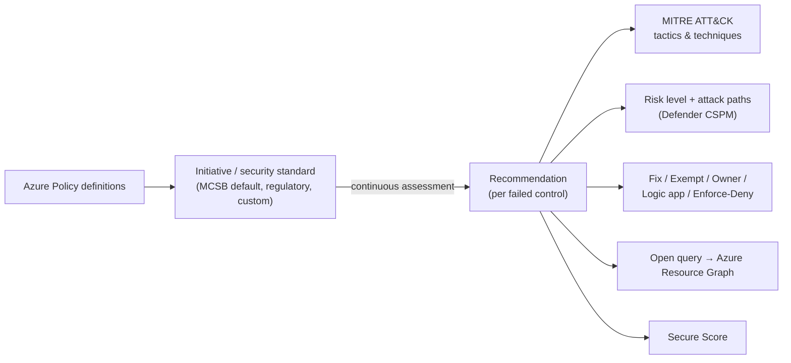

---
tags:
  - sc100
type: concept
domain:
  - infrastructure
aliases:
  - Security recommendations
  - Defender for Cloud recommendation
  - Recommendation details
status: needs-verification
---

# Defender for Cloud Recommendations

## Purpose

The actionable output of [[Microsoft Defender for Cloud]] posture assessment. Each recommendation describes a failed control on a resource, how to fix it, how risky it is, and which **MITRE ATT&CK tactics/techniques** an attacker could use to exploit it.

---

## Why Architects Choose It

- It's the **per-finding view**. When the question is "what does this weakness mean, how could it be exploited, how do I fix it", the recommendation is the object to open.
- It links posture findings to the **attacker's view**: MITRE ATT&CK tactics/techniques, attack paths and risk factors (see [[Attack Chain Models]]).
- It connects remediation to governance: owners, due dates, exemptions, workflow automation and Enforce/Deny.
- Recommendations are generated from **standards** (MCSB by default), which are built from [[Azure Policy]] definitions. They are the *result*, not the rule (see [[Security Posture Assessments]]).

---

## Anatomy of a Recommendation

| Element | What it tells you |
| --- | --- |
| Description | The issue and why it matters |
| **Tactics and techniques (MITRE ATT&CK)** | How an attacker could exploit this weakness (e.g. open management ports → Initial Access / brute force) |
| Severity | Critical / High / Medium / Low (static classification) |
| **Risk level** *(Defender CSPM)* | Context-aware: internet exposure, data sensitivity, lateral movement, attack paths |
| Risk factors / Attack paths | Environmental context, number of attack paths the finding is part of |
| Remediation steps | Manual fix guidance |
| Affected resources | Healthy / unhealthy / not applicable |
| Related initiatives | Which standards/frameworks the control maps to |
| Freshness / status | Assessment interval; owner status (on time / overdue) |

### Take action options

| Action | Purpose |
| --- | --- |
| **Fix / Quick fix** | One-click remediation for supported recommendations (view the remediation logic first) |
| **Assign owner + due date** | Governance rules, SLA tracking, weekly owner emails |
| **Exempt** | Waive or mitigate for specific resources (replaces deprecated "disable rules") |
| **Workflow automation** | Trigger a [[Logic Apps\|logic app]] |
| **Enforce / Deny** | Prevent future misconfigurations (DeployIfNotExists / Deny via [[Azure Policy]]) |
| **Open query** | Jump to [[Azure Resource Graph]] (affected resources or security findings) |

---

## When to Use

- Understanding **how a specific weakness could be exploited** (MITRE mapping).
- Planning remediation of a finding with owners and deadlines.
- Prioritizing by risk level and attack paths (Defender CSPM).
- Exempting a resource with justification rather than hiding findings.

## When NOT to Use

- Querying posture **at scale / cross-subscription** → [[Azure Resource Graph]].
- Defining *what* is evaluated → security standards / initiatives ([[Azure Policy]], [[Assigning Regulatory Compliance Standards]]).
- Active threat detection → Defender for Cloud **security alerts** / [[Microsoft Sentinel]].

---

## Exam Scenario (got wrong)

> Defender for Cloud monitors multicloud/hybrid compliance. After a breach, an auditor says **management ports on some VMs weren't secured**. Management wants to know **how the vulnerability might have been exploited**. You need the **MITRE ATT&CK tactics and techniques**. What should you do?

| Option | Verdict | Why |
| --- | --- | --- |
| **Review the associated Defender for Cloud recommendation** | ✅ | The recommendation maps the weakness to **MITRE ATT&CK tactics and techniques** |
| Review the vulnerability in Azure Resource Graph Explorer | ❌ | ARG **queries** posture data at scale (KQL). It returns data, not ATT&CK context. |
| Review the Quick Fix recommendations | ❌ | Quick fix **remediates**. It doesn't explain exploitation. |
| Review the security initiative for VM management ports | ❌ | An initiative **groups policy definitions** for assignment. It's the rule set, not the attacker analysis. |

**Recall rule:** *"How could it be exploited / which ATT&CK tactics" → open the **recommendation**. "Fix it fast" → Quick fix. "Query at scale" → ARG. "What gets evaluated" → initiative/standard.*

Related recommendations for this scenario:
- *Management ports should be closed on your virtual machines*
- *Management ports of virtual machines should be protected with just-in-time network access control* → JIT VM access / [[Azure Bastion]] (see [[Securing IaaS and PaaS Services]])

---

## Architecture

---

## Comparison

| Compare | Difference |
| --- | --- |
| Recommendation vs. security initiative/standard | The initiative is the **rule set** (grouped [[Azure Policy]] definitions). The recommendation is the **finding** generated when a resource fails a rule. |
| Recommendation vs. Quick fix | Quick fix is one **action inside** a recommendation that auto-remediates. It isn't analysis. |
| Recommendation vs. [[Azure Resource Graph]] | Portal finding with context, MITRE mapping and remediation vs. a KQL engine for querying findings across subscriptions. |
| Recommendation vs. security alert | Posture weakness (preventive, CSPM) vs. detected threat activity (CWPP/detection). Alerts also map to MITRE, but they record something that already happened. |
| Severity vs. risk level | Static classification vs. context-aware prioritization (needs **Defender CSPM**). **Risk prioritization doesn't affect Secure Score.** |
| Exempt vs. disable rule | Exemption is the supported, auditable waiver. Disable rules are being deprecated. |

---

## AZ-500 Overlap

AZ-500 covers reading and remediating recommendations, Quick fix, exemptions and JIT VM access at configuration level.

## What's New in SC-100

- Use recommendations as the **bridge between posture and threat modeling**: MITRE ATT&CK mapping, attack paths, risk factors.
- **Governance at scale**: owners, SLAs, grace periods, Enforce/Deny to stop recurrence.
- Grouped → individual recommendation transition (new individual items show as **Preview** and don't affect Secure Score yet).
- Recommendations also surface in the Defender portal under **Exposure Management → Recommendations → Cloud**.

---

## Exam Tips

- "Which MITRE ATT&CK tactics/techniques could an attacker use for this misconfiguration?" → **review the Defender for Cloud recommendation**.
- "Query affected resources across many subscriptions" → Azure Resource Graph (Open query).
- "Remediate instantly" → Quick fix. "Stop it recurring" → Enforce/Deny.
- "Suppress a finding with justification" → Exempt.
- "Prioritize by exploitability/business impact" → risk level + attack paths (**Defender CSPM**).

## Common Exam Confusion

- **Initiative vs. recommendation**: rules vs. findings.
- **ARG vs. recommendation**: query engine vs. contextual finding.
- **Quick fix vs. recommendation details**: action vs. analysis.
- **Recommendation vs. alert**: both can show MITRE tactics. Recommendation = *could be exploited*; alert = *is being exploited*.

---

## Keywords

- Security recommendation, recommendation details
- MITRE ATT&CK tactics and techniques
- Quick fix / Fix, remediation logic
- Exempt, governance rule, owner, due date, grace period
- Enforce / Deny
- Risk level, risk factors, attack paths (Defender CSPM)
- Open query → Azure Resource Graph
- Management ports, JIT network access control

---

## Related Services

- [[Microsoft Defender for Cloud]]
- [[Security Posture Assessments]]
- [[Secure Score Mechanics]]
- [[Azure Policy]]
- [[Azure Resource Graph]]
- [[Assigning Regulatory Compliance Standards]]
- [[Attack Chain Models]]
- [[Securing IaaS and PaaS Services]]
- [[Azure Bastion]]
- [[Logic Apps]]
- [[CSPM and CWPP]]
- [[Security Updates and Patch Management]]

---

## References

- [Review security recommendations](https://learn.microsoft.com/en-us/azure/defender-for-cloud/review-security-recommendations) — Microsoft Learn
- [Security recommendations](https://learn.microsoft.com/en-us/azure/defender-for-cloud/security-recommendations) — Microsoft Learn
- [Security policies, standards and recommendations](https://learn.microsoft.com/en-us/azure/defender-for-cloud/security-policy-concept) — Microsoft Learn

---

## Verification Flag

- The current Learn pages (2025–2026) no longer list "Tactics and techniques" as a named field on the recommendation page. The MITRE ATT&CK mapping comes from the earlier recommendation-details page and the exam explanation. Check the live portal.
- The exam explanation says "a security initiative contains at least two policy definitions". Azure Policy docs describe an initiative only as a *group* of definitions, so don't rely on the minimum.
