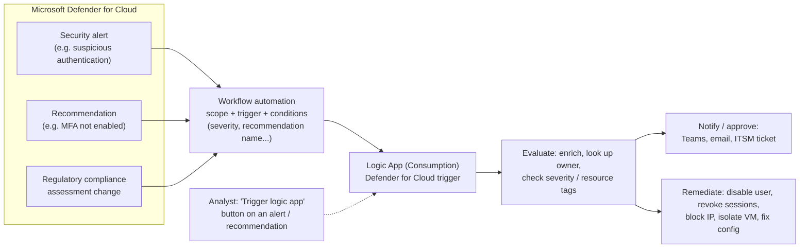

---
tags:
  - sc100
type: concept
domain:
  - infrastructure
  - ops-identity-compliance
aliases:
  - Workflow automation
  - Defender for Cloud automation
  - MDC workflow automation
status: needs-verification
---

# Defender for Cloud Workflow Automation

## Purpose

The built-in [[Microsoft Defender for Cloud]] feature that **runs a [[Logic Apps|Logic App]] automatically** when a security alert, recommendation or regulatory compliance assessment is created or changes. It's how Defender for Cloud does low-code evaluate-and-remediate.

> Hub note for the "which automation service?" exam question. It compares the four usual answer options: [[Logic Apps]], [[Azure Functions]], [[Azure Event Hubs]] and [[Azure Monitor Alerts and Action Groups|Azure Monitor webhooks]].

---

## Why Architects Choose It

- **Native trigger, no glue code**: Defender for Cloud fires the Logic App itself. Nobody has to poll the API, host a listener or parse a stream.
- **Low-code remediation**: the Logic Apps designer plus 1,000+ connectors (Teams, Outlook, ServiceNow, Entra ID, ARM, Defender for Endpoint) do the work. Developers aren't needed, which is what "**minimize development effort**" points to.
- **One mechanism for three event types**: alerts (threats), recommendations (posture) and regulatory compliance assessments (compliance).
- **Scales by policy**: built-in Azure Policy `DeployIfNotExists` definitions roll the same automation out to every subscription under a management group ([[Azure Policy]]).
- **Keeps the SOC out of posture work**: it routes cloud-posture findings to resource owners without sending everything through [[Microsoft Sentinel]].

---

## How It Works

| Element | Detail |
| --- | --- |
| **Triggers** (Logic Apps connector) | *When a Microsoft Defender for Cloud recommendation is created or triggered*, *When a Defender for Cloud Alert is created or triggered*, *When a Defender for Cloud regulatory compliance assessment is created or triggered* |
| **Legacy trigger** | *When a response to a Microsoft Defender for Cloud alert is triggered* isn't supported by workflow automation. Use the newer alert trigger. |
| **Logic App type** | Workflow automation triggers **Consumption** Logic Apps. Only Logic Apps that contain a Defender for Cloud trigger show in the list. |
| **Conditions** | Alert severity / alert name, recommendation name / severity / state, compliance standard / control |
| **Manual run** | Open an alert or recommendation and select **Trigger logic app**. Useful for analyst-initiated remediation. |
| **At scale** | Azure Policy: *Deploy Workflow Automation for Microsoft Defender for Cloud alerts* / *…recommendations* / *…regulatory compliance* (DeployIfNotExists, assign at management group) |
| **As code** | `Automations` resource in the [[Defender for Cloud REST API]] (same object the portal creates) |
| **Breakage** | If a recommendation is deprecated or replaced, automations triggered by it stop. Update the trigger. |

### Permissions

| Who | Needs |
| --- | --- |
| Person creating the workflow automation | **Security Admin** or **Owner** on the resource group, plus write permission on the target resource |
| Person creating/editing the Logic App | **Logic App Contributor** |
| Person who only runs existing Logic Apps | **Logic App Operator** (read/trigger, can't create or edit) |
| The Logic App itself, acting on resources | Its **managed identity** with least-privilege RBAC, or connector sign-ins (Outlook/Teams) ([[Identity and Access Management (IAM)]]) |

---

## When to Use

- Remediating or escalating **Defender for Cloud alerts** automatically: suspicious sign-ins, brute force, malware on a VM.
- Routing **recommendations** to resource owners (email/Teams/ticket), or auto-fixing a misconfiguration.
- Notifying compliance owners when a **regulatory compliance** control fails ([[Assigning Regulatory Compliance Standards]]).
- Any requirement that says **"workflow automation"** + **"minimize development effort"** in a Defender for Cloud scenario.

## When NOT to Use

- **Streaming all data to a SIEM or data lake** → [[Defender for Cloud REST API|continuous export]] to [[Azure Event Hubs]] / Log Analytics.
- **Cross-product incident response** (cloud + identity + endpoint + email together) → [[Microsoft Sentinel]] playbooks via automation rules ([[Playbooks and Automation Rules]]).
- **Assigning owners and due dates** to recommendations → governance rules ([[Defender for Cloud Recommendations]]).
- **One-click config fix** for a single recommendation → **Fix** (Quick fix) on the recommendation.
- **Preventing** the misconfiguration in the first place → [[Azure Policy]] Deny / Enforce.

---

## Exam Scenario (didn't know): Evaluate and remediate alerts with minimal development

> An Azure subscription has Defender for Cloud enabled. **Suspicious authentication activity** alerts appear on the **Workload protections dashboard**. Recommend a solution to **evaluate and remediate the alerts by using workflow automation**. The solution must **minimize development effort**.

| Option | Verdict | Why |
| --- | --- | --- |
| **Azure Logic Apps** | ✅ **Correct** | Workflow automation **is** Logic Apps. It's the only action type the feature triggers. Low-code designer and connectors (disable the Entra user, revoke sessions, post to Teams) mean almost no custom code. |
| Azure Functions | ❌ | Could do the job, but you'd **write, deploy, secure and maintain code**, which is the opposite of minimizing development effort. Workflow automation doesn't call a Function directly. See [[Azure Functions]]. |
| Azure Event Hubs | ❌ | A **data streaming pipeline**, used as a continuous export target to feed a SIEM. It moves events and does no evaluation or remediation. You'd still have to build a consumer app. See [[Azure Event Hubs]]. |
| Azure Monitor webhooks | ❌ | A webhook is just an **HTTP POST of the alert payload to a URL** from an Azure Monitor action group. It has no logic. Something at that URL (that you build) must evaluate and remediate. Defender for Cloud's automation feature doesn't use action groups. See [[Azure Monitor Alerts and Action Groups]]. |

**The pattern:** "Defender for Cloud" + "workflow automation" → **Logic Apps**, always. The words *evaluate*, *remediate* and *minimize development* rule out anything that needs code (Functions) or only moves data/notifications (Event Hubs, webhooks).

---

## Comparison

### The four answer options

| | [[Logic Apps]] | [[Azure Functions]] | [[Azure Event Hubs]] | [[Azure Monitor Alerts and Action Groups\|Azure Monitor webhook]] |
| --- | --- | --- | --- | --- |
| What it is | Low-code **workflow** engine | Serverless **code** | Event **streaming** platform | **HTTP callback** from an alert |
| You build | A visual workflow from connectors | Code (C#, Python, JS, PowerShell…) | Producers + consumer apps | The endpoint that receives the POST |
| Contains logic? | Yes: conditions, loops, approvals | Yes: anything you code | No: it's a pipe | No: it's a notification |
| Defender for Cloud integration | **Native** (workflow automation, Trigger logic app) | None direct (call it from a Logic App) | **Continuous export** target | None native for Defender for Cloud alerts |
| Development effort | **Lowest** | Highest | Medium-high (consumers) | Medium-high (receiver) |
| Typical security use | Playbooks, remediation, notifications | Custom enrichment, complex parsing | Feed Splunk/QRadar/data lake | Notify an external tool or chat system |
| Billing | Per action (Consumption) / plan (Standard) | Per execution (Consumption/Flex) / plan | Throughput/processing units | Action group pricing per notification |

### Defender for Cloud automation features

| Compare | Difference |
| --- | --- |
| **Workflow automation vs. continuous export** | Workflow automation *acts* on each event (Logic App). Continuous export *streams* data (alerts, recommendations, Secure Score, compliance) to Event Hubs/Log Analytics for analysis elsewhere. |
| **Workflow automation vs. Sentinel playbook** | Both are Logic Apps. Workflow automation is triggered by **Defender for Cloud** events (alert/recommendation/compliance). A Sentinel playbook is triggered by **Sentinel** incidents/alerts/entities through automation rules. Use Sentinel when the response spans many products. |
| **Workflow automation vs. governance rules** | Automation runs a workflow. Governance assigns an **owner + due date** to a recommendation and tracks it. |
| **Workflow automation vs. Quick fix** | Quick fix is a one-click, Microsoft-built remediation for **one recommendation**. Workflow automation is your own workflow, triggered by any matching event. |
| **Workflow automation vs. Azure Policy Deny/Enforce** | Automation reacts **after** something is found. Policy **prevents** it at deployment. |
| **Workflow automation vs. Defender XDR AIR** | AIR auto-investigates endpoint/email/identity entities natively. Workflow automation is custom orchestration on cloud-resource findings. |

---

## AZ-500 Overlap

AZ-500 covers creating a workflow automation, choosing a trigger and building the Logic App (the Learn module was once titled "Use a playbook" in Azure Security Center). That's assumed.

## What's New in SC-100

- Choosing **which automation layer** answers the requirement: Defender for Cloud workflow automation vs. Sentinel playbook vs. Defender XDR native response vs. continuous export.
- Reading **"minimize development effort"** as low-code (Logic Apps) over code (Functions).
- Rolling automation out at **management-group scale** with Azure Policy instead of per subscription.
- Designing the **Logic App's identity** (managed identity, least privilege) and an **approval step** for high-impact remediation.

---

## Exam Tips

- "Defender for Cloud" + "workflow automation" → **Logic Apps**. It's the only target the feature supports.
- "Minimize development effort / low-code / no custom code" → Logic Apps beats Functions.
- "Stream Defender for Cloud alerts to Splunk / a third-party SIEM" → continuous export to **Event Hubs**, not workflow automation.
- "Same automation on 100 subscriptions" → Azure Policy *Deploy Workflow Automation for Microsoft Defender for Cloud …*.
- "Analyst wants to run remediation on one alert on demand" → **Trigger logic app** from the alert.
- Webhooks and action groups belong to **Azure Monitor alerts**, not Defender for Cloud security alerts.

## Common Exam Confusion

- **Workflow automation vs. continuous export**: act on events vs. move data.
- **Logic Apps vs. Functions**: designer + connectors vs. code. Both are serverless.
- **Event Hubs vs. webhooks**: high-volume stream you consume vs. one HTTP call per alert.
- **"Playbook"**: in Sentinel it means a Logic App. In old Azure Security Center content, workflow automation was also called a playbook. In IR it means a written procedure ([[Playbooks and Automation Rules]]).

---

## Keywords

- Workflow automation, Trigger logic app
- Evaluate and remediate alerts, minimize development effort
- Workload protections dashboard, security alerts, recommendations, regulatory compliance assessment
- Logic App (Consumption), Defender for Cloud connector/trigger
- Security Admin, Logic App Contributor, Logic App Operator
- Deploy Workflow Automation for Microsoft Defender for Cloud (Azure Policy, DeployIfNotExists)
- Continuous export, Event Hubs, Log Analytics
- `Automations` REST resource

---

## Related Services

- [[Microsoft Defender for Cloud]]
- [[Logic Apps]]
- [[Azure Functions]]
- [[Azure Event Hubs]]
- [[Azure Monitor Alerts and Action Groups]]
- [[Azure Automation]]
- [[Defender for Cloud REST API]]: continuous export and the `Automations` resource
- [[Defender for Cloud Recommendations]]
- [[Assigning Regulatory Compliance Standards]]
- [[Cloud Workload Protection (CWPP)]]: where the alerts come from
- [[Playbooks and Automation Rules]]
- [[Sentinel Workbooks, Playbooks and Notebooks]]
- [[Microsoft Sentinel]]
- [[Azure Policy]]
- [[Entra ID]]

---

## References

- [Automate remediation responses (workflow automation)](https://learn.microsoft.com/en-us/azure/defender-for-cloud/workflow-automations) — Microsoft Learn (updated Oct 2026)
- [Continuous export of Defender for Cloud data](https://learn.microsoft.com/en-us/azure/defender-for-cloud/continuous-export) — Microsoft Learn
- [Logic Apps overview](https://learn.microsoft.com/en-us/azure/logic-apps/logic-apps-overview) — Microsoft Learn

---

## Verification Flag

- The Learn page (updated 2026-10-09) says workflow automation "can trigger consumption logic apps" and doesn't mention Standard. A China-cloud mirror says Standard isn't supported. Re-check before treating "Consumption only" as an exam fact.
- The billing row in the four-way comparison (action group per-notification pricing, Event Hubs units) is from training knowledge. Re-check it on the pricing pages if a cost question comes up.
