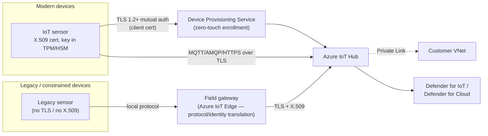
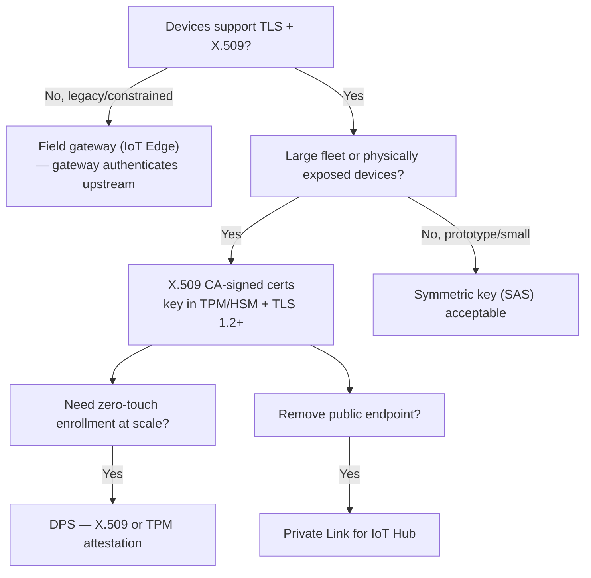

---
tags:
  - sc100
type: concept
domain:
  - infrastructure
aliases:
  - IoT Device Authentication
  - IoT Workload Security
  - Azure IoT Hub
  - IoT Hub
  - Device Provisioning Service
  - DPS
  - Field Gateway
  - IoT Edge Gateway
  - Azure IoT Edge
status: needs-verification
---

# IoT Device Authentication and Transport Security

## Purpose

How an IoT device proves its identity to Azure IoT Hub/DPS and how its telemetry is protected in transit — **X.509 + TLS** as the default answer, with shared keys, network-layer encryption and field gateways as the distractors.

---

## Why Architects Choose It

- Devices deployed in **untrusted/public locations** can be stolen, cloned or tampered with — identity must be **per-device and individually revocable**, which points to asymmetric (PKI) credentials, not shared secrets.
- Two separate requirements, two separate controls — **authentication** (who is this device?) and **transport encryption** (can the data be read/altered in flight?). An answer that covers only one is wrong.
- **X.509 certificates in a TLS handshake** satisfy both at once: TLS encrypts the channel; the client certificate authenticates the device to IoT Hub (mutual authentication).
- Scales via a CA hierarchy — IoT Hub/DPS trusts the **CA**, not each device thumbprint, so fleets of thousands enroll without per-device secret distribution (see [[Key Vault]] / PKI for issuing-CA design).
- Private key can be stored in a **TPM/HSM** on the device, so a physically compromised sensor can't easily leak its identity (see [[Trusted Platform Module (TPM)]]).

---

## When to Use

- New, modern IoT devices sending sensitive data to the cloud → **X.509 certificate auth + TLS 1.2 (or later)**.
- Devices physically exposed (outdoor, public, field-deployed) → X.509 with the private key in **TPM/HSM**.
- Zero-touch fleet enrollment → **Device Provisioning Service (DPS)** with X.509 or TPM attestation.
- Removing IoT Hub's public endpoint from the path → [[Private Link]] on top of TLS.
- **Legacy/constrained devices** that can't do TLS, X.509 or IoT Hub protocols (MQTT/AMQP/HTTPS) → **field gateway** ([[Azure IoT Edge]] as protocol/identity translation gateway).
- Back-end services/apps calling IoT Hub's service APIs → **Microsoft Entra ID + Azure RBAC** (not device auth).

---

## When NOT to Use

- **Pre-shared keys / symmetric keys (SAS)** for a large or physically exposed fleet — one leaked key is replayable, rotation across thousands of devices is painful, and a group key widens the blast radius.
- **Network-layer encryption only (IPsec/VPN)** — encrypts the pipe between networks but gives **no device-level identity**; any device on the tunnel is trusted.
- **Field gateway** when the devices are new and already support X.509/TLS — adds a component and attack surface for no benefit.
- Treating the TLS version as the deciding factor — TLS 1.3 + PSK is still weaker than TLS 1.2 + X.509 because **the authentication method** is what's being tested.

---

## Device Authentication Options

| Mechanism | Type | Revocation | Fit |
| --- | --- | --- | --- |
| **X.509 CA-signed** | Asymmetric, per-device cert chained to trusted CA | Per device (revoke/disable one) | **Recommended** for production fleets |
| **X.509 self-signed (thumbprint)** | Asymmetric, per device | Per device, but manual thumbprint registration | Small scale/testing |
| **TPM attestation (DPS)** | Hardware-rooted key (endorsement key) | Per device | Hardware with TPM; strongest tamper resistance |
| **Symmetric key / SAS token** | Shared secret | Rotate the key | Prototyping, small fleets, constrained devices |
| **Microsoft Entra ID** | Identity for **services**, not devices | RBAC | Back-end apps accessing IoT Hub data plane |

---

## Architecture

---

## Architecture Decisions

---

## Exam Scenario

**Scenario:** IoT sensors in **outdoor public locations**, collecting **sensitive** data, sending to cloud. Prevent **unauthorized access** and **interception**. Recommend robust authentication + secure transmission.

| Option | Verdict | Why |
| --- | --- | --- |
| **X.509 certificates + TLS 1.2** | ✅ Correct | PKI-based per-device identity + encrypted channel; mutual auth; scales |
| PSKs + TLS 1.3 | ❌ | Newer TLS, but shared keys are hard to rotate/secure at scale — auth is the weak link |
| Field gateways to offload encryption | ❌ | For **legacy** devices lacking modern security; these are **new** sensors |
| Network-layer encryption, no device auth | ❌ | IPsec protects the pipe, not identity — unauthorized devices could connect |

Pattern: requirement says **"authentication" + "interception"** → answer must cover **both** identity and encryption.

---

## Comparison

| Compare | Difference |
| --- | --- |
| **X.509 vs. PSK/SAS** | X.509: asymmetric, private key never leaves device, per-device revocation, CA-based scale. PSK/SAS: shared secret, must be distributed and rotated, leak = replay/impersonation across every device sharing it. |
| **TLS (transport) vs. IPsec (network layer)** | TLS: per-connection, app-layer encryption to IoT Hub; with client certs also authenticates the device. IPsec/VPN: encrypts network-to-network traffic; no per-device identity. See [[VPN Gateway]]. |
| **TLS 1.2 vs. TLS 1.3** | 1.3 is faster and drops legacy ciphers, but the exam distractor pairs it with PSK — **the auth method outranks the TLS version**. TLS 1.2 is IoT Hub's minimum supported version. |
| **Field gateway vs. direct device connection** | Gateway: for legacy/constrained devices — protocol translation, identity translation, offloads crypto. Direct: modern devices with their own X.509 identity — fewer hops, end-to-end device identity. |
| **IoT Edge transparent vs. translation gateway** | Transparent: downstream devices keep their **own** IoT Hub identities; gateway just relays. Protocol/identity translation: gateway speaks for devices that can't talk to IoT Hub themselves. |
| **DPS vs. IoT Hub registration** | DPS: zero-touch, at-scale enrollment and hub assignment using X.509/TPM/symmetric key attestation. IoT Hub registry: manual per-device registration. |
| **Device auth vs. service auth** | Devices: X.509/TPM/SAS. Back-end apps/services: [[Entra ID]] + RBAC (preferred over IoT Hub shared access policies). |
| **IoT workload auth vs. Defender for IoT** | Auth/TLS = how devices connect securely. Defender for IoT = discovering/monitoring devices and threats (see [[OT and ICS Security]], [[Securing Server and Client Endpoints]]). |

---

## Exam Tips

- "Untrusted/public location" + "sensitive data" + "robust authentication" → **X.509 + TLS**.
- "New devices" rules out field gateways; "legacy devices lacking modern security" rules them in.
- Any option that **eliminates device-level authentication** is wrong — Zero Trust: verify every device.
- Don't pick an answer for the newer TLS version if it's paired with PSK/shared keys.
- "Individually revoke one compromised device without affecting others" → X.509 (per-device cert), not SAS.
- "Zero-touch provisioning of millions of devices" → DPS.
- "Hardware-protected device identity" → TPM attestation / key in HSM.

---

## AZ-500 overlap

- AZ-500 covers certificates, TLS, [[Key Vault]], [[Private Link]] and Entra RBAC generically.
- IoT Hub/DPS/IoT Edge are not core AZ-500 content — the IoT-specific identity choices are new.

---

## What's new in SC-100

- Choosing device authentication by **fleet size, physical exposure and revocability**, not convenience.
- Treating authentication and encryption as **two separate requirements** that the recommended design must both satisfy.
- Knowing when a **field gateway** is the right compensating architecture (legacy devices) vs. unnecessary complexity (modern devices).
- Fitting IoT into [[Zero Trust]] — explicit per-device verification, no implicit trust from network location.

---

## Common Exam Confusion

- **PSK + TLS 1.3 vs. X.509 + TLS 1.2** — newer protocol ≠ better design; auth method decides.
- **Network encryption vs. device authentication** — encrypting the pipe doesn't identify who's on it.
- **Field gateway** — legacy-device answer, not a general best practice.
- **Defender for IoT vs. IoT Hub auth** — monitoring vs. connecting; different exam bullets.
- **Entra ID for IoT Hub** — secures service/back-end access to IoT Hub APIs, not device-to-cloud authentication.

---

## Keywords

- X.509 certificate, PKI, CA-signed, mutual TLS (mTLS)
- TLS 1.2 / TLS 1.3, data interception, tampering
- Pre-shared key (PSK), symmetric key, SAS token, key rotation
- Device Provisioning Service (DPS), zero-touch provisioning, attestation
- TPM, HSM, hardware root of trust
- Field gateway, IoT Edge, legacy devices, protocol translation
- Outdoor/public/untrusted locations, sensitive telemetry
- IPsec, network-layer encryption

---

## Related Services

- [[Securing Server and Client Endpoints]]
- [[OT and ICS Security]]
- [[Trusted Platform Module (TPM)]]
- [[Key Vault]]
- [[Private Link]]
- [[Entra ID]]
- [[VPN Gateway]]
- [[Zero Trust]]
- [[Microsoft Defender for Cloud]]
- [[Azure IoT Edge]]
- [[Network Security Architecture]]

---

## References

- [Security in your IoT workload](https://learn.microsoft.com/en-us/azure/well-architected/iot/iot-security) — Microsoft Learn (Well-Architected)
- [Authenticate identities with X.509 certificates](https://learn.microsoft.com/en-us/azure/iot-hub/authenticate-authorize-x509) — Microsoft Learn
- [Control access to IoT Hub by using Microsoft Entra ID](https://learn.microsoft.com/en-us/azure/iot-hub/authenticate-authorize-azure-ad) — Microsoft Learn
- [How an IoT Edge device can be used as a gateway](https://learn.microsoft.com/en-us/azure/iot-edge/iot-edge-as-gateway) — Microsoft Learn
- [[Exam Objectives]]

---

## Verification Flag

- **TLS versions:** "TLS 1.2 is IoT Hub's minimum supported version" and TLS 1.3 support status are from training-knowledge recall — re-check against the current IoT Hub TLS support page (Microsoft has been retiring TLS 1.0/1.1 and adding 1.3 support).
- **Auth options table:** confirm the self-signed thumbprint and DPS attestation mechanism list against [Authenticate identities with X.509 certificates](https://learn.microsoft.com/en-us/azure/iot-hub/authenticate-authorize-x509) and current DPS docs.
