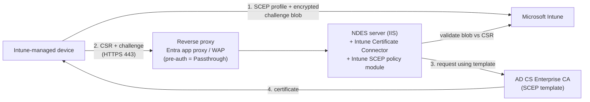

---
tags:
  - sc100
type: concept
domain:
  - infrastructure
aliases:
  - SCEP
  - Simple Certificate Enrollment Protocol
  - NDES
  - Intune SCEP certificate profiles
  - Certificate Connector for Microsoft Intune
---

# SCEP Certificate Infrastructure

## Purpose

On-premises PKI plumbing (**AD CS Enterprise CA + NDES + Certificate Connector for Microsoft Intune**) that lets [[Intune]] deploy **unique per-device/per-user certificates** with **SCEP certificate profiles**, for authentication to Wi-Fi, VPN, apps and corporate resources.

---

## Why architects choose it

- **Certificate-based authentication** (phishing-resistant, no shared secrets) for Wi-Fi/VPN/resources on Intune-managed devices.
- **Private key is generated on the device** and never leaves it. That's the security advantage of SCEP over PKCS.
- Reuses an existing **Microsoft AD CS** PKI. Supports **third-party CAs** too (no connector needed for those).

---

## When to use

- Intune-managed devices need **client certificates** for Wi-Fi (802.1X), VPN or app authentication.
- You already run **AD CS** and want Intune to issue device/user certs at scale.
- Internet-based devices must enroll → publish NDES via a **reverse proxy** (Entra application proxy / WAP / third-party).

---

## When NOT to use

- **Email encryption / Purview Message Encryption.** SCEP has **no role**. OME's prerequisite is **Azure RMS**. Classic exam distractor, see [[Microsoft Purview Message Encryption]].
- You want to avoid on-prem PKI → consider **Microsoft Cloud PKI** (Microsoft-hosted CA for Intune).
- You need the **same certificate on multiple devices** or key escrow (e.g. S/MIME decryption across devices) → **PKCS** (imported) certificates.

---

## Architecture

### Components

| Component | Requirements |
| --- | --- |
| **Certification Authority** | **Microsoft AD CS Enterprise CA** (Windows Server 2008 R2 SP1+, still in support). **Standalone CA not supported.** |
| **NDES server role** | Windows Server 2012 R2+, **domain-joined**, **same forest** as the Enterprise CA, **not a domain controller**, **not on the CA server** (security risk). IE Enhanced Security Configuration **disabled**. |
| **Certificate Connector for Microsoft Intune** | Required with a **Microsoft CA**. Installs **on the NDES server**. **Not supported on the issuing CA.** Not needed for **third-party CAs**. |
| **Reverse proxy** (internet devices) | **Microsoft Entra application proxy**, **Web Application Proxy** (needs long-URL update), or third-party supporting long URIs (**up to 40 KB**). **Pre-authentication must be Passthrough.** SCEP can't pre-authenticate. |
| **Trusted certificate profile** | **Prerequisite**: deploy the **Trusted Root CA** cert to devices first. SCEP profiles **reference** it. One root per OS platform. |
| **SCEP certificate profile** | Intune device-configuration profile that delivers the cert |

### How NDES is protected

- The connector installs the **Intune SCEP policy module** on NDES.
- Intune sends the device an **encrypted, signed challenge blob** that the device **can't read**. It contains the expected Subject/SAN.
- NDES validates the **CSR against the blob**. Mismatch means **no certificate**. Only **Intune-enrolled devices** with well-formed requests get certs.
- Browsing the NDES URL directly returns **403 Forbidden**.

### Certificates and templates

| Object | Detail |
| --- | --- |
| **SCEP certificate template** | v2 template on the issuing CA. **Subject name: Supply in the request** (the policy module enforces security). **Client Authentication** application policy. Don't publish in AD. NDES service account: **Read + Enroll**. Intune admins: **Read**. iOS/macOS: clear "Signature is proof of origin". |
| **Server authentication certificate** | Web Server cert bound in **IIS (HTTPS 443)** on NDES. CN = NDES FQDN. SANs for internal/external URLs (external not needed with Entra app proxy). |
| **Trusted Root CA certificate** | Delivered by the **trusted certificate profile** |
| Client authentication cert | Only for the **legacy** NDESConnectorSetup.exe connector |

### Other requirements

- **Revocation**: grant **Issue and Manage Certificates** on the CA to the NDES system account or NDES service account.
- **Validity**: ≥ **5 days** (shorter risks near-expiry rejection). iOS/macOS must use the template value.
- **NDES registry** `HKLM\SOFTWARE\Microsoft\Cryptography\MSCEP\`: map template Purpose → **SignatureTemplate** (Digital Signature) / **EncryptionTemplate** (Key Encipherment) / **GeneralPurposeTemplate** (both). **Restart the server** (not `iisreset`).
- Test URL: `http://<FQDN>/certsrv/mscep/mscep.dll`. **503** usually means a stopped app pool / NDES service account permission.
- **Network**: publish via reverse proxy, or allow **TCP 443** from the internet to NDES. NDES must reach the CA, DNS and DCs.
- **Strong mapping (KB5014754)**: new/renewed Intune SCEP certs carry a **SID tag in the SAN** (`URL=tag:microsoft.com,2022-09-14:sid:<value>`). The CA must support it (patched AD CS does; check third-party CAs).
- **Android Enterprise**: full-disk encryption devices need a **PIN** before SCEP provisioning. File-based encryption (OEM Android 10+) doesn't.

---

## Exam Scenario — distractor in OME question

"Recommend Purview Message Encryption so only intended recipients can read medical records sent to Gmail/Yahoo!. What first?" → **Verify Azure RMS is activated**. **Enable SCEP** is wrong: SCEP enrolls device certificates through Intune and plays no part in OME.

---

## Common Exam Confusion

| Compare | Difference |
| --- | --- |
| **SCEP vs. PKCS (Intune)** | SCEP: **key generated on device**, unique per device, needs NDES. PKCS: CA/connector generates the key pair and delivers it, so it **supports key escrow/import** (e.g. S/MIME across devices), no NDES. |
| **SCEP vs. Microsoft Cloud PKI** | SCEP with AD CS = **on-prem** CA + NDES + connector. Cloud PKI = Microsoft-hosted CA, no on-prem servers. |
| **SCEP vs. OME / Azure RMS** | SCEP = device/user **certificates for authentication**. OME/RMS = **content encryption** for email/documents. Unrelated. |
| **NDES vs. Certificate Connector** | NDES = Windows Server role implementing SCEP. Connector = Intune agent on the NDES server that adds the policy module and talks to Intune. |
| **Enterprise vs. Standalone CA** | Enterprise CA (AD-integrated, templates) is **required**. Standalone **isn't supported**. |
| **Trusted certificate profile vs. SCEP profile** | Trusted profile = deploys the **root** (trust). SCEP profile = deploys the **device cert**, and references the trusted profile. |

---

## AZ-500 overlap

AZ-500 covered certificate concepts in Key Vault and Intune device compliance basics. SCEP/NDES infrastructure is new. SC-100 mainly needs **what it's for** (device certificate auth) and **what it isn't** (email encryption).

---

## What's new in SC-100

- Certificate-based device auth as part of **endpoint and network access** design ([[Securing Server and Client Endpoints]], Wi-Fi/VPN).
- Choosing **SCEP vs. PKCS vs. Cloud PKI** by key-generation location, escrow needs and on-prem footprint.
- Hardening the PKI path: NDES not on CA or DC, policy module, passthrough reverse proxy, strong mapping.

---

## Exam Tips

- SCEP in an **email encryption** question → distractor.
- Required with a Microsoft CA: **Enterprise CA + NDES + Certificate Connector**. Connector lives **on NDES**, **never on the CA**.
- Deploy the **trusted root certificate profile first**.
- Internet devices → reverse proxy (**Entra application proxy**) with **Passthrough** pre-auth.
- Third-party CA → **no connector** required.

---

## Keywords

- Simple Certificate Enrollment Protocol (SCEP), certificate signing request (CSR)
- Network Device Enrollment Service (NDES), IIS, mscep.dll
- Certificate Connector for Microsoft Intune, Intune SCEP policy module, challenge blob
- AD CS Enterprise CA (not Standalone), SCEP certificate template, Supply in the request
- Trusted certificate profile, Trusted Root CA, SCEP certificate profile
- Microsoft Entra application proxy, Web Application Proxy, Passthrough pre-authentication
- Issue and Manage Certificates, revocation, strong mapping KB5014754, SID in SAN
- PKCS certificates, Microsoft Cloud PKI, third-party CA
- Wi-Fi, VPN, 802.1X certificate authentication

---

## Related Services

- [[Intune]]
- [[Securing Server and Client Endpoints]]
- [[Microsoft Purview Message Encryption]] — where SCEP shows up as a distractor
- [[Entra ID]] — application proxy for NDES publishing
- [[Trusted Platform Module (TPM)]] — hardware-protected keys for device certs
- [[VPN Gateway]] — certificate-based VPN authentication

---

## References

- [Configure infrastructure to support SCEP certificate profiles with Microsoft Intune](https://learn.microsoft.com/en-us/intune/fundamentals/certificates/scep-infrastructure) — Microsoft Learn (read 2026-10-20)
- [[Exam Objectives]]
