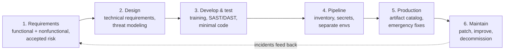

---
tags:
  - sc100
type: concept
domain:
  - apps-data
aliases:
  - Application security lifecycle
  - Secure SDLC strategy
  - Full lifecycle strategy for application security
---

# Full Lifecycle Application Security Strategy

## Purpose

An architect's strategy for embedding security into **every SDLC phase**: requirements → design → develop/test → pipeline → production → maintain/decommission. Based on the [[Azure Well-Architected Framework (WAF)]] Security pillar.

---

## Why architects choose it

- Security added **at the end** is expensive and incomplete. Security embedded **per phase** catches issues where they're cheapest to fix (see [[Shift left (WAF)]]).
- The architect's job isn't writing code. It's **designing the strategy** so each phase has defined security inputs, controls and owners.
- Documented requirements and **accepted risk** create **accountability**: if the business declines a control, it formally accepts the risk.
- The pipeline is a high-value target. "If an attacker compromises the pipeline, they can inject code that bypasses all other security controls."

---

## When to use

- Designing security for a **new application** or modernizing an existing portfolio.
- An exam scenario asks **which phase** a control belongs in, or what the **first** step of a secure SDLC is (→ collect security requirements).
- Defining governance for dev teams: training, approved dependencies, pipeline guardrails, emergency fix paths.

---

## When NOT to use

- As a substitute for specific tooling decisions. Pair it with [[DevOps Security]] (Defender for Cloud DevOps security, GHAS) and [[Application Security Testing]] (SAST/DAST/fuzzing).
- As a one-time gate. Threat modeling and maintenance are **continuous**.

---

## The six lifecycle phases

### 1. Collect and document security requirements

| Item | Detail |
| --- | --- |
| **Functional** security requirements | Authentication mechanisms, authorization models, data protection controls |
| **Nonfunctional** security requirements | Availability, compliance obligations, operational security needs |
| Where documented | Agreed-upon **specification** + reflected in the **development backlog** |
| Investments + tradeoffs | State explicitly what security investments are needed and **what risk the business accepts if not approved** |
| Example | WAF in front of a public app. If the cost isn't approved, stakeholders accept the risk of application-layer attacks succeeding. |
| Outcome | **Accountability** + the **basis for security testing** later |

### 2. Translate security requirements → technical requirements (design)

| Practice | What it means |
| --- | --- |
| **Define the security dimension of the architecture** | Overlay controls on **isolation boundaries** using your segmentation strategy. Specify **identity types per component**, **encryption at rest/in transit**, **network controls**. |
| **Evaluate platform-provided affordances** | Use the [[Shared Responsibility Model]] and don't rebuild what Azure provides: [[Front Door and Application Gateway\|Application Gateway / Front Door]] WAF instead of custom WAF code, [[Key Vault]] for secrets, **managed identities** for service-to-service auth |
| **Select approved frameworks and supply chain components** | Keep an **approved/prohibited dependency list**, enforced with **pipeline guardrails** and **automated dependency scanning** |
| **Define security design patterns** | Patterns for segmentation, strong authorization and uniform app security, e.g. the **Quarantine pattern** (verify/block software that could introduce vulnerabilities). See WAF security design patterns. |
| **Perform threat modeling** | Initial model in design to confirm choices meet requirements and expose gaps. Use specialists for **highly sensitive** workloads. **Continuous**, not one-time. See [[Threat Modeling]]. |

### 3. Secure development and testing

Goal: **prevent security defects and tampering** in code, build and deployment.

| Practice | Detail |
| --- | --- |
| **Secure coding training** | Formal, role-specific training: web/API devs on **XSS**, back-end devs on **SQL injection** |
| **Security testing tools** | **SAST** = analyze code during development. **DAST** = test the running app. Integrate **both into CI/CD** so they run automatically. Follow **OWASP**. Use **linters/code analyzers to stop credentials being pushed** to repos. See [[Application Security Testing]]. |
| **Write minimal code** | Smaller footprint = smaller attack surface. Reuse validated libraries. Use Azure managed services for authN, encryption and secrets instead of custom code. |
| **Protect developer environments** | Dev workstations and build agents are **high-value targets**. Use strong network + identity controls, patch promptly, same rigor as prod. **Prefer Microsoft-hosted build agents** (clean VM per run) over self-hosted agents. |

### 4. Protect code in deployment pipelines

| Practice | Detail |
| --- | --- |
| **Component inventory** | Track every component, including third-party libraries. **Store the inventory outside the build environment** and regularly compare it to the build to detect unauthorized additions. |
| **Secure pipeline tasks + secrets** | Pull tasks from **trusted sources** (Azure Marketplace). **Segment secrets per stage**, so dev pipelines can't reach prod secrets. Use **workload identities** for pipeline auth ([[Workload Identity Federation]]) and **managed identities** for service-to-service. No long-lived credentials. |
| **Separate environments** | **Never use production data in lower environments.** Don't connect non-prod apps to prod databases/networks. |
| **Progressive exposure** | Release to **subsets of users** first to contain blast radius, then widen as confidence grows |

### 5. Protect code in production

| Practice | Detail |
| --- | --- |
| **Versioned artifact catalog** | Catalog of all deployed assets + versions. Supports incident triage, **rollback**, and matching components against **CVE** notices. |
| **Emergency fixes** | Pipeline supports **regular and emergency** release paths. Emergency path has **simplified approval gates** but keeps testing. Security fixes must **never introduce regressions**. |

### 6. Maintain security throughout the lifecycle

- **Patch management**: software, libraries, infrastructure. See [[Security Updates and Patch Management]].
- **Continuous improvement**: code reviews, feedback, lessons learned from incidents and evolving threats.
- **Decommission unused assets**: "Every unused component is another attack surface."
- **Incident integration**: production issues feed back into development to prevent recurrence.

---

## Common Exam Confusion

| Compare | Difference |
| --- | --- |
| **Functional vs. nonfunctional security requirements** | Functional = what the app does for security (authN, authZ, data protection). Nonfunctional = qualities/obligations (availability, compliance, operational security). |
| **SAST vs. DAST** | SAST = **source code**, during development. DAST = **running app**, runtime issues. Both go in CI/CD. |
| **Microsoft-hosted vs. self-hosted build agents** | Microsoft-hosted = **fresh VM per run**, no hardening burden (preferred). Self-hosted = you patch and harden it. |
| **Workload identity vs. managed identity (pipelines)** | Workload identity (federation) authenticates the **pipeline** to Azure. Managed identity handles **service-to-service** auth for Azure-hosted resources. |
| **Progressive exposure vs. emergency fix path** | Progressive exposure limits blast radius of **new features**. The emergency path accelerates **security fixes** with lighter approvals but still tests. |
| **This strategy vs. [[DevOps Security]]** | This note = **phase-by-phase strategy** (what to do, why). DevOps Security = **tooling** (Defender for Cloud DevOps security, GHAS, IaC scanning) and the Plan/Develop/Build/Deploy/Operate stage mapping. |

---

## AZ-500 overlap

AZ-500 covered Key Vault, managed identities, App Service/API security and Defender for Cloud. SC-100 adds the **end-to-end strategy**: requirements with accepted risk, threat modeling as a continuous process, supply-chain governance and pipeline hardening.

---

## What's new in SC-100

- Treat the **business-accepted risk** of unfunded controls as a documented requirements artifact.
- Prefer **platform affordances** over custom controls. The shared responsibility model drives design.
- **Supply chain**: approved/prohibited dependencies, inventory stored outside the build, trusted task sources.
- **Pipeline as Tier-0-like asset**: secrets segmented per stage, workload identities, hosted agents.
- **Production readiness**: artifact catalog for CVE correlation, emergency fix path.

---

## Exam Tips

- First phase = **collect and document security requirements** (functional + nonfunctional) in a spec + backlog.
- Threat modeling starts in **design** and is **continuous**.
- Custom WAF logic in app code → wrong. Use **Application Gateway / Front Door WAF**.
- Prevent credentials reaching repos → **linters/code analyzers** (secret scanning) in the pipeline.
- Dev pipeline must not reach prod secrets → **segment secrets per stage**.
- **Never** use production data in lower environments.
- Unused assets → **decommission**, because they're attack surface.

---

## Keywords

- Secure SDLC, full lifecycle application security, WAF Security pillar
- Functional vs. nonfunctional security requirements, specification, backlog, accepted risk
- Security dimension of the architecture, isolation boundaries, segmentation
- Platform-provided affordances, shared responsibility
- Approved/prohibited dependencies, dependency scanning, supply chain, Quarantine pattern
- Threat modeling (continuous)
- Secure coding training, XSS, SQL injection, OWASP, SAST, DAST, linters
- Minimal code, Microsoft-hosted build agents
- Component inventory, trusted pipeline tasks, segmented secrets, workload identities
- Environment separation, progressive exposure
- Versioned artifact catalog, CVE, emergency fix path, regressions
- Patch management, continuous improvement, decommission, incident integration

---

## Related Services

- [[Azure Well-Architected Framework (WAF)]] — source framework (Security pillar)
- [[Shift left (WAF)]]
- [[DevOps Security]] — DevSecOps tooling and stages
- [[Application Security Testing]] — SAST/DAST/IAST/fuzzing
- [[Threat Modeling]]
- [[Azure Web Application Firewall]] / [[Front Door and Application Gateway]]
- [[Key Vault]]
- [[Workload Identity Federation]]
- [[Shared Responsibility Model]]
- [[Security Updates and Patch Management]]
- [[Secure Future Initiative (SFI)]] — "Protect engineering systems" pillar

---

## References

- [Design a full lifecycle strategy for application security](https://learn.microsoft.com/en-us/training/modules/design-solutions-secure-applications/2a-design-full-lifecycle-strategy-application-security) — Microsoft Learn training unit (SC-100, read 2026-10-20)
- [[Exam Objectives]]
