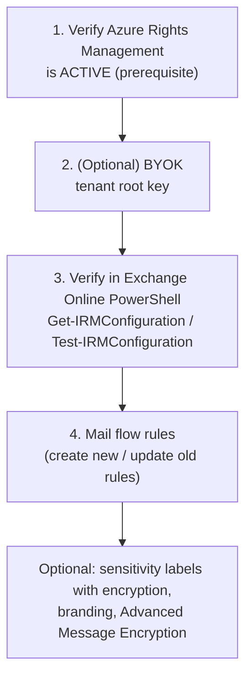

---
tags:
  - sc100
type: concept
domain:
  - apps-data
aliases:
  - OME
  - Office 365 Message Encryption
  - Purview Message Encryption
  - Message Encryption
---

# Microsoft Purview Message Encryption

## Purpose

Encrypted email that **anyone on any device** can read, including recipients on **Gmail, Yahoo!, Outlook.com** and other Microsoft 365 orgs. Built on **Azure Rights Management (Azure RMS)**.

---

## Why architects choose it

- Meets "**only intended recipients can read the content**" **and** "**send to Gmail/Yahoo!/Outlook.com**" without requiring recipients to run Microsoft infrastructure. S/MIME can't do that because it needs certificates on both sides.
- Uses the **same encryption service (Azure RMS)** as [[Sensitivity Labels]] and [[Purview|Microsoft Purview Information Protection]]. One protection engine for documents and email.
- Can be **automatic** (mail flow rules), **user-driven** (Encrypt / Do Not Forward in Outlook) or **label-driven** (a sensitivity label that applies encryption).

---

## When to use

- Regulated content (medical, financial, PII) sent to **external** recipients on **any** email service.
- Enforce encryption by condition (keyword, recipient domain, sensitive info) → combine with [[Mail Flow Rules]].
- **Do Not Forward** / **Encrypt-Only** restrictions on email.

---

## When NOT to use

- Tenant still uses **AD RMS** with Exchange Online. **OME isn't compatible with AD RMS.** Migrate to Azure RMS first.
- Requirement is **device/user certificate enrollment** (Wi-Fi/VPN auth) → [[SCEP Certificate Infrastructure|SCEP]], unrelated to OME.
- Requirement is "even Microsoft can't decrypt" → [[Double Key Encryption (DKE)]].
- Just TLS in transit between mail servers. That's transport encryption, not message-level protection.

---

## Setup order (what to do first)

| Step | Detail |
| --- | --- |
| **1. Verify Azure RMS is active** | **The only prerequisite.** If Azure RMS is active, Microsoft 365 **activates message encryption automatically**. Azure RMS is auto-activated for **most eligible plans**. If it was disabled or not auto-activated → **activate manually**. |
| AD RMS? | Using **AD RMS** with Exchange Online → **migrate to Azure RMS** first. OME isn't compatible with AD RMS. |
| **2. Tenant key (optional)** | Default = **Microsoft-managed root key** (recommended for most). Compliance may need **BYOK**. Do BYOK **before** setting up OME. |
| **3. Verify in Exchange Online PowerShell** | Account such as **Compliance Administrator**. `Get-IRMConfiguration` → **`AzureRMSLicensingEnabled` = `$True`** (else set it with `Set-IRMConfiguration`). `Test-IRMConfiguration -Sender x -Recipient y` → acquires RMS templates, verifies encryption, decryption, IRM → **OVERALL RESULT: PASS**. |
| "Failed to acquire RMS templates" | Get `LicensingIntranetDistributionPointUrl` from `Get-AipServiceConfiguration` → `Set-IRMConfiguration -LicensingLocation` + `-InternalLicensingEnabled $true` → retest |
| **4. Mail flow rules** | New deployments → **create** rules. Existing encryption rules → **update** them. Otherwise users keep getting the **old HTML-attachment format**. EAC → Mail flow → Rules → *Modify the message security* → **Apply Office 365 Message Encryption and rights protection** → template **Encrypt**. |

---

## Exam Scenario — medical records to Gmail/Yahoo!

**Scenario:** Microsoft 365 **E5**. Staff email sensitive medical records → compliance violations. Requirements: **only intended recipients can view content**, and staff can **send secure email to Gmail, Yahoo!, Outlook.com**. You recommend Purview Message Encryption. **What first?**

| Option | Verdict | Why |
| --- | --- | --- |
| **Verify that Azure RMS has been activated** | ✅ **First** | Azure RMS is the **only prerequisite** and the encryption engine. OME is auto-enabled once it's active. |
| Define mail flow rules in the Exchange admin center | ❌ Not first | Rules **apply** OME automatically. That's step 4, after RMS is confirmed. Rules can't encrypt if the RMS engine isn't active. |
| Create and publish sensitivity labels | ❌ Not first | Labels with encryption **also depend on Azure RMS**. Optional for OME, not the prerequisite. |
| Enable SCEP | ❌ Unrelated | SCEP = Intune **device certificate** enrollment (Wi-Fi/VPN). Nothing to do with email encryption. |

**Pattern:** "What should you do **first**" + OME → **verify/activate Azure RMS**. Mail flow rules and labels are *consumers* of RMS.

---

## Common Exam Confusion

| Compare | Difference |
| --- | --- |
| **Azure RMS vs. OME** | Azure RMS = the **encryption/access-control service**. OME = the **email feature** built on it. |
| **Azure RMS vs. AD RMS** | Azure RMS = cloud service, required for OME. AD RMS = on-prem, **not compatible** with OME, so migrate. |
| **OME vs. S/MIME** | OME works with **any recipient** (Gmail/Yahoo!) without certificates. S/MIME needs **certificates for sender and recipient**, and mail flow rules can only read S/MIME **envelope headers**. |
| **OME vs. [[Mail Flow Rules]]** | OME = **how** a message is encrypted. Mail flow rules = **when** it's encrypted automatically (conditions). |
| **OME vs. [[Sensitivity Labels]]** | Both use Azure RMS. Labels classify and protect **files, emails, containers**. OME is email-specific and can be applied by rule. |
| **OME vs. [[SCEP Certificate Infrastructure\|SCEP]]** | SCEP issues device/user **certificates via Intune + NDES**. It's not an email encryption mechanism. |
| **OME vs. [[Double Key Encryption (DKE)]]** | DKE keeps one key **on-prem**, so Microsoft can't decrypt. OME uses a Microsoft-managed or BYOK root key. |
| **Encrypt vs. Do Not Forward** | **Encrypt-only**: recipients can read, and forward is allowed. **Do Not Forward**: no forward, print or copy. |

---

## AZ-500 overlap

AZ-500 covered Azure Information Protection / sensitivity labels and Key Vault BYOK concepts. SC-100 tests **sequencing** (RMS before rules/labels), **external recipient** requirements, and choosing OME vs. S/MIME vs. DKE.

---

## What's new in SC-100

- Design **email protection for external parties** as part of data protection architecture.
- Know the **dependency chain**: Azure RMS → OME → mail flow rules / labels.
- **Key ownership** decision: Microsoft-managed vs. **BYOK** vs. DKE.

---

## Exam Tips

- **Only prerequisite** for OME = **Azure Rights Management active**. Auto-activated for most eligible plans.
- AD RMS + Exchange Online → **migrate to Azure RMS** before OME.
- Verify: `Get-IRMConfiguration` (**AzureRMSLicensingEnabled = True**) and `Test-IRMConfiguration`.
- Old OME rules not updated → recipients get the **legacy HTML attachment** experience.
- Mail flow rule action: **Apply Office 365 Message Encryption and rights protection**.
- SCEP in an email-encryption question is a **distractor**.

---

## Keywords

- Microsoft Purview Message Encryption, Office 365 Message Encryption (OME)
- Azure Rights Management (Azure RMS), activate, AIPService
- AD RMS incompatible, migrate to Azure RMS
- BYOK, tenant root key, Microsoft-managed key
- Get-IRMConfiguration, AzureRMSLicensingEnabled, Test-IRMConfiguration, Set-IRMConfiguration
- Mail flow rules, "Apply Office 365 Message Encryption and rights protection", Encrypt template, Do Not Forward
- Gmail, Yahoo!, Outlook.com, any device, external recipients
- Only intended recipients can view, medical records, compliance violations

---

## Related Services

- [[Data Classification and Protection]] — where OME sits in the discover → classify → protect pipeline
- [[Mail Flow Rules]] — automatic application of OME
- [[Sensitivity Labels]] — label-based encryption on the same RMS engine
- [[Purview]]
- [[Double Key Encryption (DKE)]]
- [[SCEP Certificate Infrastructure]] — the unrelated distractor
- [[Securing Microsoft 365]]
- [[Microsoft 365 Licensing]] — E3/E5 entitlements for Information Protection

---

## References

- [Set up Microsoft Purview Message Encryption](https://learn.microsoft.com/en-us/purview/set-up-new-message-encryption-capabilities) — Microsoft Learn (read 2026-10-20)
- [Define mail flow rules to encrypt email messages](https://learn.microsoft.com/en-us/purview/define-mail-flow-rules-to-encrypt-email) — Microsoft Learn
- [[Exam Objectives]]
