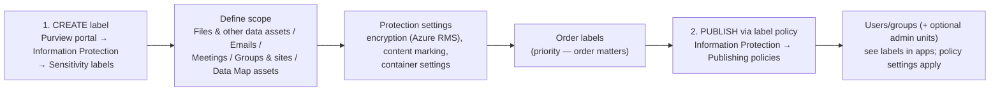

---
tags:
  - sc100
type: concept
domain:
  - apps-data
aliases:
  - Sensitivity label
  - Label policy
  - Publish sensitivity labels
---

# Sensitivity Labels

## Purpose

The building block of **all Microsoft Purview Information Protection** solutions. You **create** labels (classification + protection settings) and **publish** them to users through **label policies**.

---

## Why architects choose it

- One **persistent** classification that travels with content (files, emails, meetings) and can enforce **encryption, markings and container settings**.
- Labels are the **input** to DLP, auto-labeling, DSPM and Defender for Cloud Apps. Classify once, enforce everywhere.
- Label encryption uses **Azure Rights Management**, the same engine as [[Microsoft Purview Message Encryption]].

---

## When to use

- Classify and protect **documents and emails** (encryption, watermarks, headers/footers).
- Control **Teams / M365 groups / SharePoint sites** (privacy, external sharing, guest access) → **Groups & sites** scope.
- Protect **calendar items, Teams meetings and chat** → **Meetings** scope.
- Label **schematized data assets** in the Purview Data Map (preview).

---

## When NOT to use

- As the **first step** of an OME rollout. Verify **Azure RMS** first, because label encryption also depends on it.
- Expecting a label to **block exfiltration** by itself. Pair it with **DLP** (see [[Data Classification and Protection]]).
- Creating many label policies "just because". **Aim for as few as possible**, and one org-wide policy is common.

---

## Create → Publish

### Create (classic label scheme)

| Step | Detail |
| --- | --- |
| Where | **Microsoft Purview portal → Solutions → Information Protection → Sensitivity labels → + Create a label** |
| **Scope** | Files & other data assets · Emails · **Meetings** (only if Files **and** Emails are also selected) · Groups & sites · Data Map assets. **Unselected scope = settings unavailable and label not shown in those apps.** |
| Settings | Follow prompts: encryption, content marking, auto-labeling for files/emails, container settings |
| **Sublabels** | Select parent → **…** → **Create sublabel** |
| **Order** | **…** → Move up/down. **Label priority (order matters).** Lower in the list = higher sensitivity. |
| Modern scheme | Tenants created **from Oct 1, 2025** (or migrated) use the **modern label scheme**, with **label groups** instead of parent/sublabels |
| Editing a published label | No re-publish needed. Allow **up to 24 hours** to replicate. |
| Extra settings | **Security & Compliance PowerShell**: `Set-Label` (e.g. `LocaleSettings` for multilingual names/tooltips, `AdvancedSettings`). Use the **label GUID**, not the display name. |

### Publish (label policy)

| Step | Detail |
| --- | --- |
| Where | **Information Protection → Publishing policies → Publish label** |
| Labels | Choose labels. **Classic scheme: selecting a sublabel requires selecting its parent.** |
| **Admin units** | Optionally restrict the policy to [[Administrative Units]]. Admins assigned to AUs **must** pick one. Default = **Full directory**. |
| Users/groups | **Groups recommended**: mail-enabled security, security, distribution, **Microsoft 365 groups (dynamic OK)**. Removing a user from the group removes the policy for them. |
| Policy settings | Shown only for the scopes of the selected labels: **default label**, **mandatory labeling**, **justification for downgrade**, groups/sites defaults |
| Multiple policies | Only when users need **different labels or settings**. **Policy order** resolves conflicts. |
| Publishing | Completing the wizard **auto-publishes**. Edits auto-replicate. There's no "republish" button. |
| PowerShell | `New-Label`, `Set-Label`, `New-LabelPolicy`, `Set-LabelPolicy`, `Remove-Label`, `Remove-LabelPolicy` |

### Timing

- Allow **24 hours** for labels and policies to propagate. Some changes (group membership, network) take **24–48 hours**. Office for the web can update **within the hour**.

### Remove vs. delete

| Action | Effect |
| --- | --- |
| **Remove from policy** | Less risky and reversible. Users stop seeing it, but **already-applied labels stay** (container protection continues). |
| **Delete label** | Must first be removed from all policies. **Encryption template is archived** so old content still opens, and you **can't reuse the name**. SharePoint/OneDrive (labels for Office files enabled): label name disappears and encryption is **removed** if services can process it. Elsewhere: encryption **remains**. Containers: settings **no longer enforced** (48–72 h for SharePoint). Content/activity explorer may show **GUIDs**. |

### Protection policies (preview)

- Apply to items **outside Microsoft 365**: **Microsoft Fabric, Azure Storage, ADLS Gen2**.

---

## Exam Scenario — OME first step

"Recommend Purview Message Encryption for medical records to Gmail/Yahoo!. What **first**?" → **Verify Azure RMS is activated**. *Create and publish sensitivity labels* is **not first**: labels with encryption depend on Azure RMS, and OME doesn't require labels at all. See [[Microsoft Purview Message Encryption]].

---

## Common Exam Confusion

| Compare | Difference |
| --- | --- |
| **Label vs. label policy** | Label = **what** (classification + protection). Policy = **who** gets it and **how** (default, mandatory, justification). |
| **Remove from policy vs. delete label** | Remove = hide from users, applied labels persist. Delete = archive template, mapping lost, container settings stop. |
| **Sensitivity label vs. DLP** | Label = metadata + protection on the item. DLP = enforcement engine that **acts** on content (block/warn). |
| **Sensitivity label vs. retention label** | Sensitivity = **protect/classify**. Retention = **keep/delete** for a period. |
| **Classic vs. modern label scheme** | Classic: parent/sublabels. Modern (tenants from Oct 1, 2025 or migrated): **label groups**. |
| **Label encryption vs. OME** | Both use Azure RMS. Labels cover files/emails/meetings. OME is email-only and can be applied by [[Mail Flow Rules]]. |

---

## AZ-500 overlap

AZ-500 covered creating sensitivity labels and policies (AIP-era). The new parts here: the Purview portal workflow, **scopes** (meetings, groups & sites, Data Map), **admin-unit-scoped policies**, modern label scheme, and design decisions (few policies, remove vs. delete).

---

## What's new in SC-100

- Labels as the **foundation of data protection architecture**, feeding DLP, DSPM and Defender for Cloud Apps.
- **Container labels** for Teams/SharePoint governance.
- **Protection policies** extend label-based protection to Fabric/Azure Storage/ADLS (preview).

---

## Exam Tips

- Labels aren't usable until **published in a label policy**.
- **Meetings** scope requires **Files** + **Emails** scopes.
- Allow **24 h** before troubleshooting.
- **Groups** (not individual users) for label policies. Dynamic M365 groups are supported.
- Fewest label policies possible. Use **policy order** for conflicts.
- Can't delete a label still in a policy. Deleting **archives** the encryption template.

---

## Keywords

- Sensitivity label, label policy, publishing policies, Microsoft Purview portal, Information Protection
- Scope: Files & other data assets, Emails, Meetings, Groups & sites, Data Map assets
- Encryption (Azure Rights Management), content marking, container settings
- Parent label, sublabel, label groups, classic vs. modern label scheme
- Label priority (order matters), label policy priority
- Default label, mandatory labeling, justification
- Administrative units, Full directory
- Set-Label, Set-LabelPolicy, LocaleSettings, AdvancedSettings, GUID
- 24 hours replication, remove vs. delete, archived protection template
- Protection policies (Fabric, Azure Storage, ADLS Gen2)

---

## Related Services

- [[Data Classification and Protection]] — discover → classify → protect pipeline
- [[Purview]]
- [[Microsoft Purview Message Encryption]]
- [[Mail Flow Rules]]
- [[Data Security Posture Management (DSPM)]]
- [[Double Key Encryption (DKE)]] — label-based DKE
- [[Administrative Units]] — scope label policies
- [[SaaS Application Discovery and Control]] — Defender for Cloud Apps uses labels
- [[Microsoft 365 Licensing]]

---

## References

- [Create and publish sensitivity labels](https://learn.microsoft.com/en-us/purview/create-sensitivity-labels?tabs=classic-label-scheme) — Microsoft Learn (read 2026-10-20)
- [Learn about sensitivity labels](https://learn.microsoft.com/en-us/purview/sensitivity-labels) — Microsoft Learn
- [[Exam Objectives]]
