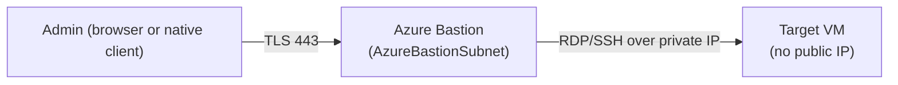

---
tags:
  - sc100
type: cheat-sheet
domain:
  - infrastructure
status: needs-verification
---
# Azure Bastion

Browser- (or native-client-) based RDP/SSH to a VM with **no public IP required on the VM itself** — traffic is brokered through the Bastion host over TLS 443. The *when to use it vs. JIT VM access* decision already lives in [[Securing IaaS and PaaS Services]]; this page is the mechanism and SKU mechanics.

## Core Capabilities

- **Deployment** — one Bastion host per VNet (or a shared hub VNet, reached via peering), in a dedicated **AzureBastionSubnet**. It's a PaaS resource with its own public IP; the *target* VM never needs one.
- **Basic / Standard tier** — Standard adds native client support (connect via your own RDP/SSH client, not just the Azure portal browser session), IP-based connection (reach a VM by private IP across peered/on-prem networks, not just an Azure-registered VM), and scalable host instances.
- **Premium tier** — adds session recording (to a Storage account) and a fully private-only deployment option (no public IP on the Bastion host itself, reached instead via Private Link).
- **Developer SKU** — a free, simplified tier for dev/test scenarios with reduced features (no scaling, fewer connection options) — not the production answer.

## Architecture



## Key Facts

- No inbound NSG rule opening RDP/SSH (3389/22) from the internet is ever needed — Bastion reaches the VM over its private IP inside the VNet.
- Session recording and private-only deployment are Premium-only — a scenario requiring either names that tier specifically.
- Bastion removes the exposure entirely (no public IP/open port, full stop); [[Securing IaaS and PaaS Services|JIT VM access]] narrows the *time window* a port is open when a public IP/direct path still exists — complementary, not interchangeable (full comparison in [[Securing IaaS and PaaS Services]]).

## Exam Notes

- "Eliminate public IP exposure on VM management ports entirely" → Azure Bastion, not just NSG rules or JIT alone.
- "Recommend a solution for **protecting SSH/RDP access** to VMs" → **Azure Bastion**. JIT = exposure-window hardening, NSG = filter, forced tunneling = egress routing.
- "Connect using a native RDP/SSH client, not just the browser" → Standard tier or higher.
- "Record and audit privileged administrative sessions" → Premium tier's session recording.
- "Bastion host itself must have no public IP" → Premium tier's private-only deployment.

## Exam Scenario (got wrong): Protect SSH access to server VMs

> CompanyA (health services) is moving to a **fully mobile workforce** and migrating servers, user VMs and appliances to Azure. Recommend a solution for **protecting SSH access to server VMs**.

| Option | Verdict | What it actually does | Why it is / isn't the answer |
| --- | --- | --- | --- |
| **Azure Bastion** | ✅ | Managed PaaS jump host in **AzureBastionSubnet**. Admins connect over **TLS 443** (portal browser session, or native client on Standard+), and Bastion opens **SSH/RDP to the VM's private IP**. | Purpose-built **secure SSH/RDP access**. The VM needs **no public IP** and **port 22 is never opened to the internet**. Access is gated by **Entra ID sign-in + Azure RBAC** (so Conditional Access/MFA apply), works from **anywhere** (fits the mobile workforce), and there's no VPN to run. |
| Just-in-time (JIT) VM access | ❌ (my pick) | Defender for Cloud (**Defender for Servers Plan 2**) feature. It keeps 22/3389 **denied by NSG/Azure Firewall rules** and, on request, **temporarily opens** the port to the requester's source IP for a set time, then closes it. | It **reduces** exposure (time + source IP) but the VM still needs a **reachable path** (usually a public IP), and while open, **port 22 is exposed**. It's a **hardening control on direct access**, not a secure access solution. Best as a **complement** to Bastion. |
| Network security groups (NSGs) | ❌ | L3/L4 allow/deny rules by IP, port and protocol on a subnet/NIC | A **filter**, not an access solution. To allow SSH you'd still have to open 22 to some source, and it gives no identity check, no TLS brokering, no audit. Bastion still needs NSGs underneath. |
| Forced tunneling | ❌ | Routes a VNet's **outbound internet-bound** traffic (0.0.0.0/0 UDR) to on-prem or an NVA/Azure Firewall for inspection | **Egress control**. It has nothing to do with **inbound** admin SSH. (It can even break VMs with public IPs, because return traffic gets tunnelled.) |

**Why JIT was tempting:** it's the other famous "protect management ports" feature, and Secure Score recommends it ("management ports should be protected with JIT"). The tiebreaker is the question wording: **"protecting SSH *access*"** means *how admins securely connect*, which is Bastion. "Reduce the *attack surface/exposure window* of open management ports" would be JIT.

> ⚠️ The practice-test explanation says JIT "requires the **manual approval** of every access attempt". That's inaccurate. A JIT request is **granted automatically** if the requester has the RBAC permission to initiate it (`.../jitNetworkAccessPolicies/initiate/action`). Approval workflows only exist if you build them yourself (e.g. PIM for the role, or a Logic App).

```
Admins need to SSH/RDP into Azure VMs securely?
  ↓
Remove public IP + no open 22/3389 from internet, connect from anywhere?
  → Azure Bastion  (Premium: session recording, private-only)
Keep some direct path but shrink the exposure window?
  → JIT VM access (Defender for Servers P2) — complements Bastion
Just filter which IPs/ports reach a subnet?
  → NSG (a building block, not an access solution)
Inspect/route OUTBOUND internet traffic?
  → Forced tunneling / Azure Firewall (egress, unrelated to admin access)
Whole network-level access to many resources?
  → VPN Gateway (P2S/S2S) or Entra Private Access (ZTNA)
```

---

## Comparison

| Compare | Difference |
| --- | --- |
| Azure Bastion vs. JIT VM access | Full comparison in [[Securing IaaS and PaaS Services]] — Bastion removes the public IP/open port requirement entirely; JIT narrows the exposure window when direct access still exists. |
| Azure Bastion vs. NSG | Secure brokered access (identity + TLS, no public IP) vs. a port/IP filter. Bastion relies on NSGs. NSGs alone don't provide secure access. |
| Azure Bastion vs. forced tunneling | Inbound admin access vs. outbound internet traffic routing. Different direction, different problem. |
| Azure Bastion vs. [[VPN Gateway]] / Entra Private Access | Per-VM RDP/SSH only vs. network-level (VPN) or per-app ZTNA access to many private resources ([[Identity as the Security Perimeter]]). |
| Basic/Standard vs. Premium | Standard adds native client + IP-based connection over Basic. Premium adds session recording and private-only (no public IP on the Bastion host) deployment — the tier to name when audit/recording or a fully private management plane is required. |

## AZ-500 Review

AZ-500 already covers deploying Azure Bastion and connecting to a VM through it at a configuration level. SC-100 adds: choosing the right tier for the scenario (session recording, private-only) and treating Bastion as one layer in a broader IaaS network architecture alongside NSGs, Azure Firewall, and JIT VM access — see [[Securing IaaS and PaaS Services]].

## Keywords

- Azure Bastion, AzureBastionSubnet
- Basic vs. Standard vs. Premium vs. Developer SKU
- Native client support, IP-based connection
- Session recording, private-only deployment
- No public IP on target VM

## Related Services

- [[Securing IaaS and PaaS Services]]
- [[Network Security Group]]
- [[Azure Firewall]]
- [[Private Link]]
- [[PIM]]
- [[Cloud Workload Protection (CWPP)]] — JIT VM access lives in Defender for Servers Plan 2
- [[VPN Gateway]]
- [[Identity as the Security Perimeter]] — Entra Private Access as the ZTNA alternative
- [[Conditional Access]] — applies to the Entra sign-in that gates Bastion
- [[Exam Objectives]]

## References

- [Azure Bastion overview](https://learn.microsoft.com/en-us/azure/bastion/bastion-overview) — Microsoft Learn
- [Azure Bastion configuration settings (SKUs/features)](https://learn.microsoft.com/en-us/azure/bastion/configuration-settings) — Microsoft Learn

## Verification Flag

JIT licensing (Defender for Servers Plan 2) and the auto-approval behaviour for users holding the initiate permission are from training knowledge. Re-check them on the JIT Learn page.

Bastion's SKU lineup (Developer/Basic/Standard/Premium) and per-tier feature split have changed as Microsoft has added tiers over time — re-verify current SKU names and exact feature boundaries against the live configuration-settings page close to exam date.
