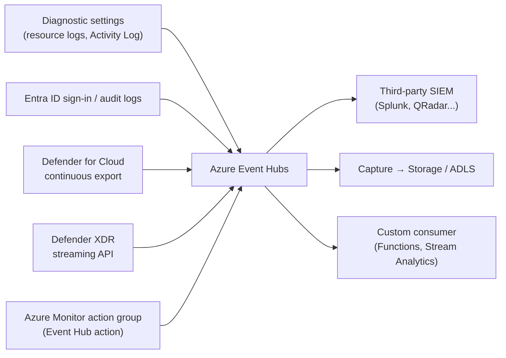

---
tags:
  - sc100
type: service
domain:
  - ops-identity-compliance
  - apps-data
aliases:
  - Event Hubs
  - Event Hub
  - Azure Event Hub
status: needs-verification
---

# Azure Event Hubs

## Purpose

Fully managed, real-time **data streaming** platform. It ingests millions of events per second (Kafka, AMQP 1.0, HTTPS) and holds them so many consumers can read the same stream.

---

## Why Architects Choose It

- **The standard "pipe" out of Azure to a third-party SIEM** (Splunk, QRadar, ArcSight, Elastic). Diagnostic settings, [[Entra ID]] logs, [[Defender for Cloud REST API|Defender for Cloud continuous export]] and the [[Microsoft Defender XDR]] streaming API all target it.
- **Decouples producers from consumers**: the SIEM can be down or slow while events wait in the hub, within the retention window.
- **Kafka-compatible endpoint**: existing Kafka clients work without code changes, so there's no Kafka cluster to run.
- **Fan-out with consumer groups**: the SIEM, a data lake and an analytics job each read the same stream independently.
- **Capture** writes the stream to Blob Storage / Data Lake Storage for cheap long-term retention, with no code.

---

## Key Concepts

| Concept | What it is |
| --- | --- |
| **Namespace** | Container for event hubs. Holds capacity, networking (private endpoints, firewall), geo-DR. |
| **Event hub** | The stream itself (= a Kafka topic). An append-only log split into partitions. |
| **Partitions** | Ordered sequences that scale throughput. Ordering is guaranteed **per partition** only. |
| **Consumer group** | An independent view (own offset) of the stream for one consuming app. |
| **Capture** | Automatic write of events to Blob Storage / ADLS in near real time. |
| **Throughput / processing units** | Capacity: throughput units (Standard, with auto-inflate), processing units (Premium), capacity units (Dedicated). |
| **Retention** | Up to 7 days (Standard), up to 90 days (Premium/Dedicated). It isn't an archive: use Capture or a SIEM for long-term storage. |

### Tiers

| Tier | Fit |
| --- | --- |
| Basic | Simple ingestion, minimal features |
| **Standard** | Most log-streaming designs. Kafka, Capture, auto-inflate. |
| **Premium** | Isolated resources, longer retention, zone redundancy, **customer-managed keys** |
| **Dedicated** | Single-tenant cluster, highest scale, CMK |

---

## Security Controls

| Control | Design choice |
| --- | --- |
| **Authentication** | **Microsoft Entra ID + RBAC** (*Azure Event Hubs Data Sender / Data Receiver / Data Owner*) with **managed identities**. Shared Access Signatures (SAS) are shared secrets, so disable local (SAS) auth where possible. |
| **Network** | **Private endpoints** ([[Private Link]]), VNet service endpoints, IP firewall. Allow **trusted Microsoft services** so diagnostic settings can still write. |
| **Encryption** | Microsoft-managed keys by default. **Customer-managed keys** in [[Key Vault]] on Premium/Dedicated. TLS 1.2 in transit. |
| **Resilience** | Zone redundancy (Premium/Dedicated), geo-disaster recovery (metadata), geo-replication |
| **Monitoring** | Its own diagnostic settings into Log Analytics ([[Azure Security Logging]]) |

---

## Where It Appears in Security Designs

- If **Sentinel** is the SIEM, you normally **don't need** Event Hubs. Use native data connectors and diagnostic settings straight to Log Analytics. Event Hubs is the answer when data must reach a **non-Microsoft** SIEM, or several consumers at once.

---

## When to Use

- Streaming Azure/Entra/Defender security data to a **third-party SIEM** or partner tool.
- High-volume telemetry ingestion (IoT, app events, clickstream) for real-time analytics.
- Multiple independent consumers of the same event stream.
- Replacing a self-managed Kafka cluster.

## When NOT to Use

- **Remediating or reacting to an alert** → [[Logic Apps]] ([[Defender for Cloud Workflow Automation]]). Event Hubs has no logic.
- **Discrete "something changed" notifications** routed to handlers → [[Azure Event Grid]].
- **Transactional, must-process-once business messages** (orders, payments) → [[Azure Service Bus]].
- **Long-term archive** → Storage (via Capture or diagnostic settings), not hub retention.
- **Sentinel as the SIEM** → Log Analytics directly.

---

## Comparison

| Compare | Difference |
| --- | --- |
| **Event Hubs vs. [[Azure Event Grid]]** | Time-ordered **stream** of many events (big data, telemetry, log streaming) vs. **discrete events** pushed to handlers (react to a state change, serverless). Event Grid routes. Event Hubs ingests and buffers. |
| **Event Hubs vs. [[Azure Service Bus]]** | Telemetry stream, no per-message transactions vs. **high-value messages** with transactions, duplicate detection, dead-lettering and FIFO sessions |
| **Event Hubs vs. Log Analytics workspace** (diagnostic setting destinations) | Stream **out** to another system vs. store and query **in** Azure (Sentinel, KQL). Storage account = cheap archive. |
| **Event Hubs vs. webhook** | A buffered stream that consumers pull at their own pace vs. one HTTP POST per alert ([[Azure Monitor Alerts and Action Groups]]) |
| **Event Hubs vs. Logic Apps** | Moves data vs. acts on it |

**Event vs. message (Learn wording):** an *event* is a lightweight notification of a state change, and the publisher has no expectation about how it's handled. A *message* is raw data under a contract that the consumer processes it.

---

## AZ-500 Overlap

AZ-500 covers diagnostic settings with an Event Hub destination, and streaming Entra ID logs to a SIEM. That's assumed.

## What's New in SC-100

- Using Event Hubs as the **integration boundary** in hybrid/multi-SIEM SOC designs, and knowing when Sentinel makes it unnecessary.
- Securing the pipe itself: Entra RBAC over SAS, private endpoints with trusted services, CMK on Premium.
- Recognizing Event Hubs as a **distractor** in automation/remediation questions. It never evaluates or remediates.

---

## Exam Tips

- "Stream logs/alerts to **Splunk / QRadar / third-party SIEM**" → **Event Hubs**.
- "Continuously export Defender for Cloud data to an external system" → continuous export → **Event Hubs**.
- "Evaluate and **remediate** alerts with minimal development" → **not** Event Hubs. It's Logic Apps.
- "Retain logs for years, cheaply" → Storage account, not Event Hubs.
- "React to a blob upload / resource change event" → Event Grid.

## Common Exam Confusion

- **Event Hubs vs. Event Grid vs. Service Bus**: streaming vs. event routing vs. enterprise messaging.
- **Event Hubs retention vs. archive**: days, not years. Capture writes to Storage.
- **Event Hubs vs. IoT Hub**: IoT Hub adds per-device identity, device-to-cloud *and* cloud-to-device messaging and device management ([[IoT Device Authentication and Transport Security]]). Event Hubs is one-way ingestion.

---

## Keywords

- Data streaming, event ingestion, millions of events per second
- Namespace, event hub, partition, consumer group, offset
- Capture, Kafka endpoint, AMQP
- Throughput units, auto-inflate, processing units, Dedicated cluster
- Stream to third-party SIEM, continuous export, diagnostic settings destination
- Azure Event Hubs Data Sender / Data Receiver, SAS, disable local auth

---

## Related Services

- [[Azure Security Logging]]: diagnostic settings destinations
- [[Defender for Cloud REST API]]: continuous export
- [[Defender for Cloud Workflow Automation]]
- [[Microsoft Defender for Cloud]]
- [[Microsoft Defender XDR]]
- [[Microsoft Sentinel]]
- [[Security Operations]]
- [[Azure Monitor Alerts and Action Groups]]
- [[Logic Apps]]
- [[Azure Functions]]: a common Event Hubs consumer (Event Hubs trigger)
- [[Private Link]]
- [[Key Vault]]
- [[Azure Event Grid]]
- [[Azure Service Bus]]

---

## References

- [What is Azure Event Hubs?](https://learn.microsoft.com/en-us/azure/event-hubs/event-hubs-about) — Microsoft Learn (updated Feb 2026)
- [Compare Azure messaging services](https://learn.microsoft.com/en-us/azure/service-bus-messaging/compare-messaging-services) — Microsoft Learn (updated Jun 2026)
- [Stream Microsoft Entra logs to an event hub](https://learn.microsoft.com/en-us/entra/identity/monitoring-health/howto-stream-logs-to-event-hub) — Microsoft Learn

---

## Verification Flag

- The Event Hubs overview page names Standard, Premium and Dedicated. Basic tier details, and which tiers support **customer-managed keys** (stated here as Premium/Dedicated), are from training knowledge. Re-check them on the Event Hubs quotas/tiers and CMK pages.
- The *Data Sender / Data Receiver / Data Owner* role names aren't on the overview page. Confirm them on the Event Hubs authorization page.
- The Defender XDR streaming API targeting Event Hubs / Storage is from training knowledge. Re-check it on the Defender XDR streaming API page.
