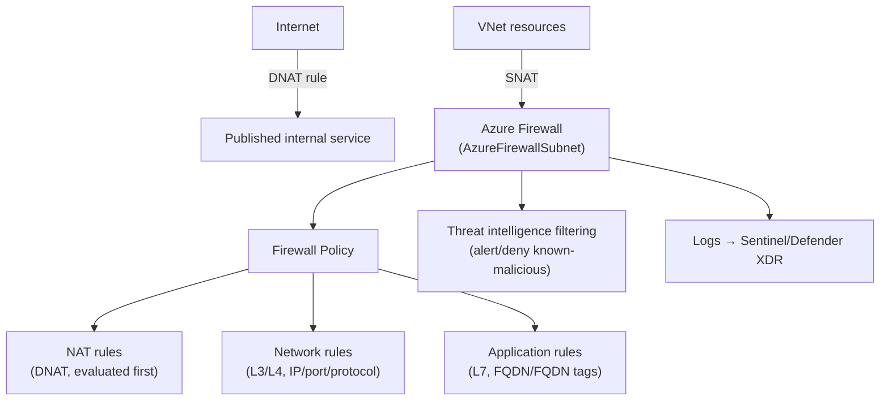
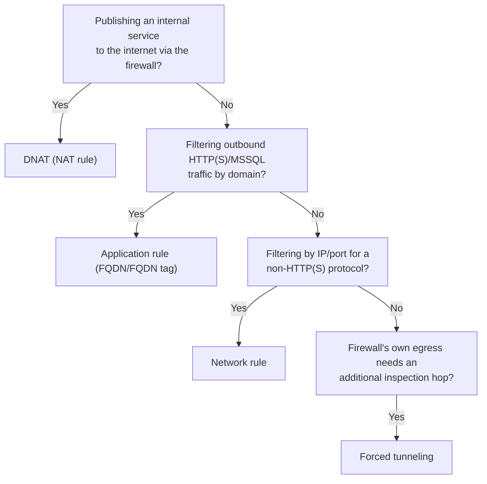

---
tags:
  - sc100
type: cheat-sheet
domain:
  - infrastructure
---

# Azure Firewall

Managed, stateful, highly-available L3–L7 PaaS firewall deployed in its own dedicated subnet. The *when to use it vs. NSG/WAF/NVA* decisions are already covered in [[Securing IaaS and PaaS Services]] and [[Network Security Architecture]]; this page is the rule/deployment mechanics.

## Core Capabilities

- **Deployment** — sits in a dedicated `AzureFirewallSubnet` (minimum /26); fully managed — no customer patching, built-in scaling and availability.
- **Rule types**, held inside a **Firewall Policy**:
  - **NAT rules (DNAT)** — translate and forward inbound traffic from the firewall's public IP to an internal resource (publishing an internal service to the internet through the firewall).
  - **Network rules** — L3/L4 filtering by IP, port, and protocol, for non-HTTP(S) traffic or where FQDN filtering isn't the goal.
  - **Application rules** — L7 filtering by **FQDN or FQDN tag**, for HTTP(S) and MSSQL traffic — the "allow only these domains" control.
  - **Processing order**: DNAT rules apply first (translating the destination), then network rules, then application rules — traffic is evaluated against the *post-translation* address for the later rule types.
- **SNAT** — outbound traffic from VNet resources is source-NAT'd to the firewall's public IP by default; ranges considered "private/internal" can be excluded from SNAT so their original source IP is preserved (relevant for on-prem-bound or private traffic visibility).
- **Firewall Policy** — the current, centralized way to manage rules (superseding older "classic" per-instance rules), supporting **hierarchical policies** (a parent policy with child/local overrides) — the object [[Network Security Architecture|Firewall Manager]] assigns across many hubs at scale; not repeated here.
- **Threat intelligence-based filtering** — a native, built-in option to alert or deny traffic matching Microsoft's threat intelligence feed of known-malicious IPs/domains — distinct from the broader Defender Threat Intelligence architecture in [[Threat Intelligence]] (that note covers *sourcing/operationalizing* TI across the platform; this is one firewall-native consumer of it).
- **SKU tiers** — Basic, Standard, Premium; Premium adds TLS inspection and IDPS — full tier trade-off and the NVA comparison already live in [[Network Security Architecture]].
- **Forced tunneling** — routes the firewall's own outbound traffic through an additional on-prem/NVA hop, for compliance chains requiring a further inspection point.

## Architecture



## Architecture Decisions



## Rule Types: Detailed Architecture Decision

### The three rule types side by side

| | **DNAT (NAT) rule** | **Network rule** | **Application rule** |
| --- | --- | --- | --- |
| **OSI layer** | L3/L4 + address translation | L3/L4 | **L7** |
| **Direction** | **Inbound** (internet/intranet → firewall public/private IP → internal resource) | **Any**: outbound, east-west (spoke↔spoke), hybrid (on-prem↔Azure), and allowing translated inbound flows | **Outbound / east-west only**. **Not applied to inbound connections.** |
| **Matches on** | Destination = **firewall's IP + port** → translated to **private IP + port** | Source IP/range/**IP group**/service tag, destination IP/**FQDN** (via DNS proxy), port, protocol (**TCP/UDP/ICMP/Any**) | Source IP/IP group → **target FQDN / FQDN tag / web category / URL** (URL needs Premium + TLS inspection) |
| **Protocols** | TCP/UDP | **Any IP protocol** (RDP, SQL, SSH, SMTP, custom ports like 6868) | **HTTP, HTTPS, MSSQL** only |
| **How it identifies the target** | IP + port | IP + port | **HTTP Host header / HTTPS SNI** |
| **Typical use** | Publish a private server (API, RDP jump, DB) on the firewall's public IP | "Allow server X to reach IP Y on TCP port Z", non-web protocols, any traffic where an IP is known | "Allow only *.windowsupdate.com / payments.contoso.com", web filtering by domain or category |
| **Exam trigger** | "access **from the internet**", "public IP", "translate", "publish" | "IP address", "port", "TCP/UDP", "non-HTTP", "RDP/SSH/SQL" | "**FQDN**", "domain", "URL", "web category", "outbound HTTP(S)" |

### Processing order (verified on Learn)

```
Threat intelligence filtering (if enabled): first, can block before any rule
  ↓
DNAT rules     ─┐
Network rules   ├─ always in this TYPE order, regardless of rule collection group / collection priority
Application rules ─┘   (within a type: parent policy first → RCG priority → RC priority, 100 = highest)
  ↓
Infrastructure rule collection (built-in platform FQDNs)
  ↓
Default DENY (nothing allowed until you allow it)
```

- **Rules are terminating.** First match wins and processing stops.
- **A network rule match stops processing**, so application rules are never evaluated for that flow (an "allow 443 to *" network rule silently bypasses all FQDN filtering).
- **A DNAT match translates *and allows*** the traffic, so it isn't re-checked by network rules (current Learn wording). Older guidance and exam explanations pair **DNAT + a network rule**, and the exam answer is still "DNAT rule **and** network rule" for inbound.
- **Application rules don't apply to inbound.** To filter inbound HTTP(S), put a **WAF** (App Gateway / Front Door) in front ([[Azure Web Application Firewall]]).
- **Stateful.** Return traffic for an allowed flow is allowed automatically, so no reverse rule is needed.
- Lock DNAT down with a **specific source IP/range**, never `*`.

### Decision tree

```
Which direction is the traffic initiated from?
│
├─ INBOUND from the internet (or intranet) to a PRIVATE resource behind the firewall
│     → DNAT rule (firewall public IP:port → private IP:port)
│       + network rule (exam pairing; restrict the SOURCE, e.g. contractor IP range)
│     Is it HTTP(S) that needs L7 inspection (OWASP, bots)?
│       → put App Gateway/Front Door + WAF in front: firewall app rules don't do inbound
│
├─ OUTBOUND (Azure → internet / partner)
│     Destination identified by FQDN / URL / web category over HTTP, HTTPS or MSSQL?
│       → Application rule (FQDN, FQDN tag e.g. WindowsUpdate, web category; URL = Premium)
│     Destination identified by IP + port, or a non-web protocol / custom port?
│       → Network rule
│     Non-HTTP protocol but you only know an FQDN?
│       → Network rule with FQDN destination (requires DNS proxy on the firewall)
│
├─ EAST-WEST (spoke ↔ spoke, Azure ↔ on-prem)
│     → Network rule (IP/port), or Application rule if HTTP(S)/MSSQL by FQDN
│
└─ Block known-malicious IPs/domains regardless of rules
      → Threat intelligence filtering (Alert / Alert and deny), evaluated first
```

### Exam Scenario (got wrong): e-commerce rule types

> CompanyA (e-commerce, expanding into manufacturing, EU/Asia, consolidating into Azure). Secure the e-commerce application. Which Azure Firewall rule type for each requirement?

| Requirement | Answer | Reasoning |
| --- | --- | --- |
| Customer access to the **API endpoint** | **DNAT rule + network rule** ✅ | **Inbound from the internet** to a private API. DNAT translates firewall public IP:443 → API private IP:443. The network rule allows the TCP 80/443 flow. |
| **Contractor** access to the **database server** | **DNAT rule + network rule** (I got this wrong) | Also **inbound from the internet**: contractors are *outside*. Translate firewall public IP → DB server private IP, and allow the port (the explanation uses **RDP 3389**). Restrict the source to the contractors' IPs. An application rule can't help: inbound, and not HTTP/S. |
| **Transaction server** → **credit card processor** | **Network rule** (I got this wrong) | **Outbound** from Azure to a partner over a **custom TCP port (6868)**, a non-HTTP protocol. **No DNAT** (nothing is being published inbound). **No application rule** (not HTTP/HTTPS/MSSQL and no FQDN given). |
| (when would it be an application rule?) | Application rule | If the processor were reached over **HTTPS by FQDN** (e.g. `process.payments.com`), filter it with an application rule. |

**How to answer every rule-type question:**
1. **Who starts the connection?** Outside → in = **DNAT** (+ network). Inside → out = **network** or **application**.
2. **Outbound: is it HTTP/HTTPS/MSSQL identified by a domain name?** Yes = **application**. No (IP, custom port, RDP/SSH/SQL/SMTP) = **network**.
3. **"Contractor"/"partner"/"customer" accessing something of yours = inbound.** "Your server" accessing a third party = outbound.

---

## Key Facts

- DNAT rules run *first* — a network or application rule written against the original (pre-translation) destination won't match; think in terms of the translated path.
- SNAT applies by default to all outbound VNet traffic through the firewall; excluding private ranges from SNAT is an explicit configuration choice, not automatic.
- "Classic" per-instance rules still exist but Firewall Policy is the current recommendation — a design still describing classic rules for a new deployment is describing the outdated pattern.

## Exam Notes

- "Publish an internal web server to the internet through the firewall's public IP" → a DNAT rule, not a network rule alone.
- "Restrict outbound traffic to a specific set of allowed domains" → an application rule (FQDN filtering), not a network rule.
- "Filter a non-web protocol by IP and port" → a network rule.
- "Internet users/contractors reach a private server" → **DNAT + network rule**. "Your server reaches a partner on a custom TCP port" → **network rule** only.
- An "allow 443 to any" **network rule** bypasses every FQDN application rule (network rules are evaluated first and are terminating).
- "Filter **inbound** HTTP(S) by URL/OWASP" → **WAF**, not a firewall application rule (application rules don't apply inbound).
- SKU tier selection (Basic/Standard/Premium), Firewall Manager centralization, and the NVA trade-off are covered in [[Network Security Architecture]] — this page assumes that decision is already made.

## Comparison

| Compare | Difference |
| --- | --- |
| NAT rule vs. network rule vs. application rule | NAT (DNAT): translates and forwards inbound traffic to an internal resource. Network: L3/L4 IP/port/protocol filtering. Application: L7 FQDN/FQDN-tag filtering for HTTP(S)/MSSQL. Different OSI layer and traffic direction each is built for. |
| Classic rules vs. Firewall Policy | Classic rules are configured per firewall instance directly. Firewall Policy is a standalone, reusable object supporting hierarchical parent/child policies — the object Firewall Manager assigns across multiple firewalls/hubs. Policy is the current recommendation. |
| Azure Firewall vs. Azure Firewall Premium | Full trade-off in [[Network Security Architecture]] — Premium adds TLS inspection and IDPS, closing gaps that otherwise required a third-party NVA. Not repeated here. |
| Azure Firewall vs. NSG | Full comparison in [[Securing IaaS and PaaS Services]] — centralized, stateful, FQDN-aware policy vs. free subnet/NIC segmentation. Not repeated here. |

## AZ-500 Review

AZ-500 already covers deploying Azure Firewall, configuring NAT/network/application rules, and basic policy at the resource level — this page's mechanics are assumed knowledge. SC-100's additions (SKU/Premium tier decision, Firewall Manager centralization across hubs, the NVA trade-off) live in [[Network Security Architecture]], not on this page.

## Keywords

- AzureFirewallSubnet
- DNAT (NAT rules) vs. network rules vs. application rules
- FQDN / FQDN tags
- SNAT, private range exclusion
- Firewall Policy, hierarchical (parent/child) policy
- Threat intelligence-based filtering
- Forced tunneling

## Related

- [[Network Security Architecture]]
- [[Securing IaaS and PaaS Services]]
- [[Network Security Group]]
- [[Azure Landing Zones]]
- [[Threat Intelligence]]
- [[Zero Trust]]
- [[Azure Web Application Firewall]] — inbound HTTP(S) L7 filtering that firewall application rules can't do
- [[Front Door and Application Gateway]]
- [[Azure Bastion]] — secure admin access instead of DNAT-publishing RDP/SSH
- [[Exam Objectives]]

## References

- [What is Azure Firewall?](https://learn.microsoft.com/en-us/azure/firewall/overview) — Microsoft Learn
- [Azure Firewall rule processing logic](https://learn.microsoft.com/en-us/azure/firewall/rule-processing) — Microsoft Learn
- [Azure Firewall Policy overview](https://learn.microsoft.com/en-us/azure/firewall-manager/policy-overview) — Microsoft Learn
- [Azure Firewall Policy rule sets](https://learn.microsoft.com/en-us/azure/firewall/policy-rule-sets) — Microsoft Learn
- [Filter inbound traffic with Azure Firewall DNAT](https://learn.microsoft.com/en-us/azure/firewall/tutorial-firewall-dnat) — Microsoft Learn
