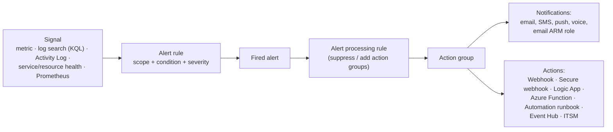

---
tags:
  - sc100
type: service
domain:
  - ops-identity-compliance
aliases:
  - Action Groups
  - Action Group
  - Azure Monitor webhooks
  - Webhooks
  - Webhook
  - Azure Monitor alerts
  - Alert processing rules
status: needs-verification
---

# Azure Monitor Alerts and Action Groups

## Purpose

Azure Monitor's alerting pipeline. An **alert rule** detects a condition in metrics/logs/Activity Log and calls an **action group**, which notifies people or calls automation. A **webhook** is one action type: an HTTP POST of the alert payload to a URL.

---

## Why Architects Choose It

- **Operational and platform alerting** (CPU, failed requests, resource deleted, service health, a KQL log search) with one reusable set of recipients and actions.
- **Action groups are reusable**: define "SecOps on-call" once and attach it to hundreds of alert rules.
- **Alert processing rules** suppress actions during maintenance windows, or add action groups to every alert in a scope, without editing each rule.
- **Common alert schema**: one JSON format for every alert type, so one Logic App or Function can handle all of them.

---

## Building Blocks

### Action types

| Action | What happens | Note |
| --- | --- | --- |
| **Webhook** | HTTP POST of the alert JSON to any URL | **No logic.** The receiver (that you build or buy) does the work. Basic auth/URL token only. |
| **Secure webhook** | Same, but authenticated with a **Microsoft Entra ID** token | Doesn't support basic auth. Use it when the endpoint must verify the caller. |
| **Logic App** | Runs a Logic App workflow | Use when the target expects another schema (e.g. Teams). The Logic App reshapes the payload. |
| **Azure Function** | Calls a function endpoint (key stored in the action) | Rotating the function key means re-creating the action |
| **Automation runbook** | Runs an [[Azure Automation]] PowerShell/Python runbook | Learn: the only action type that supports **Private Link / network security perimeter** |
| **Event Hub** | Publishes the alert to an [[Azure Event Hubs\|event hub]] stream | For a downstream consumer/SIEM |
| **ITSM** | Creates a ticket in a connected ITSM tool | ServiceNow etc. |

---

## Scope for SC-100

- **Defender for Cloud security alerts don't use action groups.** Their automation is **workflow automation → Logic Apps** ([[Defender for Cloud Workflow Automation]]), and their notification is **email notifications** (security contacts) in environment settings.
- **Sentinel incidents** use **automation rules → playbooks** ([[Playbooks and Automation Rules]]), not action groups.
- Action groups belong to **Azure Monitor alerts**: platform/operational signals, Activity Log alerts (e.g. "alert when someone deletes a Key Vault or changes an NSG"), service health, and log search alerts on a Log Analytics workspace.

---

## When to Use

- Alerting on Azure **platform/operational** conditions or **Activity Log** administrative operations.
- Notifying on-call teams by email/SMS/voice/push.
- Calling an external system that already exposes an HTTP endpoint (webhook / secure webhook).
- Suppressing notifications during planned maintenance (alert processing rule).

## When NOT to Use

- **Evaluating and remediating Defender for Cloud alerts** → workflow automation with [[Logic Apps]].
- **Responding to Sentinel incidents** → automation rules + playbooks.
- **Complex logic with minimal development** → a Logic App action, not a raw webhook that needs custom receiver code.
- **Bulk streaming of logs to a SIEM** → diagnostic settings → [[Azure Event Hubs]].

---

## Comparison

| Compare | Difference |
| --- | --- |
| **Webhook vs. secure webhook** | Unauthenticated (or URL token/basic) POST vs. Entra ID-authenticated POST |
| **Webhook vs. Logic App action** | Raw POST with no logic vs. a workflow that can parse, branch, approve and act through connectors |
| **Webhook vs. Event Hub action** | One call per alert to one endpoint vs. publishing into a buffered stream many consumers can read |
| **Alert rule vs. alert processing rule** | *When* to fire vs. *what to do* (or suppress) with fired alerts across a scope |
| **Action group vs. Sentinel automation rule** | Azure Monitor alert actions vs. Sentinel incident triage/orchestration |
| **Azure Monitor alert vs. Defender for Cloud security alert** | Platform/metric/log condition you define vs. threat detection by a Defender plan |

---

## AZ-500 Overlap

AZ-500 covers creating alert rules, action groups and Activity Log alerts for security operations. That's assumed.

## What's New in SC-100

- Knowing **which product's automation pipeline** a scenario belongs to: Azure Monitor (action groups), Defender for Cloud (workflow automation) or Sentinel (automation rules + playbooks).
- Treating a **webhook as a notification mechanism, not a solution**. If the requirement is to evaluate/remediate with low effort, the logic must live in a Logic App.

---

## Exam Tips

- "Webhook" = HTTP callback. If the stem needs **remediation logic**, a webhook alone is wrong.
- "Defender for Cloud alerts → automate response" → **Logic Apps**, not Azure Monitor webhooks.
- "Webhook endpoint must authenticate the caller with Entra ID" → **secure webhook**.
- "Silence alerts during a maintenance window" → **alert processing rule**.
- "Alert when someone deletes a resource / changes a policy assignment" → **Activity Log alert** + action group.

## Common Exam Confusion

- **Azure Monitor alerts vs. Defender for Cloud alerts vs. Sentinel incidents**: three products, three automation mechanisms.
- **Webhook vs. Logic App**: a webhook is a *call*, a Logic App is a *workflow*. Logic Apps can also be the *receiver* of a webhook (HTTP request trigger).

---

## Keywords

- Alert rule, action group, alert processing rule
- Webhook, secure webhook, common alert schema
- Logic App / Azure Function / Automation runbook / Event Hub / ITSM action
- Metric alert, log search alert, Activity Log alert, service health alert
- Email ARM role, SMS, voice, push notification

---

## Related Services

- [[Azure Security Logging]]
- [[Defender for Cloud Workflow Automation]]
- [[Logic Apps]]
- [[Azure Functions]]
- [[Azure Automation]]
- [[Azure Event Hubs]]
- [[Microsoft Defender for Cloud]]
- [[Microsoft Sentinel]]
- [[Playbooks and Automation Rules]]
- [[Security Operations]]
- [[Entra ID]]: secure webhook authentication

---

## References

- [Action groups](https://learn.microsoft.com/en-us/azure/azure-monitor/alerts/action-groups) — Microsoft Learn
- [Alert processing rules](https://learn.microsoft.com/en-us/azure/azure-monitor/alerts/alerts-processing-rules) — Microsoft Learn
- [Common alert schema](https://learn.microsoft.com/en-us/azure/azure-monitor/alerts/alerts-common-schema) — Microsoft Learn

---

## Verification Flag

- "Automation runbook is the only action type that supports Private Link / network security perimeter" comes from a search summary of the Action groups page, not a full read. Re-check it on the live page.
- "Defender for Cloud security alerts don't use action groups" reflects the documented automation path (workflow automation + email notifications). Security alerts also land in the Activity Log, so an Activity Log alert on them may be possible. Confirm before treating it as absolute.
