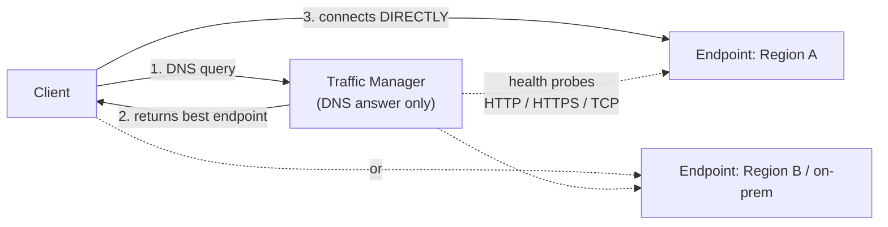

---
tags:
  - sc100
type: service
domain:
  - infrastructure
aliases:
  - Traffic Manager
status: needs-verification
---

# Azure Traffic Manager

> **In one line:** Traffic Manager is a **DNS-based global router**. It answers a DNS query with the address of the healthiest or closest endpoint, and then steps out of the way.
>
> **Remember:** it's **DNS only**. It isn't a proxy, so it has no WAF, no TLS termination and no caching. Traffic never flows *through* it.

---

## Purpose

Distributes client traffic across **global** endpoints (Azure regions, other clouds, on-prem) by returning different DNS answers based on a routing method and endpoint health.

---

## How It Works

1. A client resolves `app.contoso.com`, which is a CNAME to `contoso.trafficmanager.net`.
2. Traffic Manager picks an endpoint using the **routing method** and **health probes**.
3. It returns that endpoint's DNS name or IP.
4. The client connects **directly** to the endpoint. Traffic Manager never sees the traffic.



**Failover is not instant.** Clients and resolvers cache the DNS answer for the **TTL**, so failover time ≈ probe detection time + DNS TTL.

---

## Routing Methods

| Method | Picks the endpoint by… | Use for |
| --- | --- | --- |
| **Priority** | Primary first, backup only if primary is unhealthy | **Active/passive DR failover** |
| **Weighted** | Weight ratio | Canary / blue-green / gradual migration, spread load |
| **Performance** | Lowest network latency from the user's DNS resolver | Global users → **closest region** |
| **Geographic** | User's geographic location (country/region) | **Data sovereignty**, localized content, regulatory routing |
| **Multivalue** | Returns several healthy IPs at once | Client retries across multiple IPs (external IPv4/IPv6 endpoints only) |
| **Subnet** | Client IP range → specific endpoint | Route specific networks/offices to specific endpoints |

- **Nested profiles** combine methods, e.g. Performance at the top with Weighted or Priority per region inside.
- **Geographic routing doesn't fail over to another region automatically.** For high availability, map each region to a **nested profile** with several endpoints.

### Endpoint types

| Type | What |
| --- | --- |
| **Azure endpoints** | Azure services with a public endpoint (public IP, App Service, etc.) |
| **External endpoints** | Any IPv4/IPv6/FQDN outside Azure: **on-prem or another cloud** |
| **Nested endpoints** | A child Traffic Manager profile |

---

## Why Architects Choose It

- **Global routing for non-HTTP(S) workloads** (TCP/UDP-based apps, gaming, custom protocols). [[Front Door and Application Gateway|Front Door]] only handles HTTP(S).
- **Hybrid / multicloud failover**: external endpoints let it route between Azure, on-prem and other clouds.
- **DR at the DNS layer**: Priority routing plus [[Azure Site Recovery]] is the classic active/passive regional DR pattern for VM workloads.
- **Geographic routing** for data-residency requirements: EU users go to the EU endpoint.
- Cheap, simple and protocol-agnostic. The application path keeps whatever security stack the endpoint already has.

---

## When to Use

- Global distribution or failover for **non-HTTP(S)** apps.
- **Active/passive** regional DR (Priority).
- Route users to the **nearest region** when Layer 7 features aren't needed (Performance).
- **Country-based routing** for sovereignty or localized content (Geographic).
- Endpoints span **Azure + on-prem + other clouds**.
- Gradual migration or canary releases between environments (Weighted).

---

## When NOT to Use

- **HTTP(S) web apps needing WAF, TLS offload, caching, path-based routing or fast failover** → **Front Door** (global) / **Application Gateway** (regional).
- **Security control** of any kind. It doesn't inspect, filter or block traffic. Pair endpoints with [[Azure Web Application Firewall|WAF]], [[DDoS Protection]] and [[Network Security Group|NSGs]].
- **Instant failover** requirements. DNS caching delays it. Use Front Door (HTTP) or the cross-region (global) tier of [[Azure Load Balancer]] (TCP/UDP, static anycast IP, no DNS TTL).
- **Fully private** endpoints with no public reachability. Health probes come from the internet.
- **Load balancing inside one region** → [[Azure Load Balancer]] (L4) or Application Gateway (L7).
- **Strict geo-enforcement** for compliance. Geographic routing uses the DNS resolver's location and is a routing hint, not an access control. Use [[Conditional Access]] named locations or WAF geo-filtering to actually block.

---

## Choosing a Load Balancer: the Decision Table

| | **Global** | **Regional** |
| --- | --- | --- |
| **HTTP(S), Layer 7** | **Front Door** (WAF, caching, TLS offload, Anycast) | **Application Gateway** (WAF, VNet) |
| **Non-HTTP, Layer 4 / DNS** | **Traffic Manager** (DNS) or cross-region **Load Balancer** | **Azure Load Balancer** |

```
Is it HTTP(S)?
  ├─ Yes → Global? → Front Door   |  Regional? → Application Gateway
  └─ No  → Global? → Traffic Manager (DNS) / cross-region Load Balancer
           Regional? → Azure Load Balancer
Need WAF / OWASP?          → never Traffic Manager (Front Door or App Gateway + WAF)
"DNS-based"                 → Traffic Manager, always
On-prem + Azure failover    → Traffic Manager external endpoints (Front Door also supports any public origin for HTTP)
```

---

## Security and Operations Notes

- **Probes:** HTTP/HTTPS/TCP. Defaults: 30-second interval (10-second "fast" option costs extra), 3 tolerated failures, HTTP 200 expected.
- **NSGs / firewalls must allow probes** from the **`AzureTrafficManager` service tag**, or healthy endpoints get marked degraded.
- Endpoints stay **publicly exposed**. Traffic Manager hides nothing. Protect each endpoint (WAF, DDoS Protection, NSG).
- **HTTPS probes don't validate certificates.** The probe passes even with an invalid cert.
- **Traffic View** and **Real User Measurements** show where users come from and the latency they experience.
- Runs on Azure's global DNS, so it has **no single region** of its own to fail.

---

## Exam Tips

- **"DNS-based"** in the stem → **Traffic Manager**.
- **"Non-HTTP / TCP / UDP" + global** → Traffic Manager (or cross-region Load Balancer), never Front Door.
- **"HTTP(S) + WAF / SSL offload / caching / URL path" + global** → Front Door, never Traffic Manager.
- **"Failover to secondary region if primary fails"** → **Priority** routing.
- **"Users go to the lowest-latency region"** → **Performance** routing.
- **"EU users must be served from EU endpoints"** → **Geographic** routing.
- **"Send 10% of traffic to the new version"** → **Weighted** routing.
- **"Specific office IP ranges go to a specific endpoint"** → **Subnet** routing.
- **"Fail over VMs to another region with Site Recovery and redirect users"** → Site Recovery + Traffic Manager **Priority**.
- **"Fastest failover"** → not Traffic Manager, because of DNS TTL caching.

---

## AZ-500 Overlap

- AZ-500 covered Front Door, Application Gateway and WAF as security controls. Traffic Manager is mostly AZ-104 territory.
- What you know: NSGs, service tags, DDoS Protection, WAF placement. All of these protect the **endpoints** behind Traffic Manager.

---

## What's New in SC-100

- Treat Traffic Manager as an **availability / resiliency** building block, not a security control. Security comes from what's at each endpoint.
- Choose between global routers by **protocol (HTTP vs. not)** and **layer (DNS vs. L7 proxy)**.
- **BCDR design**: Priority routing plus Site Recovery for regional failover. See [[Ransomware Resiliency and BCDR]] and [[Azure Well-Architected Framework (WAF)]] reliability.
- **Data residency**: Geographic routing helps, but it isn't enforcement.

---

## Common Exam Confusion

| Compare | Difference |
| --- | --- |
| **Traffic Manager vs. Front Door** | DNS answer only, any protocol, no data path vs. Layer 7 HTTP(S) reverse proxy at the edge with WAF, caching, TLS offload and near-instant failover. Web app + security → Front Door. |
| **Traffic Manager vs. Application Gateway** | Global DNS routing between regions vs. **regional** L7 load balancer inside a VNet. Often layered: TM/Front Door → App Gateway per region. |
| **Traffic Manager vs. Azure Load Balancer** | Global, DNS vs. regional (or cross-region) **L4** pass-through using an IP. Load Balancer sits in the data path; Traffic Manager doesn't. |
| **Traffic Manager vs. cross-region Load Balancer** | Both global and non-HTTP. Traffic Manager = DNS (TTL-delayed failover, supports external/on-prem endpoints). Cross-region LB = static anycast IP, instant failover, **Azure regional load balancers only**. |
| **Traffic Manager vs. [[Azure CDN]]** | Routes users to an endpoint vs. **caches** content at the edge. |
| **Traffic Manager vs. Azure DNS** | Azure DNS **hosts** your zones/records. Traffic Manager **decides** which answer to give, using health and routing. |
| **Geographic vs. Performance routing** | Location-based by **policy** (sovereignty) vs. latency-based by **measurement** (speed). |
| **Priority vs. Weighted** | Primary/backup (failover) vs. split by ratio (distribution). |
| **Geographic routing vs. WAF geo-filter / Conditional Access location** | Routing hint vs. actual block/allow enforcement. |

---

## Keywords

- **DNS-based** load balancing / traffic routing, `trafficmanager.net`, CNAME, TTL
- Global, **non-HTTP**, TCP/UDP, protocol-agnostic
- Priority (failover, active/passive), Weighted (canary, blue-green), Performance (lowest latency), Geographic (data sovereignty), Multivalue, Subnet
- Azure / external / nested endpoints, on-prem and multicloud endpoints, nested profiles
- Endpoint monitoring, health probe, `AzureTrafficManager` service tag
- Azure Site Recovery regional failover, BCDR
- Traffic View, Real User Measurements
- **Wrong-answer flags:** WAF, SSL/TLS offload, caching, URL path routing, inspect traffic → Front Door / App Gateway

---

## Related Services

- [[Front Door and Application Gateway]]
- [[Azure Load Balancer]]
- [[Azure CDN]]
- [[Azure Web Application Firewall]]
- [[DDoS Protection]]
- [[Network Security Group]]
- [[Network Security Architecture]]
- [[Azure Site Recovery]]
- [[Ransomware Resiliency and BCDR]]
- [[Azure Well-Architected Framework (WAF)]]
- [[Architecture Decisions]]

---

## References

- [What is Traffic Manager?](https://learn.microsoft.com/en-us/azure/traffic-manager/traffic-manager-overview): Microsoft Learn
- [Traffic Manager routing methods](https://learn.microsoft.com/en-us/azure/traffic-manager/traffic-manager-routing-methods): Microsoft Learn
- [Traffic Manager endpoint monitoring](https://learn.microsoft.com/en-us/azure/traffic-manager/traffic-manager-monitoring): Microsoft Learn
- [Load-balancing options](https://learn.microsoft.com/en-us/azure/architecture/guide/technology-choices/load-balancing-overview): Azure Architecture Center
- [Set up Traffic Manager with Site Recovery](https://learn.microsoft.com/en-us/azure/site-recovery/concepts-traffic-manager-with-site-recovery): Microsoft Learn

---

## Verification Flag

- **Probe defaults** (30 s / 10 s fast, 3 tolerated failures) and the **HTTPS probes don't validate certificates** behaviour were written from memory. Re-check them on the endpoint monitoring page.
- **Geographic routing doesn't fail over automatically, so use nested profiles**: re-check the exact wording on the routing methods page.
