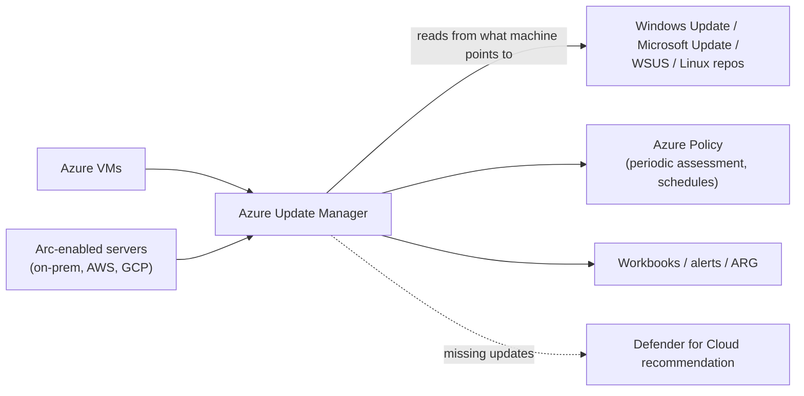

---
tags:
  - sc100
type: service
domain:
  - infrastructure
aliases:
  - AUM
  - Update Manager
  - Update Management
  - Azure Automation Update Management
  - Update Management Center
status: needs-verification
---

# Azure Update Manager

## Purpose

A native Azure service that assesses and installs Windows and Linux **server** updates across Azure VMs and [[Azure Arc]]-enabled machines (on-prem, AWS, GCP, VMware, SCVMM, Azure Local) from a single pane.

---

## Why Architects Choose It

- **Zero onboarding** on Azure VMs and Arc servers. **No dependency on Log Analytics or Azure Automation**, unlike its predecessor.
- **Per-resource Azure RBAC** and ARM-based operations, instead of access scoped to an Automation account/workspace.
- **[[Azure Policy]] support**: enforce periodic assessment and patch schedules at scale, and report compliance.
- Covers **Windows and Linux** in one tool. [[Microsoft Configuration Manager]] can't patch Linux.
- No license needed. It's the named SC-100 answer for "evaluate solutions for security updates" (see [[Security Updates and Patch Management]]).

---

## Capabilities

| Capability | Detail |
| --- | --- |
| Periodic assessment | Scans for missing updates every **24 hours** (plus on-demand) |
| Patching modes | One-time/on-demand, **scheduled** (maintenance configurations), **automatic VM guest patching**, **hotpatching** |
| Dynamic scoping | Target machines by subscription/RG/location/tags/OS at scale |
| Update sources | Whatever the machine points to: **Windows Update**, **Microsoft Update**, **WSUS**, Linux repos (apt/yum) |
| Third-party apps | Only if published to [[WSUS]] |
| Reporting | Azure Workbooks, alerts, Azure Resource Graph queries |
| Scope | Azure VMs (incl. SQL), Arc servers, VMware, SCVMM, Azure Local, cross-subscription |

---

## When to Use

- Server patching across Azure + hybrid + multicloud with one control plane.
- Replacing Azure Automation Update Management (retired).
- Modernizing server patching away from [[Microsoft Configuration Manager]].
- Enforcing patch compliance via Azure Policy.

## When NOT to Use

- **Client devices**: AUM doesn't support clients. Use [[Intune]] update rings / Windows Autopatch.
- On the **same servers ConfigMgr still patches**: running both on one set of servers isn't supported.
- If you need **phased deployments** or **orchestration groups** (maintenance sequencing): these are ConfigMgr features with no AUM equivalent.

---

## Architecture

---

## Legacy: Azure Automation Update Management + Configuration Manager

> **Retired 31 August 2024** (along with the Log Analytics/MMA agent). Replaced by Azure Update Manager. **Still appears in exam questions.**

**Old architecture:** Automation account + Log Analytics workspace with the Update Management solution + MMA agent on each machine.

**Integration prerequisites (legacy):**

1. **Update Management added to the Azure Automation account.**
2. The Windows servers managed by ConfigMgr **report to the Log Analytics workspace** that has Update Management enabled.
3. The integration was supported from ConfigMgr current branch 1606 onward.
4. **Windows agents must either be configured to communicate with a WSUS server, OR have access to Microsoft Update**, *if they don't receive security updates from Configuration Manager*.

**Two integration models (legacy):**

| Model | Who deploys updates |
| --- | --- |
| Keep managing updates in ConfigMgr | ConfigMgr deploys. Update Management reports, and can target ConfigMgr collections imported as computer groups. |
| Move update management to Update Management | Update Management deploys. Remove the ConfigMgr client's software-update role for those machines and point them at WSUS/Microsoft Update. |

### Exam scenario (got wrong)

> Hybrid infra; ConfigMgr manages PCs/servers/mobile. Update Management is in the Automation account and Log Analytics has Update Management enabled. **Security updates are NOT received from ConfigMgr. No WSUS exists.** What's the prerequisite for integrating?

| Option | Verdict | Why |
| --- | --- | --- |
| **Give the Windows Agent access to Microsoft Updates** | ✅ | Agent needs WSUS **or** Microsoft Update. There's no WSUS, so Microsoft Update is the only valid source. |
| Configure the Windows Agent to communicate with WSUS | ❌ | No WSUS server exists in the scenario. |
| Configure ConfigMgr to manage security updates | ❌ | The scenario says updates are *not* delivered by ConfigMgr, and Update Management is meant to take over. |
| Hybrid-join servers and devices | ❌ | Not a patching prerequisite. Hybrid join matters for Intune/Conditional Access. |

**Recall rule:** *Agent needs an update source → WSUS if it exists, otherwise Microsoft Update.*

### Modern equivalent: AUM + ConfigMgr co-existence

- **Disable Automatic Updates** on the machine (`NoAutoUpdate = 1` under `HKLM\SOFTWARE\Policies\Microsoft\Windows\WindowsUpdate\AU`).
- AUM can pull from **WSUS**: configure auto-approval rules, languages and disk space. Microsoft recommends a **new standalone WSUS** (own SUSDB) not tied to ConfigMgr.
- Keep publishing **third-party updates** to WSUS from ConfigMgr, and AUM installs them.
- Once AUM is enabled, use ConfigMgr **only for non-update capabilities**.

---

## Comparison

| Compare | Difference |
| --- | --- |
| AUM vs. Automation Update Management | Native, no Automation/Log Analytics dependency, per-resource RBAC, Policy support vs. retired agent-and-workspace solution. |
| AUM vs. [[Microsoft Configuration Manager]] | SaaS, Windows + Linux, flat (no site hierarchy), no phased deployment/orchestration groups, can't filter by classification for assessment (scans all metadata) vs. on-prem, Windows-only updates, hierarchy, phased deployments. |
| AUM vs. [[Intune]] | Servers vs. clients. |
| AUM vs. [[Azure Arc]] | Arc is the projection layer that makes non-Azure servers eligible. AUM is one capability on top of it. |
| AUM vs. Defender for Cloud | AUM *does* the patching. [[Defender for Cloud Recommendations]] *flag* missing updates as a posture finding. |

---

## AZ-500 Overlap

Enabling Update Management/Update Manager, creating schedules and reading compliance were AZ-500 configuration tasks.

## What's New in SC-100

- Choose AUM as a **hybrid/multicloud solution** vs. traditional tools.
- Know the **retirement** and the architecture shift (no Log Analytics/Automation).
- Know ConfigMgr co-existence rules: one patching authority per server.

---

## Exam Tips

- No WSUS, updates not via ConfigMgr → **Windows agent needs Microsoft Update access**.
- Non-Azure servers → **Arc first**, then AUM.
- "Doesn't require Log Analytics/Automation account" → AUM, not the legacy solution.
- "Linux + Windows servers, one tool" → AUM (ConfigMgr updates are Windows-only).
- "Third-party app patches via AUM" → publish to WSUS.

## Common Exam Confusion

- **WSUS option vs. Microsoft Update option**: read whether a WSUS server exists in the scenario.
- **"Update Management" vs. "Update Manager"**: retired vs. current service.
- **Automatic VM guest patching vs. hotpatching**: auto-apply critical/security updates vs. apply without reboot.

---

## Keywords

- Azure Update Manager, Update Management Center (old preview name)
- Azure Automation Update Management (retired 31 Aug 2024)
- Log Analytics workspace, MMA agent, Automation account (legacy)
- Periodic assessment (24h), maintenance configuration, dynamic scope
- Windows Agent → WSUS or Microsoft Update
- NoAutoUpdate registry key
- Co-existence with Configuration Manager

---

## Related Services

- [[Security Updates and Patch Management]]
- [[WSUS]]
- [[Microsoft Configuration Manager]]
- [[Azure Arc]]
- [[Azure Policy]]
- [[Intune]]
- [[Microsoft Defender for Cloud]]
- [[Defender for Cloud Recommendations]]
- [[Azure Resource Graph]]
- [[Ransomware Resiliency and BCDR]]
- [[Securing Server and Client Endpoints]]

---

## References

- [Azure Update Manager overview](https://learn.microsoft.com/en-us/azure/update-manager/overview) — Microsoft Learn
- [Patching guidance: Configuration Manager to Azure Update Manager](https://learn.microsoft.com/en-us/azure/update-manager/guidance-migration-azure) — Microsoft Learn
- [Evaluate solutions for security updates](https://learn.microsoft.com/en-us/training/modules/design-resiliency-strategy-common-cyberthreats-like-ransomware/5-security-updates) — Microsoft Learn

---

## Verification Flag

- The legacy "Integrate Update Management with Configuration Manager" Learn page now redirects to the AUM overview, so the legacy prerequisites above come from the retired doc (as remembered) and the exam explanation. They couldn't be re-read live.
- AUM pricing: free for Azure VMs. Arc-enabled servers are charged per server/month unless covered (e.g. Defender for Servers Plan 2). Verify current terms.
