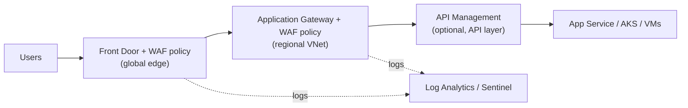

---
tags:
  - sc100
type: service
domain:
  - infrastructure
  - apps-data
aliases:
  - Azure WAF
  - Web Application Firewall
  - WAF policy
status: needs-verification
---

# Azure Web Application Firewall

## Purpose

A centralized **Layer 7 (HTTP/S)** filter that protects web apps from common exploits (SQL injection, XSS, OWASP Top 10) and bots. It's deployed as a **policy attached to a reverse proxy**, not as a standalone appliance.

---

## Why Architects Choose It

- **Patch once at the edge**: a WAF rule mitigates a known web vulnerability for every app behind it, instead of fixing each app's code.
- **Managed rule sets** maintained by Microsoft (OWASP-based), plus bot protection and custom rules.
- The architecture choice is **where the policy attaches**. The WAF engine is the same; the placement differs (see [[Front Door and Application Gateway]]).
- Logs go to Log Analytics / [[Microsoft Sentinel]], so it's part of the SOC.
- Not to be confused with the **Well-Architected Framework** ([[Azure Well-Architected Framework (WAF)]]): same acronym, unrelated.

---

## Where It Runs

| Host | Scope | Notes |
| --- | --- | --- |
| **Azure Front Door** (Standard/Premium, classic) | Global edge | Premium = managed rule sets + bot protection + Private Link to origin |
| **Application Gateway** (v2) | Regional, in VNet | Policy at **global / per-site (listener) / per-URI (path)** scope |
| Application Gateway for Containers | Regional, AKS ingress | Kubernetes-native |
| Azure CDN from Microsoft | Edge | WAF here is **preview** |

---

## Key Concepts

| Concept | Detail |
| --- | --- |
| **Detection vs. Prevention mode** | Log only vs. log **and block**. Start in Detection to tune false positives. |
| Managed rule sets | Default Rule Set (DRS 2.x) / OWASP Core Rule Set (CRS 3.x) |
| Anomaly scoring | Matches add to a score. Block when it crosses the threshold (DRS 2.x / CRS 3.x) |
| **Custom rules** | IP allow/deny, **geo-filtering**, **rate limiting**, header/URI match. Evaluated **before** managed rules. |
| Bot protection | Bot Manager rule set (good/bad/unknown bots) |
| Exclusions | Skip inspection of specific request attributes to fix false positives |
| Actions | Allow, Block, Log, Redirect, JS challenge |

---

## When to Use

- Internet-facing web apps/APIs that need OWASP Top 10 protection.
- Central virtual patching of known web vulnerabilities.
- Geo-blocking, rate limiting and bot mitigation at L7.
- In front of App Service, AKS ingress or VM web tiers.

## When NOT to Use

- L3/L4 volumetric attacks → [[DDoS Protection]].
- Network/egress filtering, FQDN rules, non-HTTP traffic → [[Azure Firewall]].
- API-contract concerns (authN, throttling per subscription key, versioning) → API Management ([[API Management and Security]]). Layer both.
- Subnet micro-segmentation → [[Network Security Group]].

---

## Architecture

---

## Comparison

| Compare | Difference |
| --- | --- |
| Azure WAF vs. [[Azure Firewall]] | L7 HTTP payload inspection for inbound web traffic vs. L3–L7 network firewall (east-west, egress, FQDN, threat intel, IDPS in Premium) |
| WAF on Front Door vs. on Application Gateway | Global edge, blocks attacks before they reach a region vs. regional/VNet, private backends, per-URI policy |
| Azure WAF vs. [[DDoS Protection]] | Application-layer exploits vs. network-layer volumetric floods (L7 DDoS can be mitigated by WAF rate limiting) |
| Azure WAF vs. API Management | Exploit payloads vs. API governance. Complementary. |
| Detection vs. Prevention mode | Log vs. block |
| Azure WAF vs. [[Azure Well-Architected Framework (WAF)\|Well-Architected Framework]] | Security service vs. architecture review framework |

---

## AZ-500 Overlap

AZ-500 covers creating WAF policies, modes, managed/custom rules and associating them with App Gateway or Front Door.

## What's New in SC-100

- Choose **placement** (edge vs. regional vs. layered) as a design decision.
- Position WAF within layered network security ([[Network Security Architecture]]) and [[Zero Trust]] application protection.
- Evaluate web workload security requirements: WAF + DDoS + Private Link to origin + APIM.

---

## Exam Tips

- "SQL injection / XSS / OWASP Top 10" → WAF.
- "Block traffic from specific countries at the edge" → WAF custom rule (geo-match) on Front Door.
- "Global app, stop attacks before they reach Azure regions" → WAF on **Front Door**.
- "Private backend in a VNet, per-path policy" → WAF on **Application Gateway**.
- "Test rules without blocking users" → **Detection mode**.

## Common Exam Confusion

- **WAF vs. Azure Firewall**: payload vs. network.
- **WAF (firewall) vs. WAF (Well-Architected)**: read the context.
- **Front Door Standard vs. Premium**: managed rule sets and bot protection need **Premium**.

---

## Keywords

- Web Application Firewall, WAF policy
- OWASP Top 10, SQL injection, cross-site scripting
- Default Rule Set (DRS), Core Rule Set (CRS), anomaly scoring
- Detection mode vs. Prevention mode
- Custom rules: geo-filter, rate limit, IP restriction
- Bot Manager rule set
- Front Door Premium, Application Gateway v2, per-site/per-URI policy

---

## Related Services

- [[Front Door and Application Gateway]]
- [[Network Security Architecture]]
- [[Azure Firewall]]
- [[DDoS Protection]]
- [[API Management and Security]]
- [[Securing IaaS and PaaS Services]]
- [[Microsoft Sentinel]]
- [[Zero Trust]]
- [[Threat Modeling]]
- [[Azure Well-Architected Framework (WAF)]]

---

## References

- [Introduction to Azure Web Application Firewall](https://learn.microsoft.com/en-us/azure/web-application-firewall/overview) — Microsoft Learn
- [WAF on Application Gateway](https://learn.microsoft.com/en-us/azure/web-application-firewall/ag/ag-overview) — Microsoft Learn
- [WAF on Azure Front Door](https://learn.microsoft.com/en-us/azure/web-application-firewall/afds/afds-overview) — Microsoft Learn

---

## Verification Flag

Rule set version names (DRS 2.1/2.2, CRS 3.2) and the Front Door Standard vs. Premium WAF feature split come from general product knowledge, not the overview page fetched. Re-check against the per-host WAF docs.
