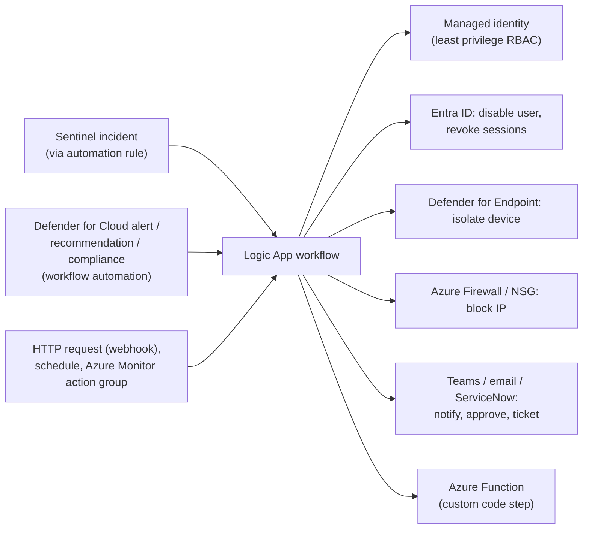

---
tags:
  - sc100
type: service
domain:
  - ops-identity-compliance
aliases:
  - Azure Logic Apps
  - Logic App
status: needs-verification
---

# Azure Logic Apps

## Purpose

Serverless, **low-code workflow engine**. Triggers and prebuilt connectors chain into automated workflows without custom code. It's the automation layer behind [[Microsoft Sentinel]] playbooks and [[Defender for Cloud Workflow Automation]].

---

## Why Architects Choose It

- **Minimal development effort**: a visual designer plus 1,000+ connectors (Azure, Microsoft 365, Entra ID, Defender, ServiceNow, Slack, on-prem via data gateway). Security teams build automation without developers.
- **Native security triggers**: Microsoft Sentinel (incident/alert/entity) and Defender for Cloud (alert/recommendation/regulatory compliance) connectors start a run directly. Nobody has to poll or build a listener.
- **Human-in-the-loop**: approval actions (Teams adaptive cards, approval emails) gate high-impact remediation.
- **Managed identity**: authenticates to Azure resources without stored credentials ([[Identity and Access Management (IAM)]]).

---

## Core Capabilities

- **Triggers**: start a run (schedule, HTTP request/webhook, event, Sentinel incident, Defender for Cloud alert)
- **Connectors / actions**: prebuilt operations against Microsoft and third-party services
- **Control flow**: conditions, switches, loops, scopes, retries, parallel branches
- **Run history**: every run's inputs/outputs are auditable. Use **secure inputs/outputs** to keep secrets and tokens out of the history.

### Hosting models

| | **Consumption** | **Standard** |
| --- | --- | --- |
| Tenancy | Multi-tenant | Single-tenant (runs on Functions-based runtime) |
| Billing | **Pay per action/connector execution** | Hosting plan (predictable) |
| Workflows | One workflow per Logic App, stateful | Many workflows per app, **stateful and stateless** |
| Networking | No VNet integration | **VNet integration, private endpoints** |
| Defender for Cloud workflow automation | ✅ Supported | Not listed on Learn (see Verification Flag) |
| Sentinel playbooks | ✅ | ✅ (use when the playbook must reach private resources) |

---

## When to Use

- Automated **evaluate-and-remediate** of Defender for Cloud alerts/recommendations ([[Defender for Cloud Workflow Automation]]).
- **Sentinel playbooks**: enrichment, notification, cross-system response ([[Playbooks and Automation Rules]]).
- Integrating SaaS/ITSM/chat systems with **minimal code**.
- Reshaping an Azure Monitor alert payload for a target system (Logic App action in an action group, see [[Azure Monitor Alerts and Action Groups]]).

## When NOT to Use

- **Heavy compute, complex parsing or custom algorithms** → [[Azure Functions]] (a Logic App can call one).
- **High-volume event streaming** → [[Azure Event Hubs]].
- **PowerShell scripts inside hybrid/on-prem servers** → [[Azure Automation]] (Hybrid Runbook Worker).
- **Triage-only Sentinel changes** (severity, owner, close) → automation rules, free and native.
- **Native response already in Defender XDR** (isolate device, contain user) → AIR / attack disruption ([[Microsoft Defender XDR]]).
- **Reaching private resources on Consumption** → Standard plan instead.

---

## Architecture

---

## Comparison

| Compare | Difference |
| --- | --- |
| **Logic Apps vs. [[Azure Functions]]** | **Designer + connectors (low-code)** vs. **code**. Both serverless. Pick Logic Apps for orchestration with "minimal development effort". Pick Functions for custom compute. They're often combined: Logic App orchestrates, Function computes. |
| **Logic Apps vs. [[Azure Automation]]** | Connector workflows triggered by events vs. PowerShell/Python runbooks, incl. on-prem via Hybrid Runbook Worker |
| **Logic Apps vs. [[Azure Event Hubs]]** | Acts on events vs. streams/buffers them for consumers |
| **Logic Apps vs. webhook** | A workflow with logic vs. a single HTTP POST. A Logic App can *receive* a webhook through its HTTP trigger. |
| **Logic Apps vs. [[Power Automate]]** | Same designer lineage. Logic Apps is the Azure resource (ARM, RBAC, managed identity, VNet) for IT/integration. Power Automate is the Microsoft 365/Power Platform citizen-developer tool. Security automation answers are **Logic Apps**. |
| **Consumption vs. Standard** | Pay-per-action, multi-tenant, no VNet vs. single-tenant plan with VNet integration, private endpoints and stateless workflows |
| **Sentinel playbook vs. Defender for Cloud workflow automation** | Same service (Logic Apps), different trigger connector and different invoker (automation rule vs. workflow automation) |

---

## AZ-500 Overlap

AZ-500 covers building a Logic App playbook, Defender for Cloud workflow automation and managed identity for Logic Apps. That's assumed.

## What's New in SC-100

- Picking Logic Apps **as an architecture decision** over Functions/Event Hubs/webhooks/Automation from requirement words ("minimize development effort", "workflow automation", "orchestrate").
- Choosing **Standard** when the workflow must reach private endpoints. This is a Zero Trust network decision.
- Designing **identity** (managed identity, least privilege), **approval gates** and **secure run history** into SOAR workflows.

---

## Exam Tips

- "Workflow automation" in Defender for Cloud → **Logic Apps**, always.
- "Automate response / minimize development effort / low-code / connectors" → **Logic Apps** over Functions.
- In a security context, a Logic App triggered by a Sentinel incident **is** a playbook: same service, different name.
- Workflow must reach a private VNet resource → **Standard** plan, not Consumption.
- Sentinel needs **Microsoft Sentinel Automation Contributor** on the playbook's resource group to run it. That's a common "playbook doesn't fire" answer.
- Creating/editing a Logic App needs **Logic App Contributor**. Only running one needs **Logic App Operator**.
- Ties into "design a solution for workload identities to access Azure resources": the Logic App managed identity is a concrete example.

## Common Exam Confusion

- **Logic Apps vs. Functions**: low-code workflow vs. code. Both are "serverless".
- **Playbook vs. workflow automation vs. runbook**: Sentinel Logic App vs. Defender for Cloud Logic App vs. Azure Automation script.
- **Logic Apps vs. Power Automate**: Azure integration service vs. Power Platform tool.
- **Not every SOC automation needs a Logic App**: automation rules handle triage natively, and Defender XDR responds natively. Choose the layer using [[Playbooks and Automation Rules]].

---

## Keywords

- Low-code, designer, connectors, triggers, actions
- Consumption vs. Standard, stateful/stateless, VNet integration
- Playbook, workflow automation, Trigger logic app
- Managed identity, secure inputs/outputs
- Logic App Contributor, Logic App Operator, Microsoft Sentinel Automation Contributor
- Approval / adaptive card, HTTP request trigger

---

## Related Services

- [[Microsoft Sentinel]]
- [[Playbooks and Automation Rules]]
- [[Sentinel Workbooks, Playbooks and Notebooks]]
- [[Defender for Cloud Workflow Automation]]
- [[Microsoft Defender for Cloud]]
- [[Azure Functions]]
- [[Azure Automation]]
- [[Azure Event Hubs]]
- [[Azure Monitor Alerts and Action Groups]]
- [[Security Operations]]
- [[Identity and Access Management (IAM)]]
- [[Zero Trust]]
- [[Private Link]]
- [[Exam Objectives]]

---

## References

- [Logic Apps overview](https://learn.microsoft.com/en-us/azure/logic-apps/logic-apps-overview) — Microsoft Learn
- [Single-tenant vs. multitenant Logic Apps](https://learn.microsoft.com/en-us/azure/logic-apps/single-tenant-overview-compare) — Microsoft Learn
- [Defender for Cloud workflow automation](https://learn.microsoft.com/en-us/azure/defender-for-cloud/workflow-automations) — Microsoft Learn

---

## Verification Flag

- Defender for Cloud's workflow automation page says it "can trigger consumption logic apps" and doesn't mention Standard. Re-check whether Standard is now supported before relying on "Consumption only".
- The Logic Apps vs. Power Automate positioning is from training knowledge, not a Learn page read this session.
