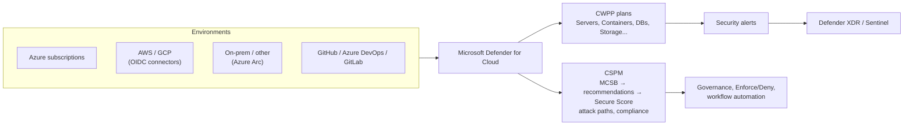

---
tags:
  - sc100
type: service
domain:
  - infrastructure
aliases:
  - Defender for Cloud
  - MDC
  - Azure Security Center
  - ASC
  - CNAPP
status: needs-verification
---

# Microsoft Defender for Cloud

## Purpose

Microsoft's **CNAPP** (Cloud-Native Application Protection Platform). It assesses posture (CSPM) and protects running workloads (CWPP) across Azure, AWS, GCP and on-prem (via [[Azure Arc]]), and adds DevOps, data and permissions signals.

> Hub note. The details live in the linked notes; this page is the map.

---

## Why Architects Choose It

- **One platform for multicloud posture and workload protection**: Azure natively, AWS/GCP via connectors, on-prem via Arc.
- **Posture built on [[Azure Policy]]**: standards (MCSB by default) → recommendations → Secure Score. Governance and scoring use the same engine.
- **Risk-based prioritization**: the Cloud Security Graph correlates misconfigurations, vulnerabilities, exposure, identities and sensitive data into **attack paths**, instead of a flat list.
- **SOC integration**: alerts flow into [[Microsoft Defender XDR]] and [[Microsoft Sentinel]]. Defender for Cloud is also surfaced in the **Defender portal** (Exposure Management / Cloud infrastructure).
- **Billed on the Azure subscription**, per protected resource. It isn't part of any Microsoft 365 license (see [[Microsoft 365 Licensing]]).

---

## Capability Map

| Pillar | What it does | Deep-dive note |
| --- | --- | --- |
| **CSPM** (Foundational free / Defender CSPM paid) | Secure Score, MCSB, recommendations, attack paths, Cloud Security Explorer, agentless scanning | [[Security Posture Assessments]] |
| Secure Score | Weighted score from recommendations | [[Secure Score Mechanics]] |
| Recommendations | Findings: MITRE ATT&CK mapping, Quick fix, exempt, governance | [[Defender for Cloud Recommendations]] |
| Regulatory compliance | Named standards (PCI, ISO, NIST, custom) | [[Assigning Regulatory Compliance Standards]] |
| **CWPP** (workload plans) | Servers P1/P2, Containers, SQL/Databases, Storage, App Service, Key Vault, Resource Manager, APIs, AI services | [[Cloud Workload Protection (CWPP)]] |
| CSPM + CWPP together | Cloud Security Graph, attack paths, EASM | [[CSPM and CWPP]] |
| **DSPM** | Sensitive data discovery and exposure in cloud stores | [[Data Security Posture Management (DSPM)]] |
| **DevOps security** | GitHub / Azure DevOps / GitLab connectors: IaC, secrets and code scanning, code-to-cloud mapping | [[DevOps Security]] |
| Containers | Image scanning, runtime, Kubernetes posture | [[Container and Kubernetes Security]] |
| **CIEM** | Over-permissioned identities across clouds | [[Securing Privileged Access]] |
| EASM | Unknown internet-facing assets | [[External Attack Surface Management (EASM)]] |
| AI security posture | AI-SPM, threat protection for AI services | [[AI and Copilot Security Architecture]] |
| Automation | REST API, workflow automation, continuous export | [[Defender for Cloud REST API]], [[Logic Apps]] |
| Querying | KQL over posture data | [[Azure Resource Graph]] |
| Hybrid onboarding | Non-Azure servers/K8s/SQL | [[Azure Arc]] |

---

## Key Server-Side Features (Defender for Servers)

| Feature | Plan |
| --- | --- |
| Defender for Endpoint integration (EDR) | P1 + P2 |
| **JIT VM access** (management ports) | **P2** |
| File integrity monitoring | P2 |
| Agentless vulnerability/secret/malware scanning | P2 (also Defender CSPM) |
| Free data ingestion allowance to Log Analytics | P2 |
| Update recommendations (missing OS patches) | Surfaced as recommendations; patch with [[Azure Update Manager]] |

---

## When to Use

- Posture management and compliance across Azure + AWS + GCP + on-prem.
- Runtime protection of IaaS/PaaS/containers/data services.
- Prioritizing cloud risk by attack path and exposure.
- Feeding cloud alerts into a unified SOC (XDR/Sentinel).

## When NOT to Use

- Users, endpoints, email, SaaS apps → [[Microsoft Defender XDR]] products (Endpoint, Office 365, Identity, Cloud Apps).
- SIEM/log correlation across all sources → [[Microsoft Sentinel]].
- Enforcing configuration at deploy time on its own → [[Azure Policy]] (Deny effect). Defender for Cloud *reports* on it and can offer Enforce/Deny.
- Microsoft 365 tenant posture → Microsoft Secure Score ([[Security Scoring Dashboards]]).

---

## Architecture



---

## Architecture Decisions

```
Need cloud posture / Secure Score / MCSB?
  ↓
Foundational CSPM (free) → Defender CSPM for attack paths, agentless, DSPM, compliance

Need runtime protection for a workload?
  ↓
Enable the matching CWPP plan (Servers P2 for EDR + JIT + FIM)

AWS / GCP?          → multicloud connector
On-prem servers?    → Azure Arc first

Need to know how a weakness could be exploited?
  ↓
Open the recommendation (MITRE ATT&CK tactics/techniques)

Need incidents correlated with endpoint/identity/email?
  ↓
Defender XDR / Sentinel
```

---

## Comparison

| Compare | Difference |
| --- | --- |
| Defender for Cloud vs. [[Microsoft Defender XDR]] | Cloud **resources** (Azure/AWS/GCP/servers/containers/PaaS) vs. **users, endpoints, email, identity, SaaS**. They share the Defender portal and incident queue. |
| Defender for Cloud vs. [[Microsoft Sentinel]] | CNAPP generating alerts vs. SIEM/SOAR correlating everything |
| Defender for Cloud vs. [[Azure Policy]] | Assessment, scoring and protection vs. the rule engine underneath (MCSB is an Azure Policy initiative) |
| Foundational CSPM vs. Defender CSPM | Free baseline vs. paid attack paths, agentless scanning, DSPM, compliance, governance (see [[Security Posture Assessments]]) |
| Recommendation vs. alert | Posture weakness vs. detected threat activity |
| Defender for Cloud Secure Score vs. Microsoft Secure Score | Azure/multicloud resource posture vs. M365 identity/app/device posture |
| Azure Security Center vs. Defender for Cloud | Old name (plus "Azure Defender" for the paid plans) vs. the current name |

---

## AZ-500 Overlap

AZ-500 covered enabling plans, reading Secure Score, remediating recommendations, JIT VM access, workflow automation and regulatory compliance at subscription level. That's assumed.

## What's New in SC-100

- Design Defender for Cloud as an **org-wide multicloud CNAPP**: connectors, Arc, management-group scope, plan selection per workload.
- **Prioritize by risk** (attack paths, Exposure Management), not by recommendation count.
- **Evaluate compliance** against named standards, and extend with custom standards/recommendations.
- Integrate with the unified SOC (Defender portal, XDR, Sentinel).
- Foundational CSPM becomes **opt-in for new Azure subscriptions from 27 Oct 2026** (see [[Security Posture Assessments]]).

---

## Exam Tips

- "Protect Azure VMs/SQL/storage" → Defender for Cloud plans. **Not** M365 E5.
- "Assess AWS/GCP" → connectors. "On-prem" → Arc first.
- "Attack paths / agentless scanning / DSPM" → **Defender CSPM** (paid).
- "JIT, FIM, EDR on servers" → **Defender for Servers Plan 2**.
- "MITRE tactics for a misconfiguration" → review the **recommendation**.
- "Prove compliance to PCI/ISO" → regulatory compliance dashboard, not Secure Score.

## Common Exam Confusion

- **Defender for Cloud vs. Defender XDR**: resources vs. users/endpoints/email/SaaS.
- **Secure Score (Defender for Cloud) vs. Microsoft Secure Score**: same name, different scope.
- **Recommendation vs. alert**, and **initiative vs. recommendation** (see [[Defender for Cloud Recommendations]]).
- **Servers Plan 1 vs. Plan 2**: P2 adds JIT, FIM, agentless scanning and the data ingestion benefit.

---

## Keywords

- CNAPP, CSPM, CWPP, DSPM, CIEM
- Foundational CSPM vs. Defender CSPM
- Secure Score, MCSB, regulatory compliance dashboard
- Recommendations vs. security alerts
- Attack path analysis, Cloud Security Explorer, Cloud Security Graph
- Defender for Servers P1/P2, JIT VM access, FIM
- Multicloud connectors, Azure Arc
- Workflow automation, continuous export
- Azure Security Center (old name)

---

## Related Services

- [[Security Posture Assessments]]
- [[Cloud Workload Protection (CWPP)]]
- [[CSPM and CWPP]]
- [[Defender for Cloud Recommendations]]
- [[Secure Score Mechanics]]
- [[Assigning Regulatory Compliance Standards]]
- [[Defender for Cloud REST API]]
- [[Microsoft Cloud Security Benchmark (MCSB)]]
- [[Azure Policy]]
- [[Azure Arc]]
- [[Azure Resource Graph]]
- [[Data Security Posture Management (DSPM)]]
- [[External Attack Surface Management (EASM)]]
- [[DevOps Security]]
- [[Container and Kubernetes Security]]
- [[Microsoft Defender XDR]]
- [[Microsoft Sentinel]]
- [[Microsoft Defender]]
- [[Securing IaaS and PaaS Services]]
- [[Azure Update Manager]]
- [[Microsoft 365 Licensing]]

---

## References

- [What is Microsoft Defender for Cloud?](https://learn.microsoft.com/en-us/azure/defender-for-cloud/defender-for-cloud-introduction) — Microsoft Learn
- [Security policies, standards and recommendations](https://learn.microsoft.com/en-us/azure/defender-for-cloud/security-policy-concept) — Microsoft Learn
- [Defender for Servers plan options](https://learn.microsoft.com/en-us/azure/defender-for-cloud/plan-defender-for-servers-select-plan) — Microsoft Learn

---

## Verification Flag

- **CIEM**: Microsoft Entra Permissions Management was retired (end of sale 2025). CIEM capabilities continue inside Defender CSPM. [[Securing Privileged Access]] still names Permissions Management, so verify the current wording.
- The Defender for Servers P1/P2 feature split (especially agentless scanning and the data ingestion benefit) changes often. Re-check the plan comparison page.
