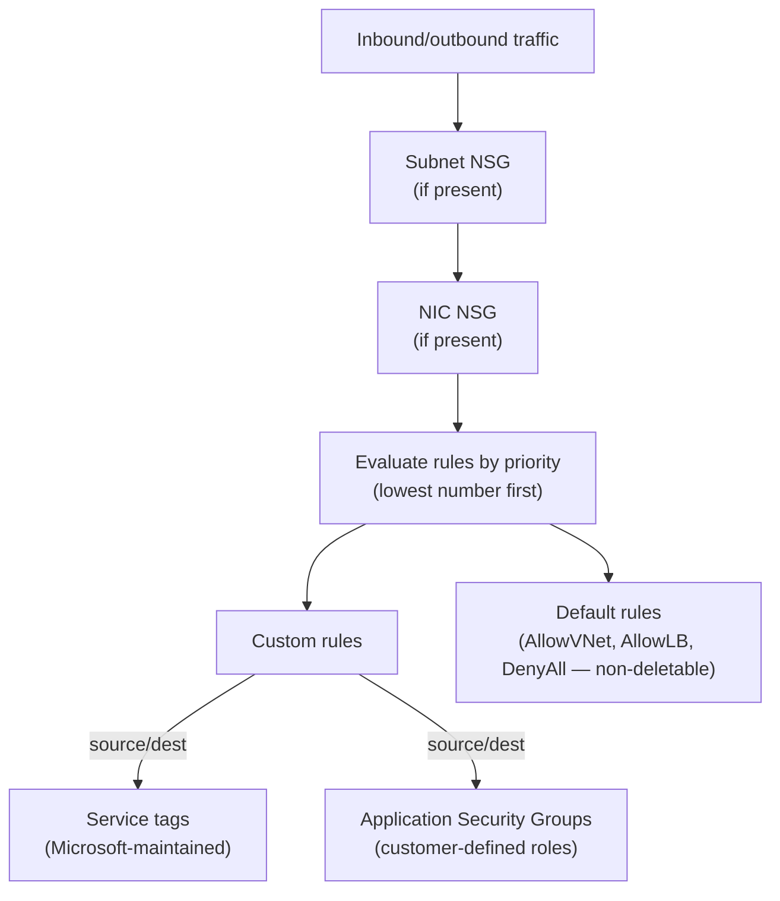
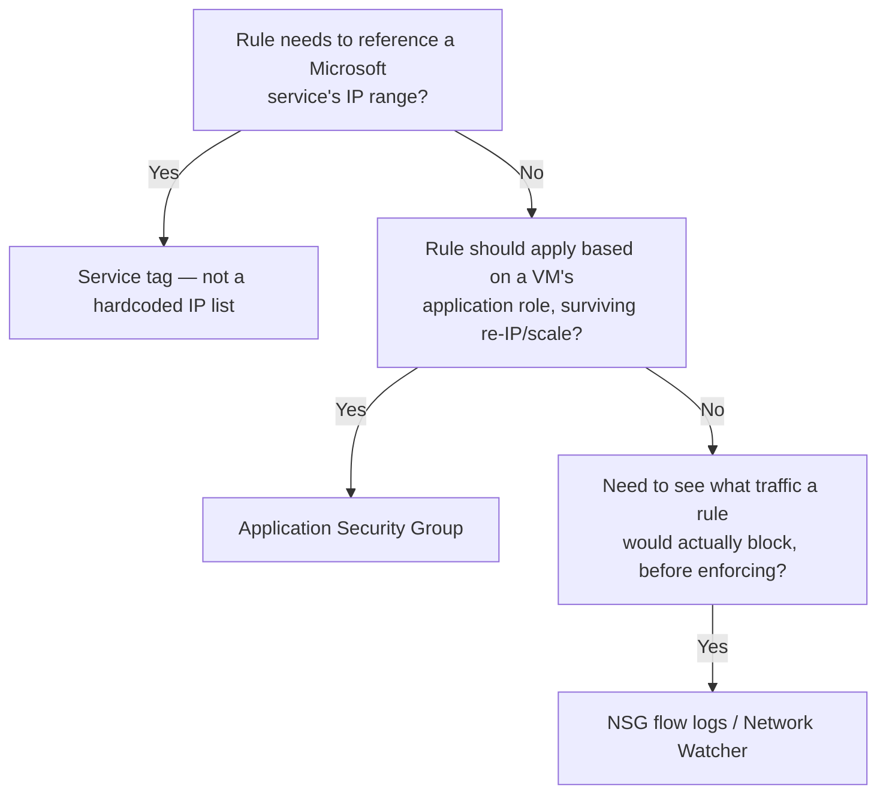

---
tags:
  - sc100
type: cheat-sheet
domain:
  - infrastructure
aliases:
  - NSG
  - ASG
  - Application Security Group
---

# Network Security Group (NSG)

Subnet/NIC-level, stateful L3–L4 traffic filter — a 5-tuple (source, destination, port, protocol, direction) allow/deny engine. The *when to use it vs. Azure Firewall* decision is already covered in [[Securing IaaS and PaaS Services]] and [[Network Security Architecture]]; this page is the rule mechanics.

## Core Capabilities

- **Rule anatomy** — priority (100–4096, **lower number wins**), source/destination (IP range, service tag, or Application Security Group), port, protocol, direction (inbound/outbound), action (allow/deny).
- **Default rules** — every NSG ships with non-deletable defaults: `AllowVNetInBound`, `AllowAzureLoadBalancerInBound`, `DenyAllInBound` (and the outbound equivalents `AllowVNetOutBound`, `AllowInternetOutBound`, `DenyAllOutBound`). Custom rules only take effect by being given a **higher priority** (lower number) than the default they need to override.
- **Association points** — a NSG can attach to a **subnet**, a **NIC**, or both simultaneously; when both are present, traffic is evaluated against *both* NSGs, and a deny at either layer blocks the traffic.
- **Service tags** — Microsoft-maintained named groups of IP prefixes (`Internet`, `VirtualNetwork`, `AzureLoadBalancer`, `Storage`, `Sql`, `AzureCloud`, etc.) that auto-update as the underlying ranges change — rules reference the tag, not a hardcoded IP list that goes stale.
- **Application Security Groups (ASGs)** — group VMs/NICs by application role (e.g., "WebTier," "DBTier") and reference the *group* in a rule instead of individual IPs; membership can change without touching the rule itself.
- **Augmented rules** — a single rule can list multiple IPs, ports, or ASGs at once, reducing rule sprawl versus one rule per address.
- **NSG flow logs** feed traffic visibility into the broader logging design — full source detail in [[Azure Security Logging]], not repeated here.

## Architecture



## Architecture Decisions



## Key Facts

- Two NSGs (subnet + NIC) apply **cumulatively**, not as alternatives — don't assume only one governs a given path.
- Default rules can't be deleted, only outranked by a custom rule at a lower (higher-priority) number — a scenario expecting to "remove" a default rule is testing whether you know to override it instead.
- Service tags cover *Microsoft/Azure* IP ranges; ASGs cover *the customer's own* resources grouped by role — different purpose, not interchangeable.

## Exam Scenario (got wrong): Publish one web VM, keep future VMs private

> New VNet for a web app on an Azure VM. The VM currently has **outbound** internet access. It must be reachable **from the internet over standard web services** (80/443) with **everything else blocked**, and **any VMs added later must not be reachable from the internet**. Pick **two** steps.

| Option | Verdict | What it really does | Why |
| --- | --- | --- | --- |
| **Assign a public IP address to the web server's NIC** | ✅ | Gives that one VM an inbound-reachable internet address | **Inbound needs a public entry point.** Only this VM gets one, so later VMs (no public IP) stay unreachable. |
| **Create an NSG and define inbound rules for web traffic** | ✅ | Allow TCP 80/443 from `Internet` above the default **`DenyAllInBound`** | "Web allowed, all else prohibited" is literally *allow 80/443 + default deny*. On the **subnet**, it also covers every future VM. |
| Deploy a NAT gateway and configure the VM's private IP | ❌ (my pick) | **Outbound-only** SNAT for a subnet to reach the internet | NAT Gateway **never accepts unsolicited inbound connections**, so it can't publish a web server. The VM already has outbound access anyway. |
| Deploy Azure Firewall and create an application rule | ❌ (my pick) | L7 FQDN filtering of **outbound** HTTP/HTTPS/MSSQL | **Application rules don't apply to inbound** traffic. Publishing through a firewall would need a **DNAT** rule, and it's heavy/costly for one VM. See [[Azure Firewall]]. |
| Create an application security group and assign a public IP | ❌ | An ASG is a **label** grouping NICs for use *inside* NSG rules | An ASG filters nothing by itself, and you **can't assign a public IP to an ASG**. It's only useful *referenced from an NSG rule*. |

> ⚠️ The practice explanation describes NAT Gateway as letting private nodes "be accessed by publicly addressed nodes". **That's wrong.** Azure NAT Gateway provides **outbound** connectivity only and doesn't support inbound-initiated connections. For inbound you need a public IP on the VM, a public Load Balancer, Application Gateway / Front Door, or a firewall **DNAT** rule.

**Trap:** both wrong picks are **outbound** tools (NAT Gateway, firewall application rules). The requirement is **inbound** reachability. **Ask first: which direction?**

```
Make ONE VM reachable from the internet on 80/443, block everything else?
  → Public IP on that VM (or a public LB / App Gateway in front)
  + NSG: allow 80/443 inbound (default DenyAllInBound blocks the rest)
Keep FUTURE VMs unreachable?
  → no public IP on them + subnet-level NSG (default deny)
Outbound internet for private VMs?
  → NAT Gateway (outbound only, never inbound)
Inbound via a central firewall?
  → Azure Firewall DNAT rule (not an application rule)
Inbound web needing OWASP/L7?
  → App Gateway / Front Door + WAF
Rules by role instead of IP?
  → ASG, referenced inside NSG rules
```

## Exam Notes

- "Expose one VM on 80/443, deny everything else, future VMs private" → **public IP on that NIC + NSG inbound web rules**. Not NAT Gateway (outbound-only), not a firewall application rule (not inbound).
- "A rule needs to keep working as an Azure service's IP ranges change" → service tag, not a static IP list.
- "Firewall rules should follow a VM's role (web tier, DB tier), even as VMs are added/removed" → Application Security Group.
- Full NSG vs. Azure Firewall architecture decision lives in [[Securing IaaS and PaaS Services]] — this page only covers NSG's own rule mechanics.

## Comparison

| Compare | Difference |
| --- | --- |
| Subnet-level vs. NIC-level NSG association | Subnet NSG applies to every resource in the subnet; NIC NSG applies to just that network interface. Both can be present on the same path and are evaluated cumulatively — not a choice between the two. |
| Service tag vs. hardcoded IP range | Service tags are Microsoft-maintained and auto-update as the underlying ranges change. A hardcoded IP range goes stale the moment the service's addresses shift — the reason service tags are the default recommendation. |
| NSG vs. NAT Gateway | Allow/deny filter (both directions) vs. outbound-only SNAT. NAT Gateway never makes a VM reachable inbound. |
| ASG vs. NSG | Label/grouping of NICs vs. the rule engine. ASGs do nothing unless referenced in an NSG rule. |
| Application Security Group vs. service tag | ASGs group the *customer's own* VMs/NICs by role. Service tags group *Microsoft/Azure service* IP ranges. Same mechanical idea (name a group instead of an IP), different side of the connection. |
| NSG vs. Azure Firewall | Full comparison in [[Securing IaaS and PaaS Services]] — free, stateless-ish subnet/NIC segmentation vs. managed, stateful, FQDN-aware centralized policy. Not repeated here. |

## AZ-500 Review

AZ-500 already covers creating NSG rules, subnet/NIC association, service tags, ASGs, and enabling flow logs at the resource level — this page's mechanics are assumed knowledge. SC-100's addition is *where* NSGs fit in a layered network architecture, which lives in [[Network Security Architecture]] and [[Securing IaaS and PaaS Services]], not on this page.

## Keywords

- 5-tuple rule (source, destination, port, protocol, direction)
- Priority (lower number wins)
- Default rules: AllowVNetInBound, AllowAzureLoadBalancerInBound, DenyAllInBound
- Service tags
- Application Security Groups (ASG)
- Augmented rules
- Subnet vs. NIC association (cumulative evaluation)

## Related

- [[Securing IaaS and PaaS Services]]
- [[Network Security Architecture]]
- [[Azure Firewall]]
- [[Azure Security Logging]]
- [[Private Link]]
- [[Zero Trust]]
- [[Azure Bastion]] — admin access without opening 22/3389 in an NSG
- [[Front Door and Application Gateway]] — inbound web publishing alternative to a VM public IP
- [[Exam Objectives]]

## References

- [Network security groups overview](https://learn.microsoft.com/en-us/azure/virtual-network/network-security-groups-overview) — Microsoft Learn
- [Azure service tags overview](https://learn.microsoft.com/en-us/azure/virtual-network/service-tags-overview) — Microsoft Learn
- [Application security groups](https://learn.microsoft.com/en-us/azure/virtual-network/application-security-groups) — Microsoft Learn
- [What is Azure NAT Gateway?](https://learn.microsoft.com/en-us/azure/nat-gateway/nat-overview) — Microsoft Learn
