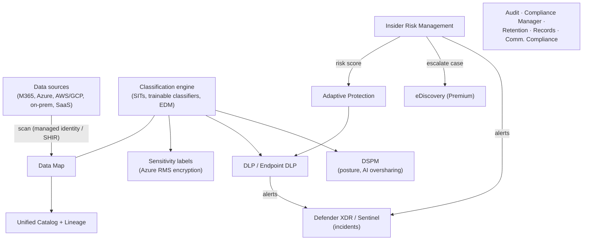

---
tags:
  - sc100
type: service
domain:
  - apps-data
  - ops-identity-compliance
aliases:
  - Microsoft Purview
  - Azure Purview
status: needs-verification
---

# Microsoft Purview

> **In one line:** Purview looks after your **data**. It finds sensitive data, labels it, stops it leaking, and keeps or deletes it to meet the law.
>
> **In two lines:** Purview never hunts attackers. If the question is about **what the data is, where it is, who can see it, how long you keep it, or proving compliance**, think Purview. If it's about **attacks, malware, compromised accounts, threat behaviour or discovering apps**, Purview is the wrong answer: think [[Microsoft Defender]].

---

## Purpose

Microsoft's unified **data governance, data security, and risk & compliance** platform for data in Microsoft 365, Azure, multicloud, on-premises and SaaS.

---

## The Formal Definition

- Microsoft Purview is a family of solutions in one portal (`purview.microsoft.com`) with **three solution areas**:
  1. **Data Governance**: Data Map, Unified Catalog, lineage. *"What data do we have and what does it mean?"*
  2. **Data Security**: Information Protection, DLP, Insider Risk Management, DSPM, Data Security Investigations. *"Is the data protected, and is anyone misusing it?"*
  3. **Risk & Compliance**: Audit, eDiscovery, Compliance Manager, Data Lifecycle Management, Records Management, Communication Compliance, Information Barriers. *"Can we prove we meet our legal and regulatory obligations?"*
- One **classification engine** sits underneath all three: Sensitive Information Types (SITs), trainable classifiers, EDM and fingerprints. You define it once and every Purview solution (plus Defender for Cloud Apps and Defender for Cloud) recognizes it.
- It used to be three separate products with old names: Azure Purview + Microsoft 365 compliance center + Azure Information Protection (see [Old names](#old-names-the-exam-may-still-use)).
- [[Priva]] sits beside Purview as the **privacy** sibling. It handles individual data subject rights, not organizational compliance.

### Memory hook: Microsoft's four verbs

| Verb | Purview answer |
| --- | --- |
| **Know** your data | Data Map, classification (SITs, classifiers), Content/Activity Explorer, DSPM |
| **Protect** your data | Sensitivity labels, encryption (Azure RMS), Message Encryption, DKE |
| **Prevent** data loss | DLP, Endpoint DLP, Insider Risk Management, Adaptive Protection |
| **Govern** your data | Retention, Records Management, eDiscovery, Audit, Compliance Manager |

---

## Every Purview Solution: What It Is and How to Remember It

### 1. Data Governance

| Solution | What it does | Remember it as |
| --- | --- | --- |
| **Data Map** | Scans and classifies data sources (Azure, AWS S3, on-prem SQL, SaaS) into a metadata map | "Google Maps for your data estate" |
| **Unified Catalog** | Business-friendly search over the Data Map: glossary, data products, data quality | "Library catalog: find data, understand what it means" |
| **Data Lineage** | Shows how data flows and transforms (Data Factory → Synapse → Power BI) | "Family tree of a dataset" |
| **Collections / domains** | Purview's **own** permission hierarchy for who can scan or browse metadata | "Purview RBAC, NOT Azure RBAC" |
| **Self-hosted integration runtime (SHIR)** | Agent installed on a machine that can reach on-prem/private sources so Data Map can scan them | "On-prem source = install SHIR" |

### 2. Data Security

| Solution | What it does | Remember it as |
| --- | --- | --- |
| **Information Protection** (sensitivity labels) | Classifies content and can encrypt, mark (watermark/header) and restrict it. Protection travels with the file | "A sticker that follows the file everywhere" |
| **Data Loss Prevention (DLP)** | Policies that detect sensitive content and **block / warn / audit** sharing in Exchange, SharePoint, OneDrive, Teams, devices, on-prem and non-Microsoft cloud apps | "A security guard at the exit door" |
| **Endpoint DLP** | DLP on the device: USB copy, print, clipboard, upload to browser. Device must be **onboarded to Defender for Endpoint** | "DLP on the laptop" |
| **Insider Risk Management** | Correlates **trusted users'** activity (mass download, copy to USB, sharing) with HR signals (resignation date) to flag data theft or leaks. Pseudonymized by default | "Watches **employees** handling data, NOT hackers" |
| **Adaptive Protection** | Raises DLP strictness automatically for users with a high Insider Risk score | "Insider Risk score → tighter DLP for that user" |
| **DSPM** | Posture view: where sensitive data is, how exposed it is, AI/Copilot oversharing risk; recommends policies | "Secure Score, but for data" |
| **Data Security Investigations** | AI-assisted investigation of **which data** was affected after an incident or leak | "After the breach: what data was in it?" |
| **Information Protection scanner** | Discovers and labels files on **on-prem** file shares and SharePoint Server | "Labels for on-prem files" |
| **Message Encryption (OME)** | Encrypted email any recipient can read (Gmail, Yahoo!). Needs **Azure RMS** active first | "Encrypted email to anyone" |
| **Double Key Encryption (DKE)** | Second customer-held key, so **Microsoft can never decrypt**. Breaks Copilot, search and co-authoring | "Top-secret 5% only" |

### 3. Risk & Compliance

| Solution | What it does | Remember it as |
| --- | --- | --- |
| **Audit** (Standard / Premium) | Searchable log of user/admin activity across M365. Premium = longer retention + more events | "CCTV recording of who did what" |
| **eDiscovery** / **Premium eDiscovery** | Find, **hold** and export content for **litigation / investigations**. Premium = review sets, analytics, predictive coding (E5) | "Lawyer's evidence locker" |
| **Compliance Manager** | Regulatory templates → assessments → improvement actions → **compliance score** | "Exam scorecard for GDPR/ISO/HIPAA" |
| **Data Lifecycle Management** | Retention policies/labels: **keep for X years, then delete** | "Keep it / bin it on a timer" |
| **Records Management** | Declare content an immutable **record**, file plan, disposition review | "Locked filing cabinet" |
| **Communication Compliance** | Detects inappropriate, harassing or regulatory-violating **messages** (Teams, Exchange, Viva Engage, Copilot) | "HR/compliance reading flagged chats" |
| **Information Barriers** | **Blocks** communication/collaboration between groups (e.g., research vs. investment banking) | "Ethical wall / Chinese wall" |
| **Customer Lockbox** | You approve or deny a **Microsoft engineer's** access to your content during support | "Microsoft must knock first" |
| **Privileged Access Management (M365)** | Just-in-time approval for **Exchange Online** admin tasks | Not Entra [[PIM]] (that's for roles) |

---

## Architecture

- **Purview feeds Defender, not the other way round.** DLP and Insider Risk alerts surface as incidents in [[Microsoft Defender XDR]] and [[Microsoft Sentinel]]. Purview says *"this data is sensitive"*; Defender says *"this is an attack"*.
- [[SaaS Application Discovery and Control|Defender for Cloud Apps]] **reuses Purview labels and DLP** to protect files inside non-Microsoft SaaS apps.
- [[Microsoft Defender for Cloud]] reuses the Purview classification engine for **sensitive data discovery** in Azure storage and databases (Defender CSPM plan). See [[Data Security Posture Management (DSPM)]].

---

## Why Architects Choose It

- **One taxonomy for the whole estate:** define sensitivity labels and SITs once, enforce them in M365, devices, on-prem, Azure data and SaaS apps.
- **Protection follows the data**, not the network. Labels encrypt the file itself, which fits [[Zero Trust]] "assume breach" when files leave the tenant.
- Turns regulations into **measurable controls**: a Compliance Manager score plus retention, audit and eDiscovery evidence.
- Covers the **insider** half of data risk (departing employees, careless sharing), which perimeter and threat tools don't model.
- Governance (catalog, lineage) shows how far sensitive data has **spread**, the input for scoping protection.

---

## When to Use

- Discover and classify **sensitive data** (PII, credit card numbers, health records) across M365, Azure, on-prem, or multicloud.
- Prevent **data leakage / exfiltration** by sharing, email, USB, print or upload → DLP / Endpoint DLP.
- Protection that **travels with the file**, even outside the organization → sensitivity labels with encryption.
- **Departing or disgruntled employees** stealing data → Insider Risk Management.
- **Litigation, legal hold, regulatory investigation** → eDiscovery.
- **Retain for N years, then delete**, or immutable records → Data Lifecycle / Records Management.
- **Prove compliance** with GDPR, ISO 27001, HIPAA and similar, with a score → Compliance Manager.
- Who did what in M365, for forensics → Audit.
- **Harassment or regulatory-violating messages** → Communication Compliance.
- **Stop two departments talking** → Information Barriers.
- **Catalog the data estate**, business glossary, lineage → Data Map / Unified Catalog.
- **Copilot / AI oversharing** risk before rollout → DSPM (AI observability).

---

## When NOT to Use (Purview Is the WRONG Answer)

| If the question says… | The answer is… | Why not Purview |
| --- | --- | --- |
| Discover **SaaS apps / shadow IT** in use, app risk score, uploaded firewall logs | **Defender for Cloud Apps**: Cloud Discovery ([[SaaS Application Discovery and Control]]) | Purview discovers **data**, not **apps** |
| **Threat behaviour**, anomalous activity, impossible travel, mass download by a **compromised** account, ransomware activity in cloud apps | **Defender for Cloud Apps** anomaly detection / [[Microsoft Defender XDR]] | Purview has no attacker/threat analytics |
| Malware, phishing, Safe Links/Attachments | Defender for Office 365 ([[Securing Microsoft 365]]) | Not a threat-protection product |
| EDR, device attacks, device discovery | Defender for Endpoint ([[Securing Server and Client Endpoints]]) | |
| Pass-the-hash, Kerberoasting, on-prem AD attacks | [[Microsoft Defender for Identity]] | |
| Risky sign-ins, leaked credentials, user risk | [[Identity Protection]] | Identity risk ≠ data risk |
| SIEM, correlate logs, hunting, SOAR | [[Microsoft Sentinel]] | Purview doesn't correlate security events |
| Cloud **resource** misconfiguration, Secure Score, workload protection | [[Microsoft Defender for Cloud]] | Purview scores data and compliance, not resource config |
| Unknown internet-facing assets | [[External Attack Surface Management (EASM)]] | |
| Enforce/deny Azure resource configuration | [[Azure Policy]] | |
| An individual asks for a copy of, or deletion of, **their** personal data (DSAR) | [[Priva]] Subject Rights Requests | Priva = individual privacy rights |
| Who can **sign in** / MFA / device compliance at sign-in | [[Conditional Access]] | |
| Manage keys for **Azure** resources (storage, SQL TDE) | [[Key Vault]] CMK | Purview labels/Customer Key cover M365 content |

> **Golden rule:** look at the **noun** the question protects.
> - **Document, email, file, record, PII, data** → Purview.
> - **Attacker, malware, account, device, app, resource** → Defender / Entra / Sentinel.

---

## The Two Traps That Cost Marks

### Trap 1: "Discovery". Discover WHAT?

| Discovering… | Service |
| --- | --- |
| **Sensitive data** (SSNs, PII, credit cards) in M365 / on-prem / multicloud | **Purview** (classification, DSPM, Data Map, IP scanner) |
| Sensitive data inside **Azure storage/databases**, tied to attack paths | **Defender for Cloud** (Defender CSPM, sensitive data discovery) |
| **SaaS apps** people use (shadow IT) | **Defender for Cloud Apps**: Cloud Discovery |
| **Unmanaged devices** on the network | **Defender for Endpoint**: device discovery |
| **OT/IoT devices** | **Defender for IoT** ([[OT and ICS Security]]) |
| **Internet-facing assets** you didn't know you owned | **Defender EASM** |
| **Evidence** for a lawsuit | **Purview eDiscovery** (discovery in the legal sense) |

### Trap 2: "Behaviour". Whose behaviour?

| Behaviour of… | Service | Typical wording |
| --- | --- | --- |
| A **trusted employee** misusing data | **Purview Insider Risk Management** | departing user, resignation, HR connector, data theft, leak by risky user |
| An employee's **messages** | **Purview Communication Compliance** | harassment, offensive language, regulatory chat monitoring |
| **Accounts/sessions in cloud apps**, looking for attacks | **Defender for Cloud Apps** anomaly detection (UEBA) | impossible travel, infrequent country, ransomware activity, **threat behaviour** |
| **Sign-ins** | **Entra ID Protection** | risky sign-in, leaked credentials, user risk |
| **On-prem AD** identities | **Defender for Identity** | lateral movement, pass-the-ticket |
| **All entities across all log sources** | **Sentinel UEBA** | behaviour analytics, entity pages, investigation and hunting |

> **Your missed question:** *"discovery + threat behaviour analysis"* = **Defender for Cloud Apps** (Cloud Discovery + anomaly/threat detection). Purview Insider Risk looks at behaviour too, but only **employees' handling of data**. It does no **threat** analysis and no **app** discovery. The word **threat** rules Purview out.

---

## Exam Tips

- **Labels do nothing alone.** A label without a DLP or encryption policy is just metadata. "Label exists but data still leaks" → missing DLP.
- **Sensitivity label ≠ retention label.** Sensitivity = protect. Retention = keep/delete.
- **Legal hold for litigation** → eDiscovery hold, **not** Records Management.
- **Endpoint DLP** needs devices onboarded to **Defender for Endpoint**.
- **Message Encryption first step** → make sure **Azure RMS is active**. SCEP is a distractor.
- **"Microsoft must never decrypt"** → DKE. **"We manage M365 at-rest keys"** → [[Microsoft 365 Customer Key]].
- **Data Map on-prem source** → **self-hosted integration runtime**. Azure sources use **managed identity**.
- **Collections** are Purview's own RBAC; Azure RBAC on a storage account doesn't grant catalog access.
- **Insider Risk case → formal legal case** → escalate to **eDiscovery (Premium)**.
- **Stricter DLP only for risky users** → **Adaptive Protection**.
- **Compliance Manager** scores process/attestation controls across M365 + multicloud. **Defender for Cloud Regulatory Compliance** scores Azure resource configuration.
- **Advanced features** (auto-labeling, Insider Risk, Communication Compliance, Premium eDiscovery, Audit Premium, Endpoint DLP) generally need **Microsoft 365 E5 / E5 Compliance**. See [[Microsoft 365 Licensing]].
- Audit Standard keeps logs **180 days**. Audit Premium keeps them **1 year** by default, up to **10 years** with an add-on.
- "Content search", "eDiscovery (Standard)" and "Advanced eDiscovery" are **retired names**. See [[eDiscovery]].

---

## AZ-500 Overlap

- AZ-500 covers Azure infrastructure security: [[Key Vault]], TDE, storage encryption, Defender for Cloud. Purview barely appears.
- What you already know: encryption at rest, CMK vs. Microsoft-managed keys, RBAC, managed identities (used by Data Map scanning).
- Treat almost all of Purview as **new** for SC-100.

---

## What's New in SC-100

- **Design the data protection strategy**: discover → classify → protect → prevent loss → govern, as one connected design.
- Choose the **right Purview solution per requirement**. Most exam questions are "which solution" questions.
- Separate **data risk** (Purview) from **threat risk** (Defender) and **identity risk** (Entra).
- Know the **integration points**: Purview labels in Defender for Cloud Apps, DLP/IRM alerts in Defender XDR, Purview classification in Defender for Cloud DSPM.
- **AI/Copilot data security**: DSPM AI observability, oversharing assessments, labels honoured by Copilot. See [[AI and Copilot Security Architecture]].
- Map **regulations to controls** with Compliance Manager, not just quoting the regulation.

---

## Common Exam Confusion

| Compare | Difference |
| --- | --- |
| **Purview vs. Defender for Cloud Apps** | Purview = **data** (classify, label, DLP). Defender for Cloud Apps = **apps and threats** (shadow IT discovery, session control, anomaly detection). MDA *uses* Purview labels/DLP inside SaaS apps. |
| **Purview Insider Risk vs. Defender for Cloud Apps anomaly detection** | Insider Risk: a **legitimate employee** misusing data (intent: theft/leak; HR signals). MDA anomaly: a **compromised or malicious session** (impossible travel, ransomware). Threat → MDA. |
| **Purview Insider Risk vs. Sentinel UEBA** | Insider Risk: data-centric, built-in policy templates, privacy by design. Sentinel UEBA: entity behaviour baselines across all SIEM data, for SOC hunting and investigation. |
| **Purview vs. Defender XDR** | Purview raises data alerts (DLP, IRM). Defender XDR correlates attacks into incidents and can include those Purview alerts. |
| **Purview vs. Defender for Cloud** | Purview: data governance/security/compliance. Defender for Cloud: cloud **resource** posture (CSPM) and workload threat protection (CWPP). |
| **Purview DSPM vs. Defender for Cloud data-aware posture** | Purview DSPM: M365/Fabric/SaaS data estate, AI oversharing. Defender for Cloud: sensitive data in Azure/AWS/GCP data stores, tied to attack paths. See [[Data Security Posture Management (DSPM)]]. |
| **Purview Compliance Manager vs. Defender for Cloud Regulatory Compliance** | Process/attestation controls, M365 + multicloud vs. technical resource configuration against MCSB/ISO. See [[Purview Compliance Manager]]. |
| **Purview vs. Priva** | Organizational compliance vs. **individual** privacy rights (DSAR, erasure). See [[Priva]]. |
| **Purview vs. Azure Policy** | Purview governs **data content**. [[Azure Policy]] governs **resource configuration**. |
| **Sensitivity label vs. DLP** | Label = classification + protection on the item. DLP = enforcement engine acting on content. See [[Sensitivity Labels]]. |
| **Sensitivity label vs. retention label** | Protect/classify vs. keep/delete for a period. |
| **DLP vs. Insider Risk** | DLP: content rule, acts in the moment. Insider Risk: user behaviour over time, raises a case. |
| **DLP vs. Information Barriers** | DLP stops **data** leaving. Information Barriers stop **people/groups** communicating. |
| **Communication Compliance vs. DLP** | Comm. Compliance reviews message **conduct** (harassment, regulatory). DLP blocks **sensitive data** in messages. |
| **eDiscovery vs. Records Management** | Reactive legal hold for a case vs. planned retention/disposal. See [[eDiscovery]]. |
| **eDiscovery vs. Audit** | eDiscovery finds **content**. Audit finds **activities** (who opened, shared, deleted). |
| **OME vs. sensitivity label encryption** | Both use Azure RMS. OME is email-only and rule-driven. Labels cover files, emails, meetings and sites. See [[Microsoft Purview Message Encryption]]. |
| **DKE vs. Customer Key** | DKE: Microsoft can't decrypt, features break. Customer Key: you own M365 at-rest root keys, features work. See [[Double Key Encryption (DKE)]]. |
| **Customer Lockbox vs. M365 Privileged Access Management vs. Entra PIM** | Approve **Microsoft support** access vs. JIT approval for **Exchange tasks** vs. JIT elevation of **directory/Azure roles**. |
| **Collections vs. Azure RBAC** | Purview metadata permissions vs. permissions on the Azure resource itself. |
| **Managed identity scan vs. SHIR** | Azure-native sources vs. on-prem/private-network sources. |

---

## Old Names the Exam May Still Use

| Old name | Current name |
| --- | --- |
| Azure Purview | Purview Data Map / Unified Catalog |
| Azure Information Protection (AIP), Microsoft Information Protection (MIP) | Purview Information Protection |
| AIP unified labeling scanner | Information Protection scanner |
| Microsoft 365 compliance center (compliance.microsoft.com) | Microsoft Purview portal (purview.microsoft.com) |
| Advanced eDiscovery / eDiscovery (Premium) | Premium eDiscovery |
| Core eDiscovery, Content Search | eDiscovery |
| Advanced Audit | Audit (Premium) |
| Office 365 Message Encryption (OME) | Purview Message Encryption |
| DSPM for AI (classic) | DSPM (AI observability) |

---

## Short Notes to Remember

- **Purview = DATA. Defender = THREATS. Entra = IDENTITY. Sentinel = SEE EVERYTHING.**
- Purview asks: *What is it? Where is it? Who touched it? Can it leave? How long do we keep it? Are we compliant?*
- **No "threat", no "attack", no "malware" in Purview.** If the stem says one of those, cross Purview out.
- **Insider Risk = good employee gone bad.** Hacked account = Defender.
- **Discover data → Purview. Discover apps → Defender for Cloud Apps.**
- **Label = sticker. DLP = guard. Retention = timer. eDiscovery = evidence locker. Audit = CCTV. Compliance Manager = scorecard.**
- **Information Barriers = wall between people. DLP = wall around data.**
- **Lockbox = Microsoft knocks first.**

---

## Keywords

**Think Purview when you see:**

- sensitive information, PII, credit card / SSN / passport numbers, health records, classify, **label**, sensitivity label, auto-labeling, trainable classifier, EDM
- **data loss prevention**, prevent data leakage / exfiltration, block sharing externally, block copy to USB, policy tip
- encrypt documents / email so only intended recipients can read, Azure RMS, Do Not Forward
- **departing employee**, resignation, disgruntled user, data theft by insiders, HR connector → Insider Risk
- **retain** for N years, delete after, disposition, file plan, immutable record → DLM / Records
- **litigation**, legal hold, custodian, review set, export evidence → eDiscovery
- audit log, who accessed / shared / deleted a file in M365 → Audit
- GDPR / ISO / HIPAA compliance score, improvement actions, assessment → Compliance Manager
- offensive language, harassment, regulatory communications (FINRA) → Communication Compliance
- ethical wall, prevent two departments from communicating → Information Barriers
- data catalog, business glossary, lineage, data estate, scan data sources → Data Map / Unified Catalog
- Copilot oversharing, AI data risk → DSPM
- Microsoft engineer access approval → Customer Lockbox

**Purview is WRONG when you see:**

- threat, attack, malware, phishing, ransomware, exploit, compromised account
- shadow IT, discover **apps**, app risk score, firewall/proxy logs → Defender for Cloud Apps
- impossible travel, anomalous sign-in, risky user → Defender for Cloud Apps / Identity Protection
- misconfiguration, Secure Score, workload protection → Defender for Cloud
- SIEM, correlate, hunt, playbook → Sentinel
- a person's own data request / erasure → Priva

---

## Related Services

- [[Data Classification and Protection]]: discovery → classification → handling → encryption mechanics
- [[Sensitivity Labels]]: label vs. label policy, scopes, publishing
- [[Data Security Posture Management (DSPM)]]
- [[Microsoft Purview Message Encryption]] · [[Mail Flow Rules]]
- [[Double Key Encryption (DKE)]] · [[Microsoft 365 Customer Key]]
- [[Compliance and Privacy]] · [[Purview Compliance Manager]] · [[eDiscovery]] · [[Priva]]
- [[SaaS Application Discovery and Control]]: Defender for Cloud Apps, the "discovery + threat" answer
- [[Microsoft Defender]] · [[Microsoft Defender XDR]] · [[Microsoft Defender for Cloud]] · [[Microsoft Sentinel]]
- [[Identity Protection]] · [[Microsoft Defender for Identity]]
- [[AI and Copilot Security Architecture]] · [[Microsoft Security Copilot]]
- [[Azure Synapse Analytics]] · [[Key Vault]] · [[Zero Trust]]
- [[Microsoft 365 Licensing]] · [[Securing Microsoft 365]]
- [[Exam Objectives]] · [[Architecture Decisions]]

---

## References

- [Microsoft Purview overview](https://learn.microsoft.com/en-us/purview/purview): Microsoft Learn
- [Microsoft Purview Data Map](https://learn.microsoft.com/en-us/purview/concept-data-map): Microsoft Learn
- [Microsoft Purview Unified Catalog](https://learn.microsoft.com/en-us/purview/unified-catalog-overview): Microsoft Learn
- [Learn about Insider Risk Management](https://learn.microsoft.com/en-us/purview/insider-risk-management): Microsoft Learn
- [Learn about Communication Compliance](https://learn.microsoft.com/en-us/purview/communication-compliance): Microsoft Learn
- [Learn about Information Barriers](https://learn.microsoft.com/en-us/purview/information-barriers): Microsoft Learn
- [Defender for Cloud Apps overview](https://learn.microsoft.com/en-us/defender-cloud-apps/what-is-defender-for-cloud-apps): Microsoft Learn
- https://aka.ms/purview

---

## Verification Flag

- **Naming churn:** DSPM's unified experience (replacing "DSPM for AI (classic)") and **Data Security Investigations** were new or rolling out around mid-to-late 2026. Re-check names and GA status before the exam.
- **Audit retention numbers** (Standard 180 days, Premium 1 year / 10-year add-on) and **E5 licensing gates** change from time to time. Re-check them against Microsoft Learn's licensing guidance.
