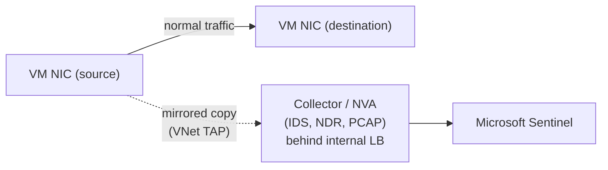

---
tags:
  - sc100
type: concept
domain:
  - infrastructure
aliases:
  - VNet TAP
  - Azure virtual network TAP
  - Network Terminal Access Point
  - TAP
  - Port Mirroring
  - SPAN
status: needs-verification
---

# Virtual Network TAP

## Purpose

Continuously mirrors VM network traffic (headers **and** payloads) to a collector/NVA for **passive** packet-level monitoring, IDS and analytics, without sitting inline.

---

## Why architects choose it

- **Passive** visibility. The mirror is a copy, so production traffic flow is never interrupted or slowed by the analyser.
- Gives **full packet capture (PCAP)** of east-west VM traffic, which NSG flow logs (metadata only) cannot.
- Adds a **detection** layer to existing prevention controls ([[Azure Firewall]], NSGs, Defender for Endpoint) as part of defence in depth.
- Lets a third-party NDR/IDS appliance analyse traffic the same way it would on-prem, which is useful for hybrid estates after an acquisition.
- Cloud-native replacement for the physical **TAP/SPAN** port you can't plug into in Azure.

---

## When to use

- "**Passively monitor** traffic between VMs" / "improve **detection**" → VNet TAP + collector (IDS/NDR/PCAP).
- Continuous full-packet inspection by a third-party network analytics or IDS appliance.
- Forensics needing payloads, not just 5-tuple flow records.

---

## When NOT to use

- One-off troubleshooting capture → [[Network Watcher and Lighthouse|Network Watcher packet capture]].
- Flow metadata / traffic analytics only → NSG/VNet **flow logs**.
- **Blocking** or restricting traffic → it's monitor-only. Use NSG, [[Azure Firewall]] or micro-segmentation.
- Inline inspection/IDPS that can drop packets → [[Azure Firewall]] Premium IDPS.

---

## Architecture

- TAP resource is attached to the **source VM NIC**. The destination is an **NVA collector** or an **internal load balancer** in front of collectors.
- The collector is called a **collector**. It typically uses PCAP to record headers and payloads.

---

## Exam Scenario

**Scenario:** Defence in depth already in place with Defender for Endpoint on Azure VMs and Azure Firewall filtering between sensitive subnets. After an acquisition, employees now talk to non-Azure VMs. The goal is to improve detection, including **passively monitoring traffic between VMs**.

| Option | Verdict | Why |
| --- | --- | --- |
| **Network TAP (VNet TAP)** | ✅ | Passive mirroring to a collector (PCAP) for analysis/IDS without interrupting flows |
| Port mirror | ❌ | A physical switch/firewall feature (SPAN), not the Azure method |
| Micro-segmentation | ❌ | **Prevention/containment** architecture (contain components); doesn't monitor anything |
| Sandbox | ❌ | Isolated environment to detonate a suspicious file/app (e.g. Windows Sandbox), not network monitoring |

Pattern: **"passively monitor traffic"** → TAP. **"isolate/contain"** → segmentation. **"detonate suspicious file"** → sandbox.

---

## Common Exam Confusion

| Compare | Difference |
| --- | --- |
| **TAP vs. port mirror (SPAN)** | TAP = dedicated device/feature that copies **all** traffic passively, with no packet drops under load. SPAN = switch feature copying a source port to a destination port, which may drop packets when oversubscribed and uses switch CPU. In Azure the answer is **VNet TAP**. |
| **VNet TAP vs. Network Watcher packet capture** | Continuous, streamed to a collector vs. on-demand, time/size-limited capture saved to storage. |
| **VNet TAP vs. NSG/VNet flow logs** | Full packets (payload) vs. flow metadata (IP, port, allow/deny). |
| **VNet TAP vs. Azure Firewall Premium IDPS** | Out-of-band monitoring (can't block) vs. inline inspection that can block. |
| **Monitoring vs. micro-segmentation** | Detection/visibility vs. containment. VNets/subnets + NSGs are Azure's segmentation building blocks (see [[Network Security Architecture]], [[Zero Trust]]). |
| **Sandbox vs. TAP** | Behavioral analysis of a file/app in isolation vs. network traffic analysis. |

---

## Exam Tips

- "Passively" + "traffic between VMs" → **VNet TAP**.
- "Without interrupting active flows" → mirror/TAP, not inline.
- Port mirroring/SPAN = **physical** network device wording.
- Micro-segmentation is the **contain** answer, not the **detect** answer.

---

## AZ-500 overlap

- Already known: NSGs, flow logs, Network Watcher tools, Azure Firewall.
- New: TAP as a passive detection design choice and how it differs from SPAN, packet capture and flow logs.

---

## What's new in SC-100

- Choosing **detection** controls (TAP, IDS, NDR) to complement **prevention** controls in a defence-in-depth design.
- Distinguishing monitoring answers from segmentation and sandbox answers in "evaluate network security" questions.

---

## Keywords

- Network Terminal Access Point (TAP), virtual network TAP
- Passive monitoring, traffic mirroring, collector, PCAP
- Port mirroring, Switch Port Analyzer (SPAN)
- Headers and payloads, intrusion detection, NDR
- Micro-segmentation, Windows Sandbox
- Defence in depth, east-west traffic

---

## Related Services

- [[Network Security Architecture]]
- [[Network Watcher and Lighthouse]]
- [[Azure Firewall]]
- [[Network Security Group]]
- [[Microsoft Sentinel]]
- [[Zero Trust]]
- [[OT and ICS Security]] (same passive SPAN/TAP principle for OT sensors)
- [[Securing Server and Client Endpoints]]

---

## References

- [Virtual network TAP](https://learn.microsoft.com/en-us/azure/virtual-network/virtual-network-tap-overview) — Microsoft Learn
- [Recommendations for building a segmentation strategy](https://learn.microsoft.com/en-us/azure/well-architected/security/segmentation) — Microsoft Learn
- [Windows Sandbox](https://learn.microsoft.com/en-us/windows/security/application-security/application-isolation/windows-sandbox/) — Microsoft Learn

---

## Verification Flag

- VNet TAP availability has changed over time: it was originally a preview, paused, then re-introduced as a preview. Re-check its current GA/preview status, region availability, and supported destinations (NVA vs. internal load balancer) against the Learn overview.
